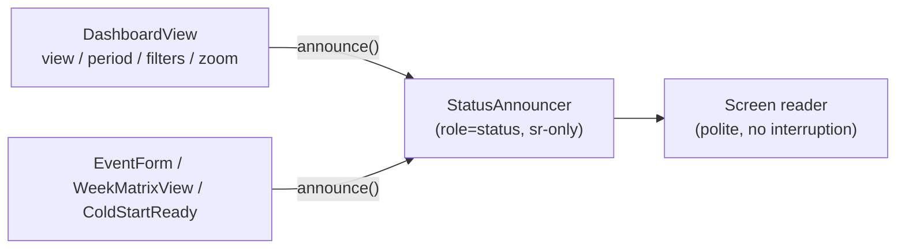
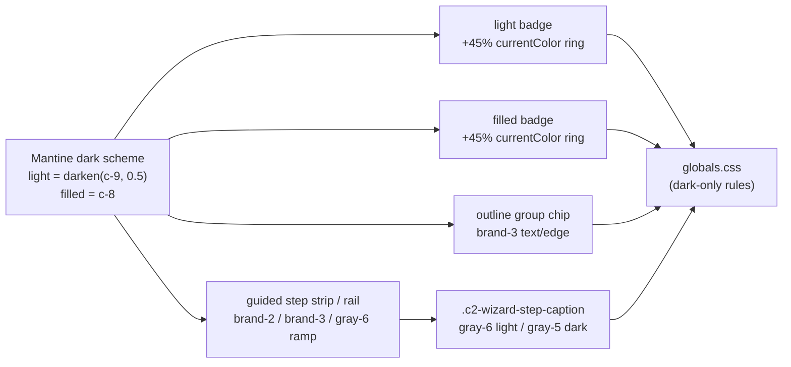

# 1. Accessibility

The app is a touch-first mobile PWA, but keyboard and screen-reader users get
first-class support too. This doc collects the assistive-tech machinery: the
skip link, the polite live region and what feeds it, the skeleton loading
announcements, the text alternatives on count badges, the dark-scheme
colour-contrast rules, the deliberate page-zoom policy, and the touch-target
floor.

## Table of contents

- [1.1 Skip-to-content link](#11-skip-to-content-link)
- [1.2 Status announcements (live region)](#12-status-announcements-live-region)
- [1.3 Loading announcements](#13-loading-announcements)
- [1.4 Count badges & text alternatives](#14-count-badges--text-alternatives)
- [1.5 Reorder controls](#15-reorder-controls)
- [1.6 Modal minimize, draft bar & focus transfer](#16-modal-minimize-draft-bar--focus-transfer)
- [1.7 Colour contrast in the dark scheme](#17-colour-contrast-in-the-dark-scheme)
- [1.8 Page zoom policy](#18-page-zoom-policy)
- [1.9 Touch targets](#19-touch-targets)
  - [1.9.1 Radio choice rows (`RadioCardGroup`)](#191-radio-choice-rows-radiocardgroup)
- [1.10 File index & related docs](#110-file-index--related-docs)

## 1.1 Skip-to-content link

`AppShellShell` renders a `.c2-skip-link` anchor as the **first focusable
element** in the app, before the AppShell root. It is visually hidden
(transformed above the viewport) until keyboard-focused
(`:focus-visible`), then appears as a chip pinned over the header; activating
it moves focus to `AppShell.Main`, which carries `id="main-content"` and
`tabIndex={-1}` so the programmatic focus lands. The styling lives in
`globals.css` (`.c2-skip-link`). The link stays functional in immersive mode —
jumping to the content is still valid when the chrome is hidden.

## 1.2 Status announcements (live region)

State changes that have **no toast** (view/date navigation, filter counts,
zoom level) are invisible to screen readers, so the shell mounts one
persistent polite live region — `StatusAnnouncer` (`src/lib/ui/announcer.tsx`)
— inside `AppShell.Main`. It survives navigations (the shell stays mounted),
and module-level `announce(message)` pushes text into it from anywhere on the
client.

Mechanics:

- The region is `role="status"` (implicit `aria-live="polite"`) +
  `aria-atomic="true"`, rendered with the `.c2-sr-only` class.
- Identical consecutive messages would be ignored by live regions, so the
  announcer clears the text and re-sets it after a short timeout.
- `announce()` is a no-op until the announcer mounts (e.g. on `/login`).

Current call sites (mostly `DashboardView`, plus a few others noted below):

| Trigger                                                                                         | Message                                                                                                                                                                                                                                                                                                                                                                                                                                                                                                           |
| ----------------------------------------------------------------------------------------------- | ----------------------------------------------------------------------------------------------------------------------------------------------------------------------------------------------------------------------------------------------------------------------------------------------------------------------------------------------------------------------------------------------------------------------------------------------------------------------------------------------------------------- |
| View tab / chevron (nav row or mobile bottom cluster) / Today / date picker / agenda day change | `"Month view, March 2026"` — one watcher on the optimistic chrome (`shownView` + `periodLabel`) covers every path; the first render only records a baseline (no page-load noise). Below `lg` the same two facts are _also_ visible — the period label in the inset bottom control pill and the view name on a thin dimmed strip beneath the header ([`dashboard-views.md`](dashboard-views.md) §1.1, Mobile view indicator); that line is static content, not a live region, so it adds no duplicate announcement |
| More Filters apply / Myself toggle / Clear                                                      | `"2 filters active"` / `"Filters cleared"` (`filterCountMessage` mirrors `activeFilterCount`'s group semantics)                                                                                                                                                                                                                                                                                                                                                                                                   |
| Timeline zoom in/out                                                                            | `"Zoom 125%"`                                                                                                                                                                                                                                                                                                                                                                                                                                                                                                     |
| Pinch-to-zoom (touch; `DashboardView`)                                                            | the same zoom string, announced once on release (`"Columns 150%"` for the Week (Grid)'s axis) — the discrete zoom buttons remain the keyboard/screen-reader path                                                                                                                                                                                                                                                                                                                                                  |
| Wizard step change (`EventForm`)                                                                | `"Step N of M: <name>"`                                                                                                                                                                                                                                                                                                                                                                                                                                                                                           |
| Wizard minimize / restore / confirmed discard (`DashboardView`)                                 | `"Event form minimized. Your draft is kept."` / `"Event form restored."` / `"Event draft discarded."`                                                                                                                                                                                                                                                                                                                                                                                                             |
| Cold-start readiness (`ColdStartReady`)                                                         | `"Calendar up to date"`                                                                                                                                                                                                                                                                                                                                                                                                                                                                                           |

## 1.3 Loading announcements

Skeletons are visual-only, so every skeleton block includes a
**`LoadingStatus`** (`src/components/LoadingStatus.tsx`): a sr-only
`role="status"` element with a label like "Loading calendar…". It is
server-safe (no hooks), so the same component serves:

- every route `loading.tsx` (16 segments), and
- the client-side skeleton swaps — the dashboard's `gridLoading` branch,
  Parade State's `contentLoading` branch, the Audit Log's `listLoading`
  branch, and the Pinned Events panel's fetch skeleton.

New skeleton sites must include it (see [`loading-transitions.md`](loading-transitions.md) §1.4).

**One exception:** the header pinned-events pill's skeleton lives **inside its
button**, where a nested `role="status"` live region would be invalid — the
button's own `aria-label` carries the pending state ("Loading pinned events")
instead ([`pinned-events.md`](pinned-events.md) §1.4).

## 1.4 Count badges & text alternatives

Visual count badges pair with a text alternative so the number reaches the
accessible name exactly once:

- **Filter buttons** (`FilterButton`, used by Audit Log and Users): the
  `ActionIcon` aria-label becomes `"Filters (2 active)"` when filters are
  applied; the visual `Badge` is `aria-hidden`.
- **Pinned events** header ticker: the count rides the button's aria-label
  (`"Pinned events (3)"`); the inline count chip, the days-remaining countdown
  chip and the rotating titles are `aria-hidden` so the number is read once and
  the 5s title rotation never spams the screen reader. The full list stays
  reachable in the panel it opens.
- The dashboard kebab's filter badge sits inside a `Menu.Target` whose
  `"More options"` name stays static — the filter state is announced via the
  live region instead (§1.2).
- **Selectable badges** (`SelectableBadge`) are real buttons with
  `aria-pressed`; the self badge includes "(You)" in its accessible name. Section
  count badges are `aria-hidden`, while the section's own control/folder label
  carries the count. The shared All/None pair names its context
  (`"Select all <group>"` / `"Clear <group>"`), so the visible "All"/"None" text
  never loses meaning out of context.

Icon-only controls across the app already carry `aria-label`s (the
`FloatingActionButton` contract requires one); active nav items carry
`aria-current="page"`; toggle-style pickers use `aria-pressed`.

## 1.5 Reorder controls

Every manageable list carries a **drag handle**; the app is locked to the
**drag-only** reorder mode. The up/down chevrons (`ReorderUpDown`) remain in code
(`arrows` / `arrowsDrag`) as the explicit **single-pointer non-drag alternative**
WCAG 2.5.7 wants, but no setting selects them today — enabling them requires
changing `LOCKED_VARIANTS.reorderDrag`. In the current
`drag` mode the non-mouse path is dnd-kit's **KeyboardSensor**, bound to the
handle: focus the grip, **Space/Enter** to start, **arrow keys** to move,
**Space/Enter** to drop, **Escape** to cancel. The handle is a focusable
`ActionIcon` with an accessible name (`Drag <name> to reorder`); `touch-action:
none` lets a touch drag start instead of scrolling, and
`prefers-reduced-motion` disables the FLIP animation. See
[`reorder.md`](reorder.md) §1.6.

## 1.6 Modal minimize, draft bar & focus transfer

The event wizard minimizes without discarding. Its header minimize / discard
controls are 44px `ActionIcon`s with accessible names and tooltips; the minimize
control also advertises `aria-keyshortcuts="Escape"` (Escape and outside taps
minimize too).

- On minimize, focus moves to the draft bar's **Resume draft** action, whose
  accessible name includes the draft kind and event title
  (`eventDraftPresentation`, `src/lib/events/draft.ts`), so keyboard and
  screen-reader users are not left on a hidden dialog. The name is identical whether
  the draft renders as the labelled bar or the icon-only docked chip.
- The bar / chip (`EventDraftBar` / `EventDraftChip`) is a `role="group"` labelled
  "Minimized event draft". Resume and discard are separate buttons (44px on the
  standalone bar, 44px + 32px on the docked chip); on the tightest phones the chip is
  the 44px resume circle alone and discarding lives in the resumed wizard's header.
  Discard first asks for
  confirmation (with **Keep editing** focused first). While minimized, the mounted
  wizard modal root drops to z-index `1`, so the draft stays in the same visible
  floating-control layer as the month chevrons / Create / Quick-links buttons — on
  mobile it docks **inside** that FAB row rather than replacing it.
- Restoring re-enters the modal's focus trap. A completed discard moves focus to
  `#main-content`, because the bar's discard trigger unmounts with the draft.
- Starting another wizard while a draft exists prompts instead of replacing it
  ("Discard draft and continue?").

## 1.7 Colour contrast in the dark scheme

Dark mode follows the OS (`defaultColorScheme="auto"`, not a forced theme), so
every themed surface resolves through Mantine's scheme-scoped CSS variables. For
a custom colour that means the `light` variant's fill is `darken({c}-9, 0.5)` and
the `filled` variant's fill is shade 8 — on the dark body (`dark-7 #242424`)
both are near-black. The pale text _inside_ such a badge passes comfortably
(8–16:1), but the badge's **boundary** against the surface around it drops to
1.1–1.5:1, so event-info badges read as labels floating with no edge.
`globals.css` restores the boundary; every rule is dark-only
(`[data-mantine-color-scheme="dark"]`), so light mode is unchanged.

Targets: text ≥ 4.5:1 (WCAG 1.4.3), component boundary ≥ 3:1 (WCAG 1.4.11).

| Surface (dark scheme)                                            | Before               | After                             | Rule                                                   |
| ---------------------------------------------------------------- | -------------------- | --------------------------------- | ------------------------------------------------------ |
| `variant="light"` badge (event detail, wizard, filters, pickers) | 1.08–1.76:1 boundary | 3.57–4.9:1 ring (fill untouched)  | `color-mix(currentColor 45%, transparent)` border      |
| `variant="filled"` selected badge (brand-8 fill)                 | 1.45:1 boundary      | 4.95:1 ring                       | same rule, `[data-variant="filled"]`                   |
| Event-type folder chip (outline, brand-4 text)                   | 4.28:1 text          | 6.52:1 text + border              | `.c2-event-type-group-tile` → brand-3                  |
| Guided step — current (brand-8 label/edge)                       | 1.45:1               | 9.27:1; glyph 7.96:1              | brand-2                                                |
| Guided step — completed (brand-0 label, brand-8 circle)          | 14.0:1 / 1.45:1 edge | 6.52:1; glyph 5.59:1; edge 6.52:1 | brand-3                                                |
| Guided step — future (`dimmed`)                                  | 4.04:1               | 4.67:1; ring 4.67:1               | gray-6                                                 |
| Step caption ("Step 3 of 7")                                     | 4.04:1               | 7.48:1                            | `.c2-wizard-step-caption` (gray-6 light / gray-5 dark) |
| Guided step keyboard focus ring                                  | 1.45:1               | 6.52:1                            | brand-3 `outline-color`                                |
| Guided step rail — connector (passed / ahead)                    | n/a (new rail)       | 6.52:1 / 4.67:1                   | brand-3 / gray-6 `::after`                             |

Mechanics:

- The badge ring is derived from the badge's own text colour (`currentColor`),
  so one rule covers every colour family without a palette table; it is applied
  in both the `light` and `filled` variants, and both already declare
  `border: 1px solid transparent` via `--badge-bd`, so only the colour changes
  (no layout shift, no fill/label change). `.c2-my-badge` is excluded because it
  already carries its 2px `accent-6` mine ring.
- The guided step strip (the locked `guided` variant, see
  [`event-lifecycle.md`](event-lifecycle.md) §1.4) runs a brand ramp in dark
  mode — current brightest, then completed, then future — so the walk reads as
  a progression instead of a mapping where the current step's label and edge
  all but disappeared. The ≥ 800px **vertical rail** is the same component with
  the same ramp, and its connector borrows the two boundary colours already in
  the table: `brand-3` (6.52:1) once a step is passed, `gray-6` (4.67:1) while
  it lies ahead — both clear the 3:1 non-text floor. The light-scheme
  primary-colour mapping is untouched.
- The step captions swapped Mantine's `c="dimmed"` (an inline style) for the
  `.c2-wizard-step-caption` class; its light branch is exactly the old `dimmed`
  gray.

Known-but-untouched (recorded so the next pass does not re-derive it): the
calendar **event chips** share the same defect (fill 1.08–1.76:1 against the
grid); the chosen treatment, when wanted, is the same hairline ring via
`color-mix(in srgb, var(--event-color) 45%, transparent)` on
`.c2-schedule-event .c2-event-inner`. The global
`--mantine-color-dimmed` (dark-2 `#828282`, 4.04:1) still governs secondary
text outside the step strip.

## 1.8 Page zoom policy

The browser's own page magnification — pinch **and** double-tap — is switched off
for the whole app. The calendar is a touch surface, so a two-finger gesture must
never scale the document like a magnifying glass, and the same rule has to hold on
every other surface (settings lists, open modals, `/login`, the launch shell and
the offline page).

**Mechanism.** One declaration on the root scroller: `touch-action: pan-x pan-y`
on `html` (`src/app/globals.css`). Pinch-zoom requires the `pinch-zoom` token, and
`touch-action` restricts every descendant by **intersection** — a child can never
re-enable what an ancestor removed — so the single rule covers every route, modal
and portal. `pan-x pan-y` (not `manipulation`, which still admits pinch in some
engines) keeps one-finger panning on both axes native, and leaves the narrower
values the app already declares (the grids' `pan-x pan-y`, the agenda swipe's
`pan-y`, the drag handles' `none`) exactly as effective as they were. The three
documents rendered outside `globals.css` carry the same rule inline:
`public/offline.html`, `public/loading.html` and the service worker's last-resort
offline copy.

**Why not the viewport meta.** `user-scalable=no` / `maximum-scale=1` is ignored by
iOS Safari (since iOS 10) and by modern Chrome (accessibility viewport zooming),
and it is a WCAG 1.4.4 audit failure — noise without behavior. A
`gesturestart`/`gesturechange` preventDefault hook is deliberately not used
either: it leaks once a touch turns uncancelable mid-scroll, and it would race the
calendar's own pinch.

**Accepted trade-off (WCAG 1.4.4).** Pinch-zoom is a text-resize path some
low-vision users rely on, so this is a deliberate exception — taken because the
app ships its own zoom for the one dense surface that needs it. What remains:

- the calendar's own zoom — the `+/−` grid controls and the grids' two-finger
  gesture ([`dashboard-views.md`](dashboard-views.md) §1.7), announced for screen
  readers (§1.2);
- desktop `Ctrl`/`Cmd` + `+` and the OS/browser text-size settings, which
  `touch-action` does not touch;
- Android's **Force enable zoom** accessibility setting, which still overrides
  this — intentionally.

**Consequences to remember.**

- A future surface that genuinely needs page magnification (an image or map
  viewer) cannot opt back in with `touch-action`, because the restriction is
  inherited from `html`; it needs its own gesture handling instead.
- Double-tap no longer zooms, and a two-finger "press" on a control stops working
  (both are how engines implement `pan-x pan-y`).
- The dashboard grids still pass `touch-action: pan-x pan-y` into `useGridPan`.
  That is redundant with the global rule now, but it documents the grids' intent
  and intersects to the same value — see [`grid-pan.md`](grid-pan.md) §1.3.

## 1.9 Touch targets

The app's minimum interactive target is **44×44 px** (WCAG 2.5.5 Target Size),
measured on the control's own hit area rather than on its visible glyph. The
fixed chrome already meets it — the mobile FAB row's 56px circles, the wizard's
44px draft-bar/minimize controls (§1.6), the 44px-tall rows of its ≥ 800px step
rail and (since 1.419) of its phone step strip too (icon-only circles with full
44px rows, `.c2-wizard-guided-steps--icons`), its tap-to-jump Review rows
(`.c2-review-jump`, whole-row targets), its 44px registration-cap steppers and
44px hit rows on the quiet compact buttons (Steps menu, "Add myself", clash
Retry), the detail modal's action footer (since 1.420 — `lg` Register / Open in
calendar buttons beside the 48px icon controls, pinned sticky so they stay
reachable), the 44px time-picker cells, the 36px
calendar-chrome `ActionIcon`s with their tap padding. What falls short are
compact inline controls whose whole hit area is the glyph itself. The fix is
never a bigger glyph: it is a **row-sized wrapper**, so the target grows without
the control changing shape.

### 1.9.1 Radio choice rows (`RadioCardGroup`)

The calendar page's recurring-event dialogs (`EventDetailBody`: "Edit repeating
event" / "Delete repeating event") offer _This event / This and following
events / All events in the series_. They shipped as bare Mantine `Radio`s — a
20px indicator beside a 14px label, ~24px tall — which is a fingertip miss on a
phone, and a miss in the delete dialog costs a re-opened confirmation. Each
option is now a **full-width row** (`src/components/RadioCardGroup.tsx`): a
borderless Mantine `Radio.Card` at `min-height: 48px` spanning the dialog, a
24px `Radio.Indicator`, and an optional one-line consequence under the label.
The chooser therefore reads as one list rather than three boxed cards; a neutral
hover fill gives the row pointer feedback.

- **The whole row is the target.** The card _is_ the `role="radio"` button, so
  the label, the indicator and the empty space all accept the tap, and the row
  is as wide as the dialog.
- **Semantics stay Mantine's.** `Radio.Group` renders the `radiogroup` (named by
  its visible label, "Apply to"), each card carries `aria-checked`, and
  Up/Down/Left/Right are roving (move + select).
- **Selection is not colour-only.** A checked row shows the brand tint **and**
  the indicator's filled dot; there is no row outline. Keyboard focus still
  draws the shared brand `:focus-visible` outline.
- **Rows stack vertically on purpose.** Three cards side by side would each be
  under 44px wide at 360px.

Any future small-square control that must stay compact on a dense surface should
follow the same recipe instead of enlarging the glyph.

## 1.10 File index & related docs

| File                                              | Role                                                              |
| ------------------------------------------------- | ----------------------------------------------------------------- |
| `src/lib/ui/announcer.tsx`                        | `StatusAnnouncer` live region + `announce()` singleton            |
| `src/components/LoadingStatus.tsx`                | Sr-only loading announcement for skeleton blocks                  |
| `src/components/AppShellShell.tsx`                | Skip link, `#main-content` target, announcer mount                |
| `src/components/PinnedEventsTicker.tsx`           | Pinned-count aria-label; `aria-hidden` chip + rotating titles     |
| `src/components/FilterButton.tsx`                 | Dynamic filter-count aria-label                                   |
| `src/app/globals.css`                             | `.c2-sr-only` + `.c2-skip-link` styles, page-zoom `touch-action`  |
| `public/offline.html` · `public/loading.html`     | Same `touch-action` rule (documents outside the app's CSS)        |
| `src/app/(protected)/dashboard/DashboardView.tsx` | View/period/filter/zoom announcements                             |
| `src/app/(protected)/dashboard/EventForm.tsx`     | Wizard step announcements                                         |
| `src/app/(protected)/dashboard/EventDraftBar.tsx` | Minimized-draft bar + docked FAB-row chip, resume/discard targets |
| `src/components/ColdStartReady.tsx`               | Cold-start readiness announcement                                 |
| `src/components/RadioCardGroup.tsx`               | 44px+ radio choice rows (series scopes), `.c2-radio-card` styling |

Related docs:

- [`loading-transitions.md`](loading-transitions.md) — the skeleton convention
  `LoadingStatus` plugs into.
- [`dashboard-views.md`](dashboard-views.md) — the view/filter/zoom mechanics
  the announcements mirror.
- [`reorder.md`](reorder.md) — the chevron + drag-handle reorder controls.
- [`announcement-banner.md`](announcement-banner.md) — the admin banner also
  carries `role="status"`.
