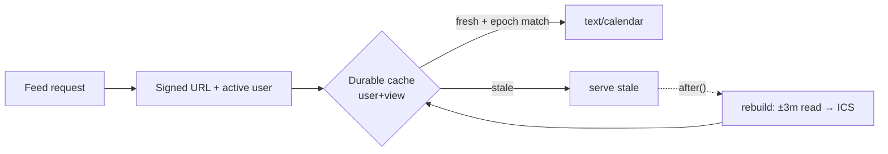

# 1. Calendar feed (ICS subscription)

The native home-screen calendar answer for **iPhone/iPad and Android**: a private,
read-only **ICS feed** that the phone's calendar app subscribes to, with the native
calendar widget rendering it. There is no third-party widget app to install, no token
to paste and no on-device Flow setup. The earlier HTTP JSON widget API (KWGT, per-device
`widget_tokens`, the `/api/widget/v1/agenda` endpoint) was removed — the feed is the only
native-widget path.

## Table of contents

- [1.1 Why a feed](#11-why-a-feed)
- [1.2 Signed, regenerable URL](#12-signed-regenerable-url)
- [1.3 Endpoint](#13-endpoint)
- [1.4 View semantics and window](#14-view-semantics-and-window)
- [1.5 ICS shape](#15-ics-shape)
- [1.6 Caching and refresh](#16-caching-and-refresh)
- [1.7 Platform setup](#17-platform-setup)
- [1.8 Security and rotation](#18-security-and-rotation)
- [1.9 Files and tests](#19-files-and-tests)

## 1.1 Why a feed

A PWA cannot register a home-screen widget; only the operating system's calendar app can.
A calendar **subscription** is the one zero-install path that works with the native
calendar apps and their widgets on both platforms:

- no token pasting or per-device setup on the phone;
- the same view filters and rendered titles as the app;
- one subscription URL per self-created dashboard view.

The trade-offs are explicit: the calendar app decides when to refresh, the feed has no
KAH/double-booking badges, and a subscription URL is a credential.

## 1.2 Signed, regenerable URL

The URL is **derived**, not stored (there is no per-device token table):

```text
https://<host>/api/widget/v1/calendar.ics?u=<userId>&v=<feedVersion>&view=<viewId>&sig=<hmac>
sig = base64url(HMAC-SHA256(NEXTAUTH_SECRET, "cloudy2:widget-feed:v1:<userId>:<feedVersion>:<viewId>"))
```

- `user_preferences.feed_version` is the revocation counter.
- **Rotate feed link** increments it; every previously generated URL returns
  401. The new URL is shown immediately — there is no show-once secret.
- Rotating `NEXTAUTH_SECRET` invalidates every feed URL (and every session),
  the same trade-off as the dashboard share links.
- Verification also re-checks `users.status = 'active'`.

## 1.3 Endpoint

`GET /api/widget/v1/calendar.ics`

- Query: `u`, `v`, `view`, `sig` (all required; `view` is a dashboard view UUID).
- Success: `200 text/calendar; charset=utf-8`,
  `Content-Disposition: inline; filename="cloudy2.ics"`,
  `Cache-Control: private, max-age=0, must-revalidate` (the durable server cache
  does the expensive work, so the client may revalidate on every poll).
- Invalid/rotated/inactive/imported-view: `401`; rate-limited: `429` + `Retry-After`;
  build failure: `500`. No CORS headers; `/api/` is already excluded from the PWA
  service-worker caches.
- Rate limit: the shared in-memory limiter keyed by `feed:<userId>`
  (60/min — calendar polling is infrequent).

## 1.4 View semantics and window

- **Only views the account created itself are feed-eligible.** The dialog and the
  signed URLs list only `user_dashboard_views` rows with
  `created_via = 'manual'`; a view imported from another account's share link
  (`created_via = 'shared'`) is never offered, and a signed URL for one returns
  `401` (so URLs generated before this rule stop working). The row's provenance
  is recorded at import time in `addSharedDashboardView`.
  - *Limitation:* rows imported before the `created_via` column existed are
    indistinguishable and keep the `manual` default; only imports made after the
    0070 migration are excluded. Dashboard sharing/importing is otherwise unchanged.
- `view` selects a stored dashboard view; its **Cal/Users/Types/Event-name
  filters** and its **title recipe** apply, exactly like the dashboard. The
  resolution is the same chain the calendar page uses (`resolveTabFilters` → `projectRangeEvents`
  → `resolveDisplayTitles` → `filterEventsByText`): `null` filter = the role default,
  stale ids fall back to the default, an explicit empty selection stays empty.
- Profile → Calendar feed opens on the **view currently active on the calendar page**
  (`?view=`) and shows the selected view's **effective filter summary** (e.g.
  `1/4 calendars · 2 users · 1 type · Name “parade”`) before the URL is copied.
  Because the URL is bound to the view id, editing a view's filters/title later
  changes the feed in place — no re-subscribe.
- The feed covers **±3 months**: first day of month−3 through the last day of
  month+3. The read set adds month−4 so a multi-day event that started earlier
  still appears as ongoing.
- Logical events are deduped by group id (`projectRangeEvents`), so a
  multi-department copy appears once.
- A deleted view falls back to the user's first tab; the signed URL continues
  to validate.

## 1.5 ICS shape

- Calendar: `VERSION:2.0`, `PRODID`, `CALSCALE:GREGORIAN`, `METHOD:PUBLISH`,
  `X-WR-CALNAME:Cloudy2 · <view>`, `X-WR-CALDESC:Filters: <effective filter summary>`,
  `X-WR-TIMEZONE:Asia/Singapore`, `REFRESH-INTERVAL;VALUE=DURATION:PT15M`,
  `X-PUBLISHED-TTL:PT15M`.
- One `VEVENT` per event:
  - `UID:<eventId ?? copyId>@cloudy2` (stable group id)
  - `DTSTAMP` = build time (UTC)
  - All-day/full/half → `DTSTART;VALUE=DATE` / `DTEND;VALUE=DATE` with the
    exclusive end (half-day therefore shows as all-day; the recipe's title can
    carry the AM/PM markers)
  - Timed → UTC `DTSTART`/`DTEND`
  - `SUMMARY` = the rendered title
  - `LOCATION` (when set), `DESCRIPTION` = the organizer's raw remarks (never
    the notes block), `URL` = the dashboard deep link
  - `STATUS:CONFIRMED`, `SEQUENCE:0`
- CRLF endings and RFC 5545 75-octet folding, reusing the same pure helpers as
  the single-event `.ics` export (`src/lib/events/calendarExport.ts`).

## 1.6 Caching and refresh



- A ±3-month feed is an eight-month read, so the rendered body is cached per
  `(user, view)` in `widget_feed_cache` (15-minute TTL). Stale bodies are served
  while the rebuild runs in `after()`; the first request after a cold cache
  rebuilds blocking.
- Event mutations bump the events-cache epoch, so the next feed read rebuilds.
  Dashboard-view name/kind/filter/delete edits invalidate the user's cache rows.
- The response also sets `Cache-Control: private, max-age=0, must-revalidate` so a
  filter edit is picked up on the calendar app's next fetch; the durable cache above
  keeps the read cost independent of that header.
- **Refresh cadence is the calendar app's choice.** Apple Calendar checks
  roughly hourly (configurable every 15 minutes/hourly/daily). Google Calendar
  refreshes subscribed ICS feeds only every ~12–24 hours and has no manual
  refresh; several third-party Android calendar apps poll faster. The feed
  works on both platforms — the setup steps below differ, the endpoint does not.

## 1.7 Platform setup

**iPhone / iPad (and Mac)**

1. Profile → Calendar feed → pick the view → copy the HTTPS URL (or **Open in Calendar**).
2. iPhone/iPad: Settings → Calendar → Accounts → Add Account → Other → Add Subscribed
   Calendar → paste the URL; set the refresh interval.
   Mac: Calendar → File → New Calendar Subscription.
3. Add the Calendar widget and select “Cloudy2 · <view>”.

**Android**

1. Profile → Calendar feed → pick the view → copy the HTTPS URL. (The Android Google
   Calendar app cannot add a URL feed; use the web UI or a third-party app.)
2. Google Calendar on the web (`calendar.google.com`) → Other calendars → **+** →
   **From URL** → paste the HTTPS URL. The subscription then appears in the Android
   Google Calendar app and its widget.
3. Add the Google Calendar widget and select “Cloudy2 · <view>”.
4. For faster refresh than Google's ~12–24 hours, subscribe the same URL in a calendar
   app that supports ICS with a configurable interval (e.g. Samsung Calendar, Business
   Calendar, DigiCal, aCalendar) and use that app's widget.

**Both platforms:** if a department calendar is also enabled, hide the extra one to
avoid duplicate copies of the same event.

## 1.8 Security and rotation

- The subscription URL is a **bearer credential**; anyone with it can read the
  feed. Calendar apps store it in their account settings.
- It appears in server logs (query string) and is read-only.
- **Rotate feed link** invalidates every existing subscription; re-subscribe
  with the new URL. Rotation is audited (`widgetFeed.rotate`).
- A deactivated user's feed stops working immediately (`users.status` check).
- The cached ICS contains no credential.

## 1.9 Files and tests

| Path | Purpose |
| --- | --- |
| `src/app/api/widget/v1/calendar.ics/route.ts` | The feed endpoint. |
| `src/lib/widgets/feedToken.ts` | HMAC signing/verification + URL builder. |
| `src/lib/widgets/feedWindow.ts` | ±3-month window, inclusive end dates, event inclusion. |
| `src/lib/widgets/feed.ts` | View resolution + ICS assembly. |
| `src/lib/widgets/feedCache.ts` | Durable body cache, epoch invalidation. |
| `src/lib/widgets/viewEvents.ts` | Shared view resolution/read (dashboard parity). |
| `src/lib/widgets/actions.ts` | Feed links + rotation server actions. |
| `src/components/CalendarFeedModal.tsx` | Profile → Calendar feed UI (iOS + Android). |
| `src/lib/events/icalFeed.ts` | Multi-event ICS rendering. |
| `src/lib/events/calendarExport.ts` | Shared escaping/folding/date primitives. |
| `src/db/schema.ts` | `widget_feed_cache`, `user_preferences.feed_version`, `user_dashboard_views.created_via`. |
| `drizzle/0069_windy_warstar.sql` | Drops `widget_tokens` (removed HTTP widget API). |
| `drizzle/0070_left_lake.sql` | Adds `user_dashboard_views.created_via` (feed eligibility provenance). |
| `src/lib/widgets/feedToken.test.ts` | Signing, tampering, version/view binding. |
| `src/lib/widgets/feedWindow.test.ts` | Window math, inclusive end dates, edge inclusion. |
| `src/lib/widgets/feedCache.test.ts` | TTL/epoch freshness. |
| `src/lib/widgets/viewEvents.test.ts` | View filters → feed projection (Cal/Users/Types/Text) + filter summary. |
| `src/lib/events/icalFeed.test.ts` | ICS shape, dedupe, escaping, folding, `X-WR-CALDESC`. |

The former `docs/widgets.md` (KWGT JSON agenda) was removed with the HTTP widget API.
