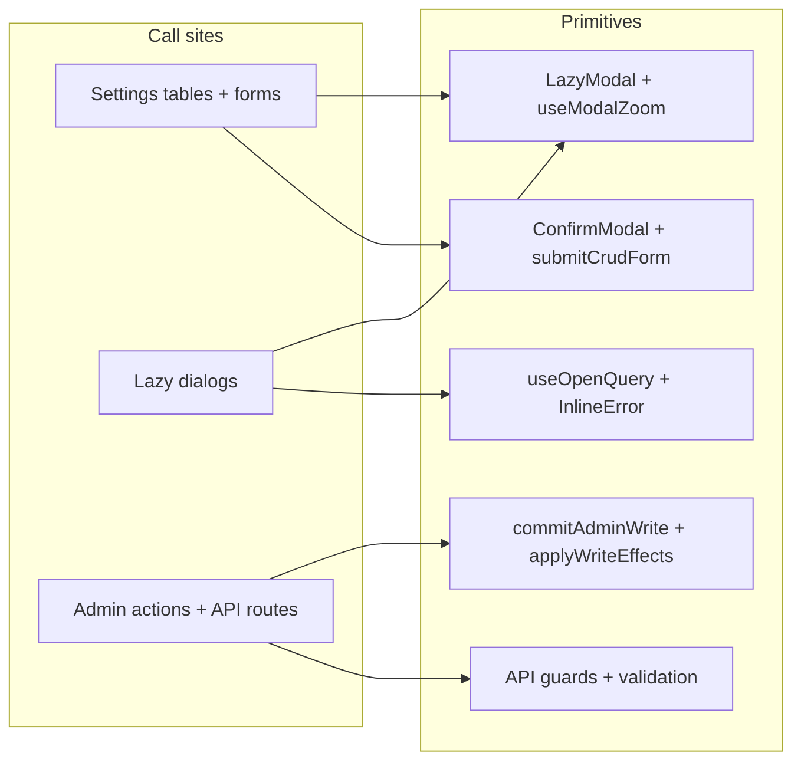

# 1. Shared composition framework

## Table of contents

- [1.1 Purpose](#11-purpose)
- [1.2 Principles](#12-principles)
- [1.3 Inventory](#13-inventory)
- [1.4 Foundation primitives](#14-foundation-primitives)
  - [1.4.1 Action results and session actors](#141-action-results-and-session-actors)
  - [1.4.2 Write effects and the admin write tail](#142-write-effects-and-the-admin-write-tail)
  - [1.4.3 Validation, UUIDs, config cache](#143-validation-uuids-config-cache)
  - [1.4.4 API route guards](#144-api-route-guards)
- [1.5 Settings CRUD composition](#15-settings-crud-composition)
  - [1.5.1 ConfirmModal + runConfirm](#151-confirmmodal--runconfirm)
  - [1.5.2 submitCrudForm + FormFooterActions](#152-submitcrudform--formfooteractions)
  - [1.5.3 useEntityEditor + LazyModal](#153-useentityeditor--lazymodal)
  - [1.5.4 Shared loading skeletons](#154-shared-loading-skeletons)
- [1.6 Dialog composition](#16-dialog-composition)
  - [1.6.1 useModalZoom](#161-usemodalzoom)
  - [1.6.2 LazyModal for dialogs](#162-lazymodal-for-dialogs)
  - [1.6.3 useOpenQuery + InlineError](#163-useopenquery--inlineerror)
  - [1.6.4 preloadLazyBody](#164-preloadlazybody)
- [1.7 Adoption map](#17-adoption-map)
- [1.8 Deferred candidates](#18-deferred-candidates)
- [1.9 Verification](#19-verification)

## 1.1 Purpose

Cloudy2 already had a healthy **primitive** layer (`MotionModal`, `CrossfadeSwap`,
`useChunkReady`, `SettingsListChrome`, `EmptyState`, `useReorderRows`, `activatable`,
`LoadingStatus`, `showValidationFailure`). The debt was one layer above it: the same
**composition** of those primitives was re-typed in every settings table, form, dialog and
admin action.

This framework names that composition so a convention changes in one file instead of
twelve. It is deliberately **not** a generic CRUD base class: entity-specific validation,
database writes, Google/ACL side effects and audit payloads stay at each call site.

## 1.2 Principles

1. **Preserve behavior.** Refactors move code; they do not reinterpret it. Audit payloads,
   toast copy, field-error mapping and idempotent delete semantics stay identical.
2. **Extract composition, not decisions.** `commitAdminWrite` logs and invalidates; it never
   builds the audit `details`. `submitCrudForm` maps a field error; it never validates.
3. **Keep chunks split.** `dynamic()` stays at the call site's module scope. `LazyModal` and
   `preloadLazyBody` accept an already-created loader/component; they never create one during
   render.
4. **Pure logic gets tests.** The repo has no DOM harness, so state machines
   (`openQueryReducer`), size resolution (`resolveModalSize`), effect presets and the submit
   branch are pure modules with Vitest coverage.
5. **Adopt incrementally.** Every primitive landed separately and every checkpoint ran
   `lint → typecheck → test → build`.

## 1.3 Inventory

| Concern | Copies found | Shared primitive |
| --- | --- | --- |
| `actorFrom(session)` | 7 helpers + 9 inline | `actorFromSession` (`audit/build.ts`) |
| Result unions | ~35 named types | `ActionResult` aliases (`actions/result.ts`) |
| Revalidate/invalidate tails | 6 presets, ~45 literals | `WRITE_EFFECTS` + `applyWriteEffects` |
| Audit + effects tail | 12 admin actions | `commitAdminWrite` |
| URL/text/string-array validation | 8 families | `lib/validation/*` |
| Unique-violation mapping | 6 catches | `uniqueViolationResult` |
| Cached config reads | 7 wrappers | `cachedConfig` |
| Route-handler preamble | 12 routes | `withApiSession` / `withApiJson` |
| Lazy create/edit modal wiring | 8 modals | `useEntityEditor` + `LazyModal` |
| Delete/action confirm dialog | ~14 | `ConfirmModal` + `runConfirm` |
| Form submit branch + footer | 6 forms | `submitCrudForm` + `FormFooterActions` |
| Settings tab skeletons | 3 duplicate files | `CrudTabSkeleton` |
| Modal zoom plumbing | 8 call sites | `useModalZoom` |
| Open-on-demand fetch | 10 state machines | `useOpenQuery` + `InlineError` |
| Chunk preload wrappers | 7 | `preloadLazyBody` |

## 1.4 Foundation primitives

### 1.4.1 Action results and session actors

`actorFromSession(session)` is the one session → audit-column mapper. Both `requireAdmin()`
and `requireSession()` results satisfy its structural `SessionActorLike`, so no generic or
cast is needed. `ActionResult<T, F>` is the one `{ ok: true } & T | { ok: false; error; field? }`
shape. Existing exported names stay as aliases so the ~36 client files importing them never
change.

### 1.4.2 Write effects and the admin write tail

`WRITE_EFFECTS` centralizes the load-bearing cache/path arrays (`departments`, `users`,
`eventTypeGroups`, `templates`, …). `applyWriteEffects(name, extra)` invalidates the config
cache first, then revalidates — the order every existing tail used. `commitAdminWrite` adds
the audit call in front; audit `details` are still passed in by the caller.

`effects.test.ts` asserts each preset's exact arrays and the merge/dedupe order, so a dropped
`/dashboard` path fails CI instead of going stale in production.

### 1.4.3 Validation, UUIDs, config cache

- `normalizeHttpUrl` / `validateHttpUrl` (messages parameterized per caller).
- `trimToMax` / `validateRequiredText`.
- `normalizeStringArray` with an explicit `null` (not an array) vs `[]` distinction.
- `uniqueUuidIds` and a single `isUuid` (the duplicate in `kah/status.ts` was removed).
- `uniqueViolationResult(error, byConstraint, fallback)`.
- `cachedConfig(key, loader)` and the shared `DEPARTMENT_ORDER` /
  `EVENT_TYPE_GROUP_ORDER` orderings.

### 1.4.4 API route guards

`withApiSession(request, { requireApiHeader, admin })` performs CSRF → session → role and
returns the response to return on failure. `withApiJson` adds the body parse. Admin routes
get a JSON **403**, never `requireAdmin()` (which redirects into HTML a fetch caller cannot
parse). `apiJson` / `apiError` always add `Cache-Control: no-store`.

## 1.5 Settings CRUD composition

### 1.5.1 ConfirmModal + runConfirm

`ConfirmModal` is the one small centered confirmation dialog (message/children, confirm
label/color/icon, busy state). `runConfirm` is its async branch: run the call, then invoke
the same success/error toast path. The duplicate quick-link confirmation was deleted.

### 1.5.2 submitCrudForm + FormFooterActions

`submitCrudForm({ form, isEdit, create, update, success, fieldMap, onSuccess, warnings })`
owns the create/update dispatch, success copy, warning toast and field-error mapping.
`onSuccess(result, values)` keeps the event-type migration hint and the department optimistic
row patch. `FormFooterActions` is the shared delete/status + submit row.

### 1.5.3 useEntityEditor + LazyModal

`useEntityEditor<Row>()` owns `opened` / `editing` / `openCreate` / `openEdit` / `closeEditor`.
`LazyModal` composes `MotionModal` + `CrossfadeSwap` for an already-created module-level
`dynamic()` body. Used by the Users, Departments, Event Types, Quick Links, Webhooks, KAH
Groups and Templates editors.

### 1.5.4 Shared loading skeletons

`SettingsTableSkeleton` moved from the route folder to `src/components/`. `CrudTabSkeleton`
is the shared mobile-card + add-button + desktop-table loading shape used by the Quick Links,
Webhooks and KAH Groups routes.

## 1.6 Dialog composition

### 1.6.1 useModalZoom

`useModalZoom({ originRect, spec, contentWidthPx?, viewport? })` resolves the responsive
`MantineSize`, viewport, content width and `modalZoomTransitionProps` in one call.
`resolveModalSize` and `MODAL_SIZE_PX` are pure and unit-tested (`lg = 620`, which fixed the
event-history shrink scale). `useModalSize` covers non-zoom dialogs.

### 1.6.2 LazyModal for dialogs

The date picker, filter, pinned events, event search, manage views, share import, department
detail, event history (zoom only) and event detail (zoom only) use the shared transition
plumbing. `LazyModal` is used where the chrome was already a static `MotionModal` +
`CrossfadeSwap` pair. `EventDetail`, `EventForm`, `FilterModal` and `UserSelectModal` remain
bespoke where their mount/flex/size semantics are unique.

### 1.6.3 useOpenQuery + InlineError

`useOpenQuery` is the load-on-open state machine: render-phase reset on open/key change,
monotonic request ids (a stale response is ignored), and a terminal `ready` / `error` state
with `reload`. `InlineError` is the shared inline failure line. Adopted by Calendar Access,
Preferences, Notifications and the Department access panel; the Pinned panel (seed),
Event History (cache-first) and Event Search (submit-driven) stay bespoke.

### 1.6.4 preloadLazyBody

`preloadLazyBody(loader)` replaces the hand-written `void loadChunk(loader).catch(() => {})`
wrappers. `loadChunk` already joins in-flight loads and retries after a failure.

## 1.7 Adoption map

| Area | Primitive |
| --- | --- |
| Admin create/update/delete | `commitAdminWrite`, `applyWriteEffects` |
| Settings forms | `submitCrudForm`, `FormFooterActions`, `ConfirmModal` |
| Settings tables | `useEntityEditor`, `LazyModal` |
| Trigger-origin dialogs | `useModalZoom` |
| Load-on-open dialogs | `useOpenQuery`, `InlineError` |
| Settings route loading | `CrudTabSkeleton` |
| Read APIs | `withApiSession`, `withApiJson`, `apiJson`, `apiError` |

## 1.8 Deferred candidates

The list/view layer was deliberately left for a follow-up (it touches `DashboardView`,
`ContactList` and `ParadeStateView`, where the regression risk is higher):

- One `StickyChrome` / generalized `ListChrome` (Contacts duplicates ~100 lines of
  `SettingsListChrome`).
- `ListCollection` mobile-card + desktop-table shell and `PaginationFooter` /
  `paginateRows`.
- `EventListRow` / `EventListSkeleton` (My Events, Pinned panel, event search) and one
  exported `LIST_BORDER`.
- `chipHighlightClasses` + `renderChipRoot` for the six event-chip renderers.
- `rendererSkeleton(kind)` for the three kind→skeleton mappings.
- `useLazyMount` / `useEventClick` / `ReadOnlyEventDetail` / `useEventDetailHost` for the
  repeated detail hosts.
- `useParamNav` / `deepLinkReducer`, zoom-announcement consolidation, `EmptyState live`,
  `ColorSwatchPicker` palette, `formatEventWhen` display formatting.
- Retired feature-flag variant removal (`arrows`/`arrowsDrag`, ticker indicators, bottom-nav
  variants, wizard step indicators) — a separate dead-code task, not a framework.

**Do not** genericize `getXOrNull` or a CRUD base class: the entity-specific cores
(Google ACLs, tree renumbering, membership replacement, audit payload shaping) dominate.

## 1.9 Verification

Per checkpoint: `pnpm lint`, `pnpm typecheck`, `pnpm test`. Final: `pnpm build` and
`pnpm db:generate` (no schema change). Manual QA covers the settings tabs at 360/640/1024,
every dialog's open → close → immediate reopen, nested z-index, reduced motion and the
settings/loading/deep-link routes.
