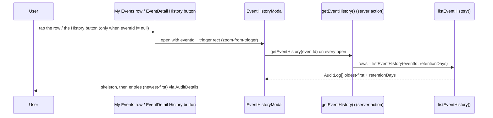
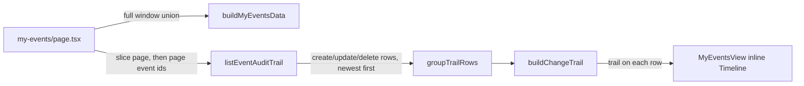

# 1. Event history & My Events

Two read-only surfaces over the event rows already written to `audit_logs`:
a **per-event history modal** (create / every edit / delete, keyed by the
logical event's group id) and **My Events** (the signed-in user's own created
events, including those since deleted). Both are self-service — no admin role
required — and both reuse the audit-log write path, the `formatAuditDetails`
display layer, and this repo's skeleton-only loading pattern. Nothing new is
recorded; this document covers how the existing rows are read, authorized,
rendered, and kept fresh.

## Table of contents

- [1.1 Problem](#11-problem)
- [1.2 Data source](#12-data-source)
- [1.3 Per-event history modal](#13-per-event-history-modal)
- [1.4 My Events page](#14-my-events-page)
  - [1.4.1 Inline change timeline](#141-inline-change-timeline)
- [1.5 Authorization & privacy](#15-authorization--privacy)
- [1.6 Retention](#16-retention)
- [1.7 Read layer & the event-id index](#17-read-layer--the-event-id-index)
- [1.8 Always-fresh caching](#18-always-fresh-caching)
- [1.9 Navigation & the footer overflow](#19-navigation--the-footer-overflow)
- [1.10 Pure helpers & testing](#110-pure-helpers--testing)
- [1.11 File index & related docs](#111-file-index--related-docs)

## 1.1 Problem

Users asked to see what changed on their events, and to keep track of events they
created after those events are deleted. The data already existed: every
create/update/delete writes an `audit_logs` row with the actor, a timestamp, the
event's group id, and — for edits — a before→after `FieldDiff`
([`audit-log.md`](audit-log.md), [`event-mutations.md`](event-mutations.md) §1.8).
But it only surfaced in the admin-only audit log as a flat stream; there was no
per-event view and no per-user view. The gap is a read/UI gap, not an
instrumentation gap, so the design is deliberately a thin read layer over the
audit rows plus one modal and one page.

## 1.2 Data source

Event mutations are the only writer, and they already stamp everything needed
([`event-mutations.md`](event-mutations.md) §1.8):

- The **group id** (`eventId`) is minted at create and written into `details` on
  every `event.create` / `event.update` / `event.delete` row. All copies of a
  logical event share it, so the group id is the natural history key.
- The **actor** (name + role snapshotted, id `ON DELETE SET NULL`) identifies who
  created the event — the organizer is fixed at create, so the create actor
  *is* the organizer.
- `details` carries a human-readable snapshot (rendered title, pre-formatted UTC+8
  `time`, departments, invitees, creator, …); an edit row carries a `FieldDiff`.

`parseEventPeople(...).eventId` on the read path (the `CalendarEventPayload.eventId`
the dashboard already ships) is what the event modal hands to the history modal.

## 1.3 Per-event history modal

`EventHistoryModal` (`src/components/EventHistoryModal.tsx`) is a read-only
changelog of one logical event, opened in place — there is no history route:



- **Entry points:** tapping a **My Events row**, and the **History button** in
  `EventDetail`'s editable action row (stacked above the event modal with
  `zIndex={300}`). The History button is hidden when `payload.eventId === null`
  (external or never-app-edited legacy events have no group id and no history)
  and is not shown in the read-only details (Double Booking / KAH Status).
- **Data:** the `getEventHistory(eventId)` server action (`requireSession()` +
  `listEventHistory`) runs on **every open** — always fresh, no client cache —
  with the shaped `EventHistorySkeleton` inside while loading (skeleton-only
  rule). A failed fetch shows a quiet error line.
- **Entries:** each row renders as a **collapsible entry** (all collapsed by
  default; tap to expand) via the shared `EventHistoryEntries`
  (`src/components/EventHistoryEntries.tsx`): the always-visible header shows
  the action label, UTC+8 timestamp, actor, and a one-line change summary (the
  changed field labels for an edit, or the title for a create/delete); tapping
  it reveals the shared `AuditDetails` (`src/components/AuditDetails.tsx`) —
  the same before→after lines and "Resulting state" section the admin audit
  modal uses. A delete row (when present) is simply the newest entry.
- **Header:** the newest row's `entity_name` (the rendered title at that edit),
  falling back to the create snapshot's title; a red **Deleted** badge when the
  newest row is a delete; a dimmed retention line.
- Closing returns to whatever opened the modal (no back button, no route).

## 1.4 My Events page

`/my-events` lists the events the signed-in user organized, last-edit first
(newest recorded edit on top), over an adjustable **±-months window** (default ±3;
`±3 / ±6 / ±12`, selected with the same `NoKeyboardSelect` control the KAH Status
page uses and reflected in `?range=`).
It is a **union of two sources** (`buildMyEventsData`,
`src/lib/events/myEventsData.ts`):

- **Live** events where `payload.creatorId === me`, read across every department
  calendar over the window. The organizer is stored *on the event* (the notes
  `createdBy`), not just on the audit actor — so this catches events created
  "on behalf of" a user and events older than audit retention.
- **Deleted** events, from the user's own `event.create` rows that have a paired
  `event.delete` row (`latestDeleteTimes`) and are not still live, range-filtered
  by the leading `YYYY-MM-DD` of the snapshot `time`. Shown with a red **Deleted**
  badge. Because live reads can't see deleted events, this is what makes deleted
  events trackable (within audit retention).

Rows are deduped by group id (live wins) and sorted **last-edit first**
(`mergeMyEvents`): a live row orders by the newest `created_at` of its audit rows
(`latestEventEditTimes` — every `entity_type='calendar'` row carrying the event
id, i.e. `event.create`/`event.update`/`event.delete` plus the same-minute
`event.participantNotify` side-effect rows), a deleted row by its `event.delete`
time (`latestDeleteTimes`). Rows with no recorded audit
rows (older than any remaining audit history, or edited directly in Google
Calendar) fall back to the event's start time; ties break on start (newest first),
then key. Tapping a row opens the history modal (§1.3); legacy rows with no group
id are inert. Pagination is `?page=` (page size 20), applied in memory since
the combined set is bounded by the window + retention.

Rows render in the shared one-line row style (the EventSearchModal list recipe,
`docs/event-search.md`): one bordered container of 1px-separated rows, each a
4px accent bar (`--mantine-color-<color>-filled`) + truncated title + one dim
meta line (`time · departments`). The bar color is the event's read-time color
(`CalendarEvent.color` for live rows; `gray` for audit rows); **Deleted** rows
always ride a red bar and keep a small inline red
`Deleted` badge. Times are humanized for display (`humanizeMyEventTime`:
`21 Aug · 14:00 – 15:30`, year only off the current year, same-month all-day
spans collapse) while `sortKey` stays the naive `YYYY-MM-DD HH:mm` — live
all-day rows normalize to `00:00` so live/deleted all-day events interleave
consistently within a day. The ordering itself uses the row's `editKey` (the
naive `YYYY-MM-DD HH:mm` of the last recorded edit — the audit row's
`created_at` formatted in the app's UTC+8) and falls back to `sortKey` when the
event has no audit history.

### 1.4.1 Inline change timeline

Every row carries a compact **change timeline** (Mantine `Timeline`) that shows
*when* each change was made, so the list answers "what happened to this event"
without opening the history modal.



- **Data:** one indexed read per page. `listEventAuditTrail(eventIds, retentionDays)`
  (`src/lib/audit/queries.ts`) fetches every `event.create` / `event.update` /
  `event.delete` row of the events on the current page — never the
  `event.participantNotify` side-effects — newest first, within the retention
  window (same `details->>'eventId'` expression index as the other event reads).
  `page.tsx` attaches the shaped trail to each row after slicing, so the read is
  bounded by the page size, not the window.
- **Shaping:** `buildChangeTrail` (`src/lib/events/changeTrail.ts`, pure +
  unit-tested) collapses the per-copy fan-out — a cross-department mutation
  writes one audit row *per calendar copy*, so rows sharing an action and the
  same minute become one item (the same minute-precision convention
  `latestEventEditTimes` ordering relies on). The full trail renders inline
  (no cap); rows grow with their trail length.
- **Display:** one `Timeline.Item` per change (`ChangeTrailTimeline` in
  `MyEventsView.tsx`) — a colored bullet (brand = Created, accent = Edited,
  red = Deleted), the action label, a coarse relative age ("3 days ago", pure
  `relativeChangeLabel`) with the absolute UTC+8 stamp on hover/focus, the
   actor, and the changed-field labels for an edit (the shared `changeSummary`
   from `audit/format.ts`, now also used by the history modal). The
   skeleton paints matching bullet + line placeholders so the reveal doesn't
   reflow. Rows with no audit rows left (legacy, Google-edited, or outside
   retention) render exactly as before — no empty-trail noise.
- The trail items themselves are non-interactive; tapping the row opens the
  history modal (§1.3) for the full before→after diffs.

## 1.5 Authorization & privacy

Both surfaces are open to **any signed-in user** (`requireSession()`), matching how
events are already viewable: the dashboard lets any authenticated user select any
department calendar, and `user_calendar_access` never gates dashboard reads
([`roster-sharing.md`](roster-sharing.md) §1.5). So "who can see this event's
history" is "who can see the event" — no separate ACL.

Privacy notes:

- **Every viewer only sees their own events** on `/my-events` (the live read is
  filtered by `payload.creatorId === me`; the audit read by `actor_id = me`); the
  history modal is open to any signed-in user for any event, consistent with
  event visibility.
- **Hidden-invitee event types** leak nothing: `resolveEffectiveInput` strips
  hidden attendees *before* any snapshot is built, so an audit row already contains
  only the effective (post-policy) participant set. The one residual case — an
  admin later disabling `showInvitees` — leaves older rows listing invitees that
  were public when written; that is historical truth, and history is not rewritten.
- The shared `Admin` pseudo-account's creations (no `actor_id`) are intentionally
  excluded from `/my-events`.

## 1.6 Retention

History is bounded by `settings.audit_log_retention_days` (default 90, clamp
7–365, [`audit-log.md`](audit-log.md) §1.4). Both reads apply the window **as a
filter** (`created_at >= now - N days`); they never purge — only the audit-log page
rotates on read. Rows older than the window simply don't appear.

## 1.7 Read layer & the event-id index

Both features filter the jsonb expression `details->>'eventId'`. Event audit rows
store the group id there, **not** in `entity_id` (which holds the calendar id), so
no pre-existing index covers it. `audit_logs_event_id_idx` is a plain expression
index (`drizzle/0056_charming_blue_marvel.sql`):

```sql
CREATE INDEX "audit_logs_event_id_idx" ON "audit_logs" USING btree ((details->>'eventId'));
```

Reads in `src/lib/audit/queries.ts`:

| Function | Query |
| -------- | ----- |
| `listEventHistory(eventId, retentionDays)` | `entity_type='calendar' AND details->>'eventId'=$1` (+ window), `order by created_at asc, id asc` |
| `listMyCreatedEvents(userId)` | all `action='event.create' AND actor_id=$1`, `order by created_at desc, id desc` (deleted candidates, retention-bounded) |
| `latestDeleteTimes(eventIds)` | `max(created_at)` per `details->>'eventId'` from `action='event.delete'` for the given ids (key set = deleted ids) |
| `latestEventEditTimes(eventIds)` | `max(created_at)` per `details->>'eventId'` from `entity_type='calendar'` for the given ids — every calendar row with the event id (create/update/delete + same-minute `event.participantNotify` side-effects); last in-app edit; no retention window, like its siblings |

`buildMyEventsData` (`src/lib/events/myEventsData.ts`) combines the live
`fetchRangeEvents` read (organizer = the user) with those audit reads into one
shaped, sorted list.

## 1.8 Always-fresh caching

`/my-events` is **always-fresh** — in `ALWAYS_FRESH_PREFIXES` in
`src/lib/pwa/swRules.ts`, so its document/RSC payloads are never served from the
SWR caches (audit rows change with every event mutation anywhere). The server
page stamps `renderedAt` (epoch ms) into the payload and the client view gates
on `useLiveRouteRefresh(renderedAt)`, forcing one in-place re-read when the
mounted payload is a cache replay ([`audit-log.md`](audit-log.md) §1.10,
[`loading-transitions.md`](loading-transitions.md)). The header **Force
refresh** already routes always-fresh paths through `LIVE_REFRESH_EVENT`
(`AppShellShell`). Consequence: like the audit log, the page is unavailable
offline. The history modal needs no route entry — its rows come from a server
action invoked on every open, which never reads the SWR caches.

## 1.9 Navigation & the footer "More" menu

**My Events** is a global nav entry (`/my-events`), shown to every role. On the
desktop sidebar (≥ `lg`) every entry is listed directly. The **mobile footer** keeps
only the four primary tiles (Calendar, Parade State, Contacts, Double Booking) plus
a **More** tile that opens a `Menu` popup (the profile-menu pattern, animated with
the shared `pop-top-right` / `MOTION.popover` transition) holding the
rest — My Events, KAH Status (when visible), and Settings (admin). `NavRouteWarmer`
preloads the new route.

## 1.10 Pure helpers & testing

| Helper | Module | Tests |
| ------ | ------ | ----- |
| `eventIdFromAuditDetails`, `createdEventSummary` | `events/history.ts` | `events/history.test.ts` |
| `formatMyEventTime`, `auditTimeSortKey`, `humanizeMyEventTime`, `mergeMyEvents` | `events/myEvents.ts` | `events/myEvents.test.ts` |
| `relativeChangeLabel`, `buildChangeTrail`, `groupTrailRows` | `events/changeTrail.ts` | `events/changeTrail.test.ts` |
| `parseMyEventsRange`, `myEventsRangeLabel`, `myEventsWindow` | `events/myEventsRange.ts` | `events/myEventsRange.test.ts` |
| `formatAuditDetails`, `actionLabel`, `actorLabel`, `changeSummary`, `formatLogTimestamp` | `audit/format.ts` | `audit/format.test.ts` |
| `isAlwaysFreshPath` (the new prefixes) | `pwa/swRules.ts` | `pwa/swRules.test.ts` |

I/O-bound (not unit-tested, per the repo convention): the `queries.ts` read
functions, `buildMyEventsData`, the My Events route page, and the client views
(including the history modal and its server action).

## 1.11 File index & related docs

| File | Role |
| ---- | ---- |
| `src/components/EventHistoryModal.tsx` | Shared history modal (zoom-from-trigger, fetch-on-open) |
| `src/components/EventHistoryEntries.tsx` | Shared collapsible changelog entries |
| `src/components/EventHistorySkeleton.tsx` | Shared shaped skeleton |
| `src/lib/events/historyActions.ts` | `getEventHistory` server action |
| `src/app/(protected)/my-events/page.tsx` | My Events server page (window + pagination + trail attach) |
| `src/app/(protected)/my-events/MyEventsView.tsx` | Client view + range selector + pagination + inline trail |
| `src/components/AuditDetails.tsx` | Shared `details` renderer (audit log + history) |
| `src/app/(protected)/dashboard/EventDetail.tsx` | The History button (opens the modal at `zIndex={300}`) |
| `src/lib/audit/queries.ts` | `listEventHistory`, `listMyCreatedEvents`, `latestDeleteTimes`, `latestEventEditTimes`, `listEventAuditTrail` |
| `src/lib/events/myEventsData.ts` | My Events union builder (live + audit) |
| `src/lib/events/history.ts` | Pure snapshot parsers (unit-tested) |
| `src/lib/events/changeTrail.ts` | Pure inline change-timeline shaping (unit-tested) |
| `src/lib/events/myEvents.ts` / `myEventsRange.ts` | Pure list shaping + window helpers (unit-tested) |
| `src/db/schema.ts` + `drizzle/0056_charming_blue_marvel.sql` | `audit_logs_event_id_idx` |
| `src/components/AppShellShell.tsx` | My Events nav entry + footer More `Menu` |
| `src/lib/pwa/swRules.ts` | Always-fresh prefixes |

Related docs:

- [`audit-log.md`](audit-log.md) — the table, write path, `details` shapes, display
  formatting, retention.
- [`event-mutations.md`](event-mutations.md) — the create/update/delete rows and
  their snapshots.
- [`event-lifecycle.md`](event-lifecycle.md) — what an event is (group id, notes).
- [`roster-sharing.md`](roster-sharing.md) — why reads are not ACL-gated.
- [`loading-transitions.md`](loading-transitions.md) — skeleton-only loading and the
  always-fresh re-read pattern.
