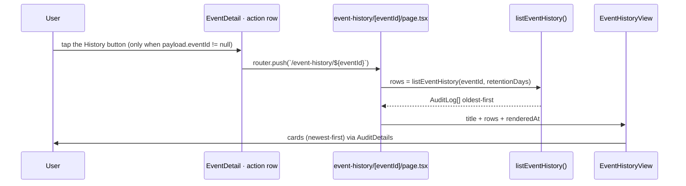

# 1. Event history & My Events

Two read-only surfaces over the event rows already written to `audit_logs`:
a **per-event history** page (create / every edit / delete, keyed by the
logical event's group id) and **My Events** (the signed-in user's own created
events, including those since deleted). Both are self-service — no admin role
required — and both reuse the audit-log write path, the `formatAuditDetails`
display layer, and this repo's always-fresh route pattern. Nothing new is
recorded; this document covers how the existing rows are read, authorized,
rendered, and kept fresh.

## Table of contents

- [1.1 Problem](#11-problem)
- [1.2 Data source](#12-data-source)
- [1.3 Per-event history route](#13-per-event-history-route)
- [1.4 My Events page](#14-my-events-page)
- [1.5 Authorization & privacy](#15-authorization--privacy)
- [1.6 Retention](#16-retention)
- [1.7 Read layer & the event-id index](#17-read-layer--the-event-id-index)
- [1.8 Always-fresh caching](#18-always-fresh-caching)
- [1.9 Navigation & the footer overflow](#19-navigation--the-footer-overflow)
- [1.10 Pure helpers & testing](#110-pure-helpers--testing)
- [1.11 File index & related docs](#111-file-index--related-docs)

## 1.1 Problem

Users asked to see what changed on their events, and to keep track of events they
created after those events are deleted. The data already existed: every
create/update/delete writes an `audit_logs` row with the actor, a timestamp, the
event's group id, and — for edits — a before→after `FieldDiff`
([`audit-log.md`](audit-log.md), [`event-mutations.md`](event-mutations.md) §1.8).
But it only surfaced in the admin-only audit log as a flat stream; there was no
per-event view and no per-user view. The gap is a read/UI gap, not an
instrumentation gap, so the design is deliberately a thin read layer over the
audit rows plus two small routes.

## 1.2 Data source

Event mutations are the only writer, and they already stamp everything needed
([`event-mutations.md`](event-mutations.md) §1.8):

- The **group id** (`eventId`) is minted at create and written into `details` on
  every `event.create` / `event.update` / `event.delete` row. All copies of a
  logical event share it, so the group id is the natural history key.
- The **actor** (name + role snapshotted, id `ON DELETE SET NULL`) identifies who
  created the event — the organizer is fixed at create, so the create actor
  *is* the organizer.
- `details` carries a human-readable snapshot (rendered title, pre-formatted UTC+8
  `time`, departments, invitees, creator, …); an edit row carries a `FieldDiff`.

`parseEventPeople(...).eventId` on the read path (the `CalendarEventPayload.eventId`
the dashboard already ships) is what the event modal hands to the history route.

## 1.3 Per-event history route

`/event-history/[eventId]` (`src/app/(protected)/event-history/[eventId]/`) is a
read-only changelog of one logical event:



- The entry point is a **standalone History button** in `EventDetail`'s editable
  action row (next to Edit/Delete); it is hidden when `payload.eventId === null`
  (external or never-app-edited legacy events have no group id and no history) and
  is not shown in the read-only details (Double Booking / KAH Status).
- The page renders each row as a card (action label, UTC+8 timestamp, actor) with
  the shared `AuditDetails` component (`src/components/AuditDetails.tsx`) — the
  same before→after lines and "Resulting state" section the admin audit modal
  uses. A delete row (when present) is simply the last entry.
- Title: the newest row's `entity_name` (the rendered title at that edit), falling
  back to the create snapshot's title.
- **Back** returns to `/dashboard`.

## 1.4 My Events page

`/my-events` lists the events the signed-in user organized, newest first, over an
adjustable **±-months window** (default ±3; `±3 / ±6 / ±12`, selected with the same
`NoKeyboardSelect` control the KAH Status page uses and reflected in `?range=`).
It is a **union of two sources** (`buildMyEventsData`,
`src/lib/events/myEventsData.ts`):

- **Live** events where `payload.creatorId === me`, read across every department
  calendar over the window. The organizer is stored *on the event* (the notes
  `createdBy`), not just on the audit actor — so this catches events created
  "on behalf of" a user and events older than audit retention.
- **Deleted** events, from the user's own `event.create` rows that have a paired
  `event.delete` row (`deletedEventIds`) and are not still live, range-filtered by
  the leading `YYYY-MM-DD` of the snapshot `time`. Shown with a red **Deleted**
  badge. Because live reads can't see deleted events, this is what makes deleted
  events trackable (within audit retention).

Rows are deduped by group id (live wins) and sorted newest-first
(`mergeMyEvents`). Each row links to `/event-history/<eventId>`; legacy rows with
no group id render unlinked. Pagination is `?page=` (page size 20), applied in
memory since the combined set is bounded by the window + retention.

## 1.5 Authorization & privacy

Both surfaces are open to **any signed-in user** (`requireSession()`), matching how
events are already viewable: the dashboard lets any authenticated user select any
department calendar, and `user_calendar_access` never gates dashboard reads
([`roster-sharing.md`](roster-sharing.md) §1.5). So "who can see this event's
history" is "who can see the event" — no separate ACL.

Privacy notes:

- **Every viewer only sees their own events** on `/my-events` (the live read is
  filtered by `payload.creatorId === me`; the audit read by `actor_id = me`); the
  history route is reachable by direct URL, consistent with event visibility.
- **Hidden-invitee event types** leak nothing: `resolveEffectiveInput` strips
  hidden attendees *before* any snapshot is built, so an audit row already contains
  only the effective (post-policy) participant set. The one residual case — an
  admin later disabling `showInvitees` — leaves older rows listing invitees that
  were public when written; that is historical truth, and history is not rewritten.
- The shared `Admin` pseudo-account's creations (no `actor_id`) are intentionally
  excluded from `/my-events`.

## 1.6 Retention

History is bounded by `settings.audit_log_retention_days` (default 90, clamp
7–365, [`audit-log.md`](audit-log.md) §1.4). Both reads apply the window **as a
filter** (`created_at >= now - N days`); they never purge — only the audit-log page
rotates on read. Rows older than the window simply don't appear.

## 1.7 Read layer & the event-id index

Both features filter the jsonb expression `details->>'eventId'`. Event audit rows
store the group id there, **not** in `entity_id` (which holds the calendar id), so
no pre-existing index covers it. `audit_logs_event_id_idx` is a plain expression
index (`drizzle/0056_charming_blue_marvel.sql`):

```sql
CREATE INDEX "audit_logs_event_id_idx" ON "audit_logs" USING btree ((details->>'eventId'));
```

Reads in `src/lib/audit/queries.ts`:

| Function | Query |
| -------- | ----- |
| `listEventHistory(eventId, retentionDays)` | `entity_type='calendar' AND details->>'eventId'=$1` (+ window), `order by created_at asc, id asc` |
| `listMyCreatedEvents(userId)` | all `action='event.create' AND actor_id=$1`, `order by created_at desc, id desc` (deleted candidates, retention-bounded) |
| `deletedEventIds(eventIds)` | distinct `details->>'eventId'` from `action='event.delete'` for the given ids |

`buildMyEventsData` (`src/lib/events/myEventsData.ts`) combines the live
`fetchRangeEvents` read (organizer = the user) with those audit reads into one
shaped, sorted list.

## 1.8 Always-fresh caching

Both routes are **always-fresh** — added to `ALWAYS_FRESH_PREFIXES` in
`src/lib/pwa/swRules.ts`, so their documents/RSC payloads are never served from the
SWR caches (audit rows change with every event mutation anywhere). Each server page
stamps `renderedAt` (epoch ms) into the payload and its client view gates on
`useLiveRouteRefresh(renderedAt)`, forcing one in-place re-read when the mounted
payload is a cache replay ([`audit-log.md`](audit-log.md) §1.10,
[`loading-transitions.md`](loading-transitions.md)). The header **Force refresh**
already routes always-fresh paths through `LIVE_REFRESH_EVENT`
(`AppShellShell`). Consequence: like the audit log, these pages are unavailable
offline.

## 1.9 Navigation & the footer "More" menu

**My Events** is a global nav entry (`/my-events`), shown to every role. On the
desktop sidebar (≥ `lg`) every entry is listed directly. The **mobile footer** keeps
only the four primary tiles (Calendar, Parade State, Contacts, Double Booking) plus
a **More** tile that opens a `Menu` popup (the profile-menu pattern) holding the
rest — My Events, KAH Status (when visible), and Settings (admin). `NavRouteWarmer`
preloads the new route.

## 1.10 Pure helpers & testing

| Helper | Module | Tests |
| ------ | ------ | ----- |
| `eventIdFromAuditDetails`, `createdEventSummary` | `events/history.ts` | `events/history.test.ts` |
| `formatMyEventTime`, `auditTimeSortKey`, `mergeMyEvents` | `events/myEvents.ts` | `events/myEvents.test.ts` |
| `parseMyEventsRange`, `myEventsRangeLabel`, `myEventsWindow` | `events/myEventsRange.ts` | `events/myEventsRange.test.ts` |
| `formatAuditDetails`, `actionLabel`, `actorLabel`, `formatLogTimestamp` | `audit/format.ts` | `audit/format.test.ts` |
| `isAlwaysFreshPath` (the new prefixes) | `pwa/swRules.ts` | `pwa/swRules.test.ts` |

I/O-bound (not unit-tested, per the repo convention): the `queries.ts` read
functions, `buildMyEventsData`, both route pages, and the client views.

## 1.11 File index & related docs

| File | Role |
| ---- | ---- |
| `src/app/(protected)/event-history/[eventId]/page.tsx` | Per-event history server page |
| `src/app/(protected)/event-history/[eventId]/EventHistoryView.tsx` | Client view (always-fresh) |
| `src/app/(protected)/event-history/[eventId]/EventHistorySkeleton.tsx` | Shared shaped skeleton |
| `src/app/(protected)/my-events/page.tsx` | My Events server page (window + pagination) |
| `src/app/(protected)/my-events/MyEventsView.tsx` | Client view + range selector + pagination |
| `src/components/AuditDetails.tsx` | Shared `details` renderer (audit log + history) |
| `src/app/(protected)/dashboard/EventDetail.tsx` | The standalone History button |
| `src/lib/audit/queries.ts` | `listEventHistory`, `listMyCreatedEvents`, `deletedEventIds` |
| `src/lib/events/myEventsData.ts` | My Events union builder (live + audit) |
| `src/lib/events/history.ts` | Pure snapshot parsers (unit-tested) |
| `src/lib/events/myEvents.ts` / `myEventsRange.ts` | Pure list shaping + window helpers (unit-tested) |
| `src/db/schema.ts` + `drizzle/0056_charming_blue_marvel.sql` | `audit_logs_event_id_idx` |
| `src/components/AppShellShell.tsx` | My Events nav entry + footer More `Menu` |
| `src/lib/pwa/swRules.ts` | Always-fresh prefixes |

Related docs:

- [`audit-log.md`](audit-log.md) — the table, write path, `details` shapes, display
  formatting, retention.
- [`event-mutations.md`](event-mutations.md) — the create/update/delete rows and
  their snapshots.
- [`event-lifecycle.md`](event-lifecycle.md) — what an event is (group id, notes).
- [`roster-sharing.md`](roster-sharing.md) — why reads are not ACL-gated.
- [`loading-transitions.md`](loading-transitions.md) — skeleton-only loading and the
  always-fresh re-read pattern.
