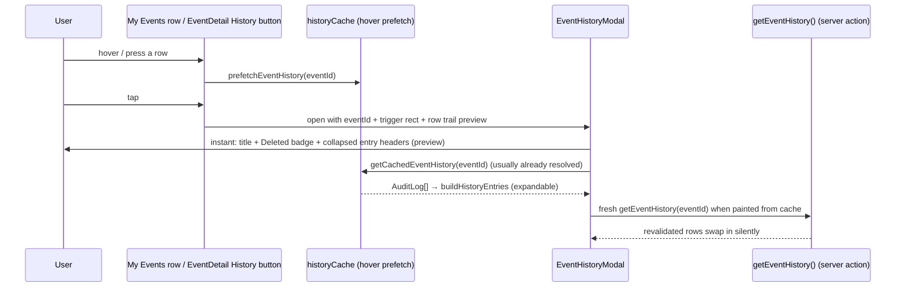
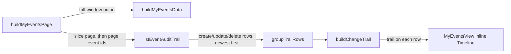

# 1. Event history & My Events

Two read-only surfaces over the event rows already written to `audit_logs`:
a **per-event history modal** (create / every edit / delete, keyed by the
logical event's group id) and **My Events** (the signed-in user's own created
events, including those since deleted). Both are self-service — no admin role
required — and both reuse the audit-log write path, the `formatAuditDetails`
display layer, and this repo's skeleton-only loading pattern. Nothing new is
recorded; this document covers how the existing rows are read, authorized,
rendered, and kept fresh.

## Table of contents

- [1.1 Problem](#11-problem)
- [1.2 Data source](#12-data-source)
- [1.3 Per-event history modal](#13-per-event-history-modal)
- [1.4 My Events page](#14-my-events-page)
  - [1.4.1 Inline change timeline](#141-inline-change-timeline)
  - [1.4.2 Load performance](#142-load-performance)
  - [1.4.3 Shared range vocabulary](#143-shared-range-vocabulary)
- [1.5 Authorization & privacy](#15-authorization--privacy)
- [1.6 Retention](#16-retention)
- [1.7 Read layer & the event-id index](#17-read-layer--the-event-id-index)
- [1.8 Always-fresh caching](#18-always-fresh-caching)
- [1.9 Navigation & the footer overflow](#19-navigation--the-footer-overflow)
- [1.10 Pure helpers & testing](#110-pure-helpers--testing)
- [1.11 File index & related docs](#111-file-index--related-docs)

## 1.1 Problem

Users asked to see what changed on their events, and to keep track of events they
created after those events are deleted. The data already existed: every
create/update/delete writes an `audit_logs` row with the actor, a timestamp, the
event's group id, and — for edits — a before→after `FieldDiff`
([`audit-log.md`](audit-log.md), [`event-mutations.md`](event-mutations.md) §1.8).
But it only surfaced in the admin-only audit log as a flat stream; there was no
per-event view and no per-user view. The gap is a read/UI gap, not an
instrumentation gap, so the design is deliberately a thin read layer over the
audit rows plus one modal and one page.

## 1.2 Data source

Event mutations are the only writer, and they already stamp everything needed
([`event-mutations.md`](event-mutations.md) §1.8):

- The **group id** (`eventId`) is minted at create and written into `details` on
  every `event.create` / `event.update` / `event.delete` row. All copies of a
  logical event share it, so the group id is the natural history key.
- The **actor** (name + role snapshotted, id `ON DELETE SET NULL`) identifies who
  created the event — the organizer is fixed at create, so the create actor
  *is* the organizer.
- `details` carries a human-readable snapshot (rendered title, pre-formatted UTC+8
  `time`, departments, invitees, creator, …); an edit row carries a `FieldDiff`.

`parseEventPeople(...).eventId` on the read path (the `CalendarEventPayload.eventId`
the dashboard already ships) is what the event modal hands to the history modal.

## 1.3 Per-event history modal

`EventHistoryModal` (`src/components/EventHistoryModal.tsx`) is a read-only
changelog of one logical event, opened in place — there is no history route.
It is built to **feel instant**: a My Events row already carries the event's
trail, so the modal paints that immediately and revalidates underneath:



- **Entry points:** tapping a **My Events row**, and the **History button** in
  `EventDetail`'s editable action row (stacked above the event modal with
  `zIndex={300}`). The History button is hidden when `payload.eventId === null`
  (external or never-app-edited legacy events have no group id and no history)
  and is not shown in the read-only details (Double Booking / KAH Status).
  The modal is `keepMounted` in **`keepMountedMode="display-none"`**: it can be
  hosted from inside the event detail body, and a nested portaled dialog must not
  be hidden with React 19 `<Activity>` (that cancels its exit transition and strands
  its overlay above later modals — [`event-lifecycle.md`](event-lifecycle.md) §1.4.4).
- **Perceived-latency design:** rows prefetch on `onMouseEnter`/`onPointerDown`
  into a session-lifetime `Map` (`src/lib/events/historyCache.ts`, cleared on
  sign-out so the next account never paints the previous user's history), so
  the tap usually opens from cache. A My Events row also passes its inline trail as a
  `preview` — the modal renders the real title, **Deleted** badge, and entry
  headers **before any fetch resolves**; the fetched
  entries (identical headers, now expandable) swap in silently. The shaped
  `EventHistorySkeleton` (rail bullets + lines, so the reveal moves nothing) only
  shows on the cold no-preview path (the dashboard
  History button, which still passes the event `title` for an instant header).
  A failed fetch is only surfaced when there is no preview to keep, and a
  successful (re)load clears the error line. (The generalized
  recipe: [`loading-transitions.md`](loading-transitions.md) §1.18.)
- **List shape matches the trail:** `buildHistoryEntries`
  (`src/lib/events/changeTrail.ts`) applies the same collapse as the inline
  timeline — same-minute per-copy fan-out merged into one entry,
  `event.participantNotify` rows dropped — so preview and final list are
  identical and the swap never reflows. (The admin audit stream still shows
  every raw row; the modal is deliberately the cleaner changelog.)
- **Form factor:** below `lg` the modal is a **full-height sheet** (`fullScreen`),
  because reading a trail is the only task on the screen — a scrolling card
  floating inside a scrolling page is how you get two scrollbars to aim. At `lg`+
  it is a centered dialog (`size="lg"`) that grows out of the tapped row
  (`modalZoomTransitionProps`); the sheet fades in instead, having no trigger
  rect to grow from.
- **One scroller:** Mantine's `Modal.Header` is already sticky, so the event's
  name stays put while the trail scrolls beneath it. Nothing inside the body
  scrolls — `AuditDetails` deliberately has **no** scroll container of its own
  (the JSON fallback wraps and clamps with an explicit **Show more** instead),
  which also removed the nested pane from the admin audit-log detail modal.
- **Header:** an "Event history" eyebrow over the newest row's `entity_name`
  (the rendered title at that edit), falling back to the create snapshot's
  title, then the preview/`title` prop; a red **Deleted** badge beside it when
  the newest entry is a delete. The title ellipsizes rather than wrapping so the
  sticky header keeps one height.
- **Entries:** `EventHistoryEntries` (`src/components/EventHistoryEntries.tsx`)
  renders a **vertical rail** (`ul.c2-hist` in `globals.css`): a bullet per
  change, joined by one hairline, newest first. What the reader scans is always
  on the surface — an action chip (brand = Created, accent = Edited, red =
  Deleted), the coarse relative age, the actor **and** the absolute UTC+8 stamp
  (no hover-to-discover), and the changed-field names as chips. Only the
  before→after diff folds away behind a disclosure, and only when there is a diff
  worth reading; an **Expand all / Collapse all** control appears once two or
  more entries are expandable. Preview items (no `details` yet) render the same
  head without the disclosure, so the swap reflows nothing.
- **Curated details:** the modal reads each row through
  `formatAuditDetails(details, { omitKeys: EVENT_HISTORY_OMIT_KEYS, dropEmpty:
  true, includeAfter: false })` (`src/lib/audit/format.ts`). Omitted: the
  identifiers an operator chases but the reader cannot act on (`eventId`,
  `googleEventIds`, `googleCalendarId`, `target/added/removedCalendarIds`) and —
  most importantly — `title`, which is the **rendered** Google Calendar title: a
  derived value that changes as a consequence of an edit rather than being one,
  and already the modal's own heading. Empty snapshot fields are dropped, and
  the "Resulting state" dump (which repeats every field the edit did not touch)
  is not shown. The admin audit log passes **no** options and stays forensic.
  `hasAuditDetails` then tells the rail whether the entry is worth expanding at
  all, so an edit that only moved derived values shows no disclosure.
- **Coverage note:** the trail read is bounded by audit **retention**, not by the
  My Events date window, so a missing `Created` entry means the row was pruned —
  widening the range would not bring it back. `historyCoverageNote`
  (`src/lib/events/changeTrail.ts`) returns null when a `Created` entry is on
  screen and otherwise one line explaining that, rendered as a footnote under the
  rail. It replaces the always-on "Changes are tracked for N days" line, which
  stated a setting the reader cannot change even when nothing was missing.
- **Footer action — Open in calendar:** when the caller passes a `detailLink`
  (the shared `?event=` dashboard deep link, `buildEventDeepLink` — the My
  Events rows always do; the `EventDetail` History button only **off** the
  calendar page, since on `/dashboard` the details modal is already open behind
  the history modal and there is nothing to navigate to), the footer offers
  **Open in calendar**, the same button recipe as the read-only detail's action
  (`docs/user-clashes.md`): it closes the modal and navigates, and the deep link
  opens the event's details on the calendar page regardless of the active tab's
  filters (`_eventCal` names the copy's calendar). A **Deleted** event keeps the
  button visible but **disabled** with a tooltip — its copies are gone, so the
  link could not resolve.
- Closing returns to whatever opened the modal (no back button, no route).

## 1.4 My Events page

`/my-events` lists the events the signed-in user organized, last-edit first
(newest recorded edit on top), over an adjustable **±-months window** (default
**±1**; `±1 / ±6 / ±12`, selected with the shared `TimeRangeSelect`
(`src/components/TimeRangeSelect.tsx` — the same control the KAH Status and
Double Booking pages use, [`desktop-responsive.md`](desktop-responsive.md) §1.11)
and reflected in `?range=`). The three values and the window arithmetic are the
app-wide vocabulary in `src/lib/dateRange/monthRange.ts` (see §1.4.3); an
unrecognized or legacy `?range=3` falls back to the default rather than erroring.

**Changing the range applies immediately, in place.** It used to be a
`router.push` to a new `?range=`, which meant a full RSC round-trip behind a
route skeleton for what reads as a filter — the page's most common action felt
like navigation. The view now keeps the selection in state, paints the new
window on the control at once, and calls `getMyEventsPage`
(`src/lib/events/myEventsActions.ts`, a `"use server"` action) inside
`useTransition`: the control stays interactive-but-inert, the list skeleton
covers the swap, the URL is rewritten with `history.replaceState` (so a reload or
share still lands on the same window + page), and a failed load reverts to the
previous selection with a red toast. A request token makes the last click win
when several ranges are chosen in a row. `?range=`/`?page=` remain the server's
input on a cold load, parsed by the thin `page.tsx` shell.

**A title search rides the same rails.** The sticky chrome carries a search box
(docs/ui-ux-improvements.md C4): the dashboard event-name filter's semantics
(case-insensitive substring, `filterMyEventRowsByTitle` in
`src/lib/events/myEvents.ts` over `textFilter.ts`), applied **server-side**
inside `buildMyEventsPage` before the page slice — paging is server-side, so a
client-only filter would silently miss rows on other pages. The box debounces
300 ms, resets to page 1, and mirrors the term in `?q=` with the same
`history.replaceState` rule as `?range=`/`?page=` (reload/share keep the
search; the always-fresh adoption gate compares all three).

It is a **union of two sources** (`buildMyEventsData`,
`src/lib/events/myEventsData.ts`):

- **Live** events where `payload.creatorId === me`, read across every department
  calendar over the window. The organizer is stored *on the event* (the notes
  `createdBy`), not just on the audit actor — so this catches events created
  "on behalf of" a user and events older than audit retention.
- **Deleted** events, from the user's own `event.create` rows that have a paired
  `event.delete` row (`latestDeleteTimes`) and are not still live, range-filtered
  by the leading `YYYY-MM-DD` of the snapshot `time`. Shown with a red **Deleted**
  badge. Because live reads can't see deleted events, this is what makes deleted
  events trackable (within audit retention).

Rows are deduped by group id (live wins) and sorted **last-edit first**
(`mergeMyEvents`): a live row orders by the newest `created_at` of its audit rows
(`latestEventEditTimes` — every `entity_type='calendar'` row carrying the event
id, i.e. `event.create`/`event.update`/`event.delete` plus the same-minute
`event.participantNotify` side-effect rows), a deleted row by its `event.delete`
time (`latestDeleteTimes`). Rows with no recorded audit
rows (older than any remaining audit history, or edited directly in Google
Calendar) fall back to the event's start time; ties break on start (newest first),
then key. Tapping a row opens the history modal (§1.3); legacy rows with no group
id are inert. Each row with a group id also carries a trailing **Open in
calendar** action icon — a sibling of the tap target (never nested in it) — that
pushes the shared `?event=` deep link built from the row's `sortKey` +
`calendarId` (the live copy's calendar; audit-only rows have none); deleted rows
keep the icon **disabled** with a tooltip, since their copies no longer exist to
open. Pagination is `?page=` (page size 20, `MY_EVENTS_PAGE_SIZE`),
applied in memory since the combined set is bounded by the window + retention;
`buildMyEventsPage` runs the union, the slice, and the trail read as one call and
stamps `renderedAt` **after** the build (stamping at the start would make every
cold render look like a stale cache replay to §1.8's freshness gate).

Rows render in the shared one-line row style (the EventSearchModal list recipe,
`docs/event-search.md`): one bordered container of 1px-separated rows, each a
4px accent bar (`--mantine-color-<color>-filled`) + truncated title + one dim
meta line (`time · departments`). The bar color is the event's read-time color
(`CalendarEvent.color` for live rows; `gray` for audit rows); **Deleted** rows
always ride a red bar and keep a small inline red
`Deleted` badge. Times are humanized for display (`humanizeMyEventTime`:
`21 Aug · 14:00 – 15:30`, year only off the current year, same-month all-day
spans collapse) while `sortKey` stays the naive `YYYY-MM-DD HH:mm` — live
all-day rows normalize to `00:00` so live/deleted all-day events interleave
consistently within a day. The ordering itself uses the row's `editKey` (the
naive `YYYY-MM-DD HH:mm` of the last recorded edit — the audit row's
`created_at` formatted in the app's UTC+8) and falls back to `sortKey` when the
event has no audit history.

### 1.4.1 Inline change timeline

Every row carries a compact **change timeline** (Mantine `Timeline`) that shows
*when* each change was made, so the list answers "what happened to this event"
without opening the history modal.



- **Data:** one indexed read per page. `listEventAuditTrail(eventIds, retentionDays)`
  (`src/lib/audit/queries.ts`) fetches every `event.create` / `event.update` /
  `event.delete` row of the events on the current page — never the
  `event.participantNotify` side-effects — newest first, within the retention
  window (same `details->>'eventId'` expression index as the other event reads).
  `buildMyEventsPage` attaches the shaped trail to each row after slicing, so the
  read is bounded by the page size, not the window.
- **Shaping:** `buildChangeTrail` (`src/lib/events/changeTrail.ts`, pure +
  unit-tested) collapses the per-copy fan-out — a cross-department mutation
  writes one audit row *per calendar copy*, so rows sharing an action and the
  same minute become one item (the same minute-precision convention
  `latestEventEditTimes` ordering relies on). The full trail renders inline
  (no cap); rows grow with their trail length.
- **Display:** one `Timeline.Item` per change (`ChangeTrailTimeline` in
  `MyEventsView.tsx`) — a colored bullet (brand = Created, accent = Edited,
  red = Deleted), the action label, a coarse relative age ("3 days ago", pure
  `relativeChangeLabel`) with the absolute UTC+8 stamp on hover/focus, the
   actor, and the changed-field labels for an edit (the shared `changeSummary`
   from `audit/format.ts`, now also used by the history modal). The
   skeleton paints matching bullet + line placeholders so the reveal doesn't
   reflow. Rows with no audit rows left (legacy, Google-edited, or outside
   retention) render exactly as before — no empty-trail noise.
- The trail items themselves are non-interactive; tapping the row opens the
  history modal (§1.3) for the full before→after diffs.

### 1.4.2 Load performance

My Events is the one page that reads **every** department calendar across the **whole**
±window (3 months at the default ±1, 13 at ±6, 25 at ±12), so it was disproportionately slow: the union's live
half paid a blocking Google fan-out and a heavy per-event parse on every visit. Five
changes fixed it (measured on `next dev` against the real Neon pooler + Google, 4
calendars; costs scale linearly with calendars × months):

| Scenario (cache rows older than the 30-min expire) | Before | After |
| -------------------------------------------------- | ------ | ----- |
| ±3 build (28 → 16 blocking `events.list` calls)    | 6.64s  | **3.89s** |
| ±12 build (100 → 52 blocking `events.list` calls)  | 14.09s | **9.57s** |
| Warm build (L1 hit, same session)                  | ~5ms   | ~21ms (end-to-end incl. audit reads) |
| Projection CPU (42 items × 3 runs)                 | 212ms  | **29ms** |

1. **Parse the notes block once per event.** `mapCalendarItem`
   (`src/lib/events/queries.ts`) previously called a dozen-plus `parseEventX(description)`
   helpers, each of which brotli-decompressed and JSON-parsed the *same* description. It now
   calls `parseEventDescription(description)` (`src/lib/events/notes.ts`) once and reads
   every field off the one parsed result — a ~7× cut in projection CPU, largest for orgs
   with many events. The single-field `parseEventX` helpers remain for one-field callers.
2. **Serve past months from cache for 24 h.** `buildMyEventsData` passes a per-month
   freshness override into the events cache (`freshnessFor`): months strictly before the
   current month are served without a blocking Google fetch or a background refresh until
   they hard-expire at 24 h. In-app edits still invalidate the row (read-your-writes
   unchanged); only external Google edits to past months converge slower. Current + future
   months keep the default 30-min budget, so the cold ±12 residual is those months —
   widening them is a one-constant change to `myEventsFreshnessFor` if ever justified.
   Details: [`events-cache.md`](events-cache.md) §1.7.1.
3. **Filter the organizer inside the projection.** `fetchRangeEvents`/`projectRangeEvents`
   accept `creatorFilter`; My Events passes its own user id, so events the user did not
   create never build a `CalendarEvent` payload (the window spans every calendar).
4. **Cheaper audit read + a cold-refresh pool.** `listMyCreatedEvents` projects only
   `{ id, createdAt, details }` and is served by a new composite index
   (`audit_logs_actor_action_created_idx`, migration `0072`); the cache's cold Google refresh
   now runs one flat pool across all pending `(month, calendar)` pairs instead of a
   sequential month loop.
5. **Pre-filter at the cache row, not just the projection.** The organizer lives inside the
   compressed notes, so filtering in JS still meant **shipping** every calendar-month payload
   in the window — the page's Neon egress grew with calendars × months. The cache now records
   the distinct organizers of each `(calendar, month)` payload in
   `google_event_cache_creators` (`collectCreatorIds`, written in the same transaction as the
   payload), and `readCalendarRange({ creatorFilter })` consults that index first: only rows
   that can contain the user's events are fetched, and rows written before the index existed
   (`creator_indexed = false`) are fetched conservatively until their next refresh. The read
   also skips the adjacent-month prefetch, since My Events is not a navigation surface. The
   organizer filter inside the projection (item 3) stays as the final guard.
   Details: [`neon-usage.md`](neon-usage.md).

`src/lib/perf.ts` (`PERF_LOG=1`) prints per-stage timings (`gcalCache …`,
`buildMyEventsData …`) for re-measuring without a profiler. The always-fresh contract
(§1.8) is unchanged — none of this caches the *document*, only the server-side event read.

**Perceived latency.** Because the route is always-fresh, even the improved cold build
lands with no stale-document replay in front of it, so two UX layers cover the residual
wait: `/my-events` joins the idle nav preload (Parade State / Contacts / Double Booking,
[`loading-transitions.md`](loading-transitions.md) §1.15) so the first visit per session
paints from the router cache (the always-fresh re-read still fires on the warm payload),
and the list skeleton wears the shared **wait overlay** — breathing app icon over
rotating "calendar archaeology" copy + a slower tip ticker, revealing only after 300 ms
so warm loads never flash it (shared `WaitOverlay` + `waitCopy.ts`, §1.4.1 of that doc).
Decorative and honest: no fake progress bars; the sr-only `LoadingStatus` stays the only
announcement. The wait overlay is a **cold-load** affordance only: a range change is an
in-place refetch (§1.4), so it shows the list skeleton, never this card.

### 1.4.3 Shared range vocabulary

Every date-range control in the app picks from the same three widths — **1 month,
6 months, 1 year** — so one dropdown's meaning never changes between pages. The
vocabulary lives in `src/lib/dateRange/monthRange.ts` (client-safe, pure,
unit-tested): `RANGE_MONTHS`, `RangeMonths`, `isRangeMonths`, `parseRangeMonths`,
`rangeMonthsLabel`, and the two window shapes — `forwardWindow(today, months)`
(today → last day of the month N months out) for look-aheads, and
`symmetricWindow(today, months)` (first day of the month N back → last day of the
month N forward) for look-back lists.

Each page keeps a thin wrapper that fixes its own style, default, and copy:

| Page | Wrapper | Style | Default |
| ---- | ------- | ----- | ------- |
| My Events | `src/lib/events/myEventsRange.ts` | symmetric | ±1 month |
| KAH Status | `src/lib/kah/range.ts` | forward | 1 month |
| Double Booking | `src/lib/events/clashRange.ts` | forward | 1 month |

Only My Events puts the range in the URL (`?range=`), because its list is the
page; KAH Status and Double Booking keep the look-ahead as a per-view client
choice that never becomes a shareable route. Dropping the old ±3 option means an
older `?range=3` link resolves to the default — silently, which is what a
narrower vocabulary should do.

The default is **one month** everywhere: the wider windows were rarely chosen and
made the common question ("what's on my calendar / where am I double-booked this
month?") require a deliberate narrowing first. Where a month is genuinely too
narrow to answer it, the Double Booking strip switches to one cell per month
([`user-clashes.md`](user-clashes.md) §1.3.1).

## 1.5 Authorization & privacy

Both surfaces are open to **any signed-in user** (`requireSession()`), matching how
events are already viewable: the dashboard lets any authenticated user select any
department calendar, and `user_calendar_access` never gates dashboard reads
([`roster-sharing.md`](roster-sharing.md) §1.5). So "who can see this event's
history" is "who can see the event" — no separate ACL.

Privacy notes:

- **Every viewer only sees their own events** on `/my-events` (the live read is
  filtered by `payload.creatorId === me`; the audit read by `actor_id = me`); the
  history modal is open to any signed-in user for any event, consistent with
  event visibility.
- **Hidden-invitee event types** leak nothing: `resolveEffectiveInput` strips
  hidden attendees *before* any snapshot is built, so an audit row already contains
  only the effective (post-policy) participant set. The one residual case — an
  admin later disabling `showInvitees` — leaves older rows listing invitees that
  were public when written; that is historical truth, and history is not rewritten.
- The shared `Admin` pseudo-account's creations (no `actor_id`) are intentionally
  excluded from `/my-events`.

## 1.6 Retention

History is bounded by `settings.audit_log_retention_days` (default 90, clamp
7–365, [`audit-log.md`](audit-log.md) §1.4). Both reads apply the window **as a
filter** (`created_at >= now - N days`); they never purge — only the audit-log page
rotates on read. Rows older than the window simply don't appear.

## 1.7 Read layer & the event-id index

Both features filter the jsonb expression `details->>'eventId'`. Event audit rows
store the group id there, **not** in `entity_id` (which holds the calendar id), so
no pre-existing index covers it. `audit_logs_event_id_idx` is a plain expression
index (`drizzle/0056_charming_blue_marvel.sql`):

```sql
CREATE INDEX "audit_logs_event_id_idx" ON "audit_logs" USING btree ((details->>'eventId'));
```

Reads in `src/lib/audit/queries.ts`:

| Function | Query |
| -------- | ----- |
| `listEventHistory(eventId, retentionDays)` | `entity_type='calendar' AND details->>'eventId'=$1` (+ window), `order by created_at asc, id asc` |
| `listMyCreatedEvents(userId)` | `action='event.create' AND actor_id=$1`, `order by created_at desc, id desc`, projecting `{id, created_at, details}` (deleted candidates; served by `audit_logs_actor_action_created_idx`; not retention-bounded — a deleted event stays listed while its delete row exists) |
| `latestDeleteTimes(eventIds)` | `max(created_at)` per `details->>'eventId'` from `action='event.delete'` for the given ids (key set = deleted ids) |
| `latestEventEditTimes(eventIds)` | `max(created_at)` per `details->>'eventId'` from `entity_type='calendar'` for the given ids — every calendar row with the event id (create/update/delete + same-minute `event.participantNotify` side-effects); last in-app edit; no retention window, like its siblings |

`buildMyEventsData` (`src/lib/events/myEventsData.ts`) combines the live
`fetchRangeEvents` read (organizer = the user) with those audit reads into one
shaped, sorted list.

## 1.8 Always-fresh caching

`/my-events` is **always-fresh** — in `ALWAYS_FRESH_PREFIXES` in
`src/lib/pwa/swRules.ts`, so its document/RSC payloads are never served from the
SWR caches (audit rows change with every event mutation anywhere). The server
page stamps `renderedAt` (epoch ms) into the payload and the client view gates
on `useLiveRouteRefresh(renderedAt)`, forcing one in-place re-read when the
mounted payload is a cache replay ([`audit-log.md`](audit-log.md) §1.10,
[`loading-transitions.md`](loading-transitions.md)). The in-place range/page
refetch (§1.4) carries the same `renderedAt` in the action's payload and is
subject to the same gate, so a replayed action response is refetched exactly like
a replayed document. The header **Force
refresh** already routes always-fresh paths through `LIVE_REFRESH_EVENT`
(`AppShellShell`). Consequence: like the audit log, the page is unavailable
offline. The history modal needs no route entry — its rows come from a server
action invoked on every open, which never reads the SWR caches.

## 1.9 Navigation & the footer "More" menu

**My Events** is a global nav entry (`/my-events`), shown to every role. On the
desktop sidebar (≥ `lg`) every entry is listed directly. The **mobile footer** keeps
only the four primary tiles (Calendar, Parade State, Contacts, Double Booking) plus
a **More** tile that opens a `Menu` popup (the profile-menu pattern, animated with
the shared `pop-top-right` / `MOTION.popover` transition) holding the
rest — My Events, KAH Status (when visible), and Settings (admin). `NavRouteWarmer`
preloads the new route.

## 1.10 Pure helpers & testing

| Helper | Module | Tests |
| ------ | ------ | ----- |
| `eventIdFromAuditDetails`, `createdEventSummary` | `events/history.ts` | `events/history.test.ts` |
| `formatMyEventTime`, `auditTimeSortKey`, `humanizeMyEventTime`, `mergeMyEvents` | `events/myEvents.ts` | `events/myEvents.test.ts` |
| `relativeChangeLabel`, `buildChangeTrail`, `buildHistoryEntries`, `groupTrailRows`, `historyCoverageNote` | `events/changeTrail.ts` | `events/changeTrail.test.ts` |
| `isRangeMonths`, `parseRangeMonths`, `rangeMonthsLabel`, `forwardWindow`, `symmetricWindow` | `dateRange/monthRange.ts` | `dateRange/monthRange.test.ts` |
| `parseMyEventsRange`, `myEventsRangeLabel`, `myEventsWindow` | `events/myEventsRange.ts` | `events/myEventsRange.test.ts` |
| `parseUserClashAhead`, `userClashWindow` | `events/clashRange.ts` | `events/clashRange.test.ts` |
| `formatAuditDetails`, `hasAuditDetails`, `actionLabel`, `actorLabel`, `changeSummary`, `formatLogTimestamp` | `audit/format.ts` | `audit/format.test.ts` |
| `isAlwaysFreshPath` (the new prefixes) | `pwa/swRules.ts` | `pwa/swRules.test.ts` |

I/O-bound (not unit-tested, per the repo convention): the `queries.ts` read
functions, `buildMyEventsData`, the My Events route page, and the client views
(including the history modal and its server action).

## 1.11 File index & related docs

| File | Role |
| ---- | ---- |
| `src/components/EventHistoryModal.tsx` | Shared history modal (full-height sheet below `lg`, centered dialog above; sticky header carries the event name) |
| `src/components/EventHistoryEntries.tsx` | Shared changelog rail (always-visible facts + curated expandable diff) |
| `src/components/EventHistorySkeleton.tsx` | Shared shaped skeleton (rail bullets + lines) |
| `src/lib/events/historyActions.ts` | `getEventHistory` server action |
| `src/lib/events/historyCache.ts` | Hover-prefetch + open cache (session lifetime; cleared on sign-out) |
| `src/app/(protected)/my-events/page.tsx` | Thin server shell (`?range` / `?page` / `?q` → `buildMyEventsPage`) |
| `src/lib/events/myEventsActions.ts` | `getMyEventsPage` server action — the in-place range/page/search refetch (§1.4) |
| `src/app/(protected)/my-events/MyEventsView.tsx` | Client view + range selector + title search + pagination + inline trail |
| `src/components/TimeRangeSelect.tsx` | Shared month-range menu (My Events range; KAH Status + Double Booking look-ahead) |
| `src/components/AuditDetails.tsx` | Shared `details` renderer (audit log + history); no inner scroll, options curate the history view |
| `src/app/(protected)/dashboard/EventDetail.tsx` | The History button (opens the modal at `zIndex={300}`) |
| `src/lib/audit/queries.ts` | `listEventHistory`, `listMyCreatedEvents`, `latestDeleteTimes`, `latestEventEditTimes`, `listEventAuditTrail` |
| `src/lib/events/myEventsData.ts` | My Events union builder (live + audit) + `buildMyEventsPage` (union → search → page → trail); past-month freshness + creator filter (§1.4.2) |
| `src/lib/events/history.ts` | Pure snapshot parsers (unit-tested) |
| `src/lib/events/changeTrail.ts` | Pure inline change-timeline shaping + coverage note (unit-tested) |
| `src/lib/events/myEvents.ts` / `myEventsRange.ts` / `clashRange.ts` | Pure list shaping (incl. `filterMyEventRowsByTitle`, §1.4) + per-page range wrappers (unit-tested) |
| `src/lib/dateRange/monthRange.ts` | The app-wide 1/6/12-month vocabulary and window arithmetic (§1.4.3) |
| `src/lib/perf.ts` | `PERF_LOG=1` per-stage timing helper for re-measuring the read path (§1.4.2) |
| `src/components/WaitOverlay.tsx` + `src/lib/loading/waitCopy.ts` | Shared wait overlay (rotating copy, tips) on the list skeleton covering the always-fresh build's residual wait (§1.4.2) |
| `src/db/schema.ts` + `drizzle/0056_charming_blue_marvel.sql` | `audit_logs_event_id_idx` |
| `src/db/schema.ts` + `drizzle/0072_steady_brother_voodoo.sql` | `audit_logs_actor_action_created_idx` (My Events create read, §1.4.2) |
| `src/db/schema.ts` + `drizzle/0073_melted_baron_zemo.sql` | `google_event_cache_creators` + `google_event_cache.payload` / `creator_indexed` (organizer row pre-filter, §1.4.2) |
| `src/lib/google/eventsCacheCreators.ts` | `collectCreatorIds` — distinct, UUID-valid organizers of one cached month (unit-tested) |
| `src/components/AppShellShell.tsx` | My Events nav entry + footer More `Menu` |
| `src/lib/pwa/swRules.ts` | Always-fresh prefixes |

Related docs:

- [`audit-log.md`](audit-log.md) — the table, write path, `details` shapes, display
  formatting, retention.
- [`event-mutations.md`](event-mutations.md) — the create/update/delete rows and
  their snapshots.
- [`event-lifecycle.md`](event-lifecycle.md) — what an event is (group id, notes).
- [`roster-sharing.md`](roster-sharing.md) — why reads are not ACL-gated.
- [`loading-transitions.md`](loading-transitions.md) — skeleton-only loading and the
  always-fresh re-read pattern.
