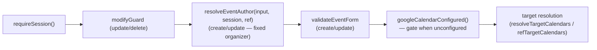
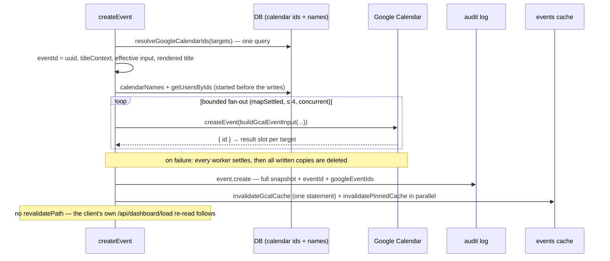
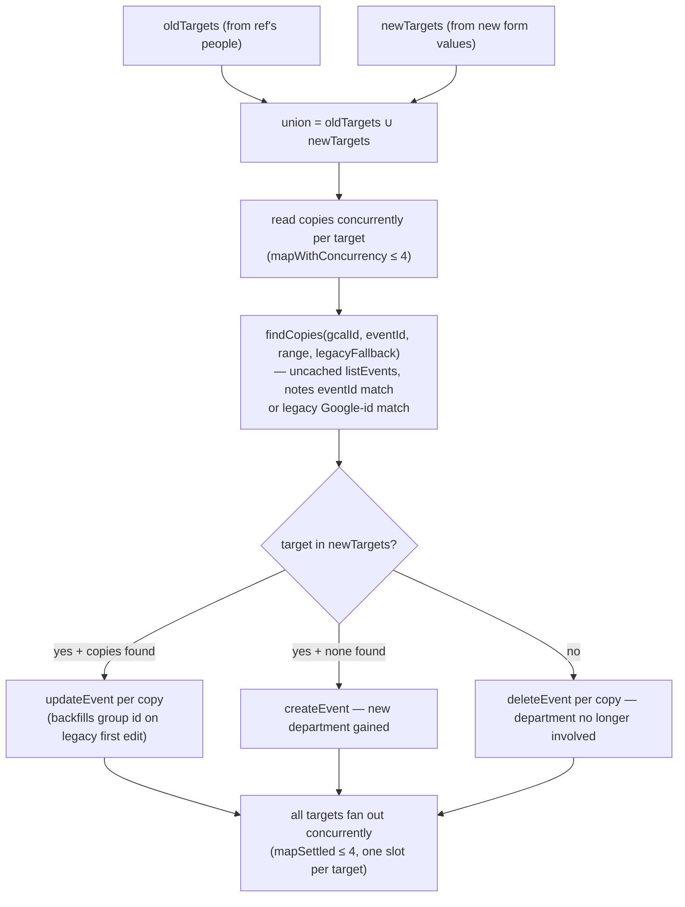

# 1. Event mutations: cross-department copies

The create/update/delete server actions in `src/lib/events/actions.ts` keep one
**logical event** — possibly spanning several department calendars — consistent in
Google Calendar: copies are created, updated, retired, and rolled back so that a
failure never leaves orphan or stale copies behind. This document covers the three
actions, the copy-reconciliation algorithm, failure semantics, and how each mutation
integrates with the audit log and the month cache. What an event _is_ (notes block,
title, location, time options) is covered in
[`event-lifecycle.md`](event-lifecycle.md); what happens to the cached month read is
covered in [`events-cache.md`](events-cache.md).

## Table of contents

- [1.1 Problem](#11-problem)
- [1.2 Identity & the group id](#12-identity--the-group-id)
- [1.3 Shared prelude (all three actions)](#13-shared-prelude-all-three-actions)
- [1.4 createEvent](#14-createevent)
- [1.5 updateEvent — reconciling copies](#15-updateevent--reconciling-copies)
- [1.6 deleteEvent](#16-deleteevent)
- [1.7 Failure semantics](#17-failure-semantics)
- [1.8 Audit integration](#18-audit-integration)
- [1.9 Cache invalidation & revalidation](#19-cache-invalidation--revalidation)
- [1.10 Pure helpers & testing](#110-pure-helpers--testing)
- [1.11 Registration mutations](#111-registration-mutations)
- [1.12 Write-path concurrency (measured)](#112-write-path-concurrency-measured)
- [1.13 File index & related docs](#113-file-index--related-docs)

## 1.1 Problem

Every department is a Google Calendar, and an event involving several departments must
appear in each of them so each department's people see it. The complications:

- **No foreign keys across calendars**: the copies are independent Google events; the
  only link is the group id written into each copy's notes (`eventId`,
  [`event-lifecycle.md` §1.7.1](event-lifecycle.md#171-fields-eventnotes-srclibeventsnotests19)).
- **Google is not a local database**: there is no transaction. A multi-calendar write
  can fail halfway, and the app must define what a half-finished mutation means.
- **Legacy events** created before the copies feature have no group id and may exist in
  a single calendar; the first edit or delete must still find and adopt them.
- **Reads go through a cache** ([`events-cache.md`](events-cache.md)), so after a
  mutation the app must invalidate exactly the affected calendar×month keys.

The design answers: an **idempotent reconcile plan** (create missing copies, update
present ones, delete retired ones) with **rollback of only the copies this run
created**, so a retry self-heals a half-failed attempt.

## 1.2 Identity & the group id

- On **create**, `createEvent` mints `eventId = crypto.randomUUID()`
  (`actions.ts`) and writes it into every copy's notes.
- All copies of a logical event therefore share the same `eventId`;
  `parseEventPeople(item.description).eventId` is how a copy is recognized
  (`actions.ts`).
- **Legacy events** (no group id) are found differently: `legacyFallback(ref)`
  (`actions.ts`) resolves the representative copy's registry calendar to its Google
  id and matches **by Google event id** within the search range. On the first edit of a
  legacy event, `updateEvent` mints a group id (`ref.eventId ?? crypto.randomUUID()`,
  `actions.ts`) and backfills it into the copies it writes.
- For **display**, the read path collapses the copies: `dedupeEventsByGroupId`
  (`targets.ts`) keeps the first copy per group id (legacy events always pass), fed
  in deterministic calendar-name order.
- `EventRef` (`targets.ts`) is the unit of identity an edit/delete operates on: one
  representative copy plus its people fields, which define the target set.

## 1.3 Shared prelude (all three actions)

All actions are `"use server"` and follow the same opening sequence (create/update/delete in `actions.ts`):

- **Guards** (`events/guards.ts`): `modifyGuard` opens edit/delete/duplicate to the
  organizer, tagged attendees, and active members of tagged departments — unless the
  organizer set the `ownerOnlyEdits` lock (only the organizer, or an admin who always
  bypasses). Creator-less, people-less legacy/external events are admin-only. Create
  needs no guard: the organizer is always the acting session user (there is no admin
  "on behalf of"), and an edit keeps the stored organizer (see
  [`event-lifecycle.md` §1.5](event-lifecycle.md#15-guards--validation)).
- **Validation** (`events/validate.ts`): required fields, AM/PM for `half` events, and
  chronological order. On failure the action returns
  `{ ok: false, error, field }` with the _first_ failing field so the form can jump to
  the owning step. Separately, both create and update refuse an event whose _effective_
  attendees and tagged departments are both empty ("Add at least one participant or
  department", no `field`) — such an event would occupy no one.
- **Google gate**: without service-account credentials the actions refuse with
  "Google Calendar is not configured" (the stub integration would otherwise "succeed"
  and audit-log phantom events).
- **Server re-normalization** (create, update):
  `resolveEventFields(resolveEventLocation(resolveEventTime(input, ctx), ctx), ctx)`
  clamps the time option, the location category, and hidden fields to the type's
  allowed set — a type with remarks disabled clears the description, a type with
  invitees disabled drops every attendee beyond the creator. Target calendars are
  derived from this _effective_ input (`resolveTargetCalendars(effectiveInput)`), so a
  hidden-attendee type only ever lands in the creator's department — and re-saving an
  existing event of such a type removes its other departments' copies. The same pure
  helpers the form uses, so a stale or tampered form can't submit an out-of-policy
  combination.
- **Result type**: `EventActionResult = { ok: true } | { ok: false; error: string;
field?: EventResultField }` (`actions.ts`) — actions never throw for expected
  failures; the client maps the error back onto the wizard.

## 1.4 createEvent

`createEvent(input)` (`actions.ts`):

- **Fan-out**: every target copy is an independent Google write, so they are created
  concurrently under `GOOGLE_WRITE_CONCURRENCY` (4) via `mapSettled` (`src/lib/async.ts`).
  A three-department create therefore costs roughly one Google write rather than three:
  measured 1.5 s vs 1.1 s for one department, where a serial loop would be ~3×
  (`tasks/responsiveness-plan.md`). `mapSettled` deliberately keeps running every worker
  after a failure so the rollback below sees **all** written copies.
- **Target resolution** (`resolveTargetCalendars`, `writeContext.ts`): each invitee
  user's department + each tagged department, deduped. The organizer's home department
  is included only when the organizer is a participant (or as a fallback when no
  participant carries a department). When nothing derives, create fails with "Assign
  yourself to a department or tag an invitee" (there is no fallback calendar for a
  brand-new event).
- **Per-target input**: `buildGcalEventInput` (`actions.ts`) renders the title
  (`renderEventTitle`), assembles the description (`Edit:` link — a `?event=` details
  deep link carrying the copy's own calendar id — + brotli notes block + internal
  marker, [`event-lifecycle.md` §1.7.3](event-lifecycle.md#173-description-assembly--markers)),
  converts the range via `absEventRange`, and puts the location in Google's first-class
  field. The request origin is resolved once per action and passed in.
- **Rollback**: if any copy fails, the action waits for every concurrent worker to
  settle, then deletes every copy this run managed to create
  (`Promise.allSettled` — best-effort) and returns the error — a failed
  multi-department create never leaves orphan events (`actions.ts`).
- **Audit**: `event.create` with a flat `EventAuditSnapshot` (the rendered title, raw
  description, type, pre-formatted `time`, out-of-camp/location, department + invitee
  **names**, creator name) plus `eventId` and the per-copy `googleEventIds`
  (`actions.ts`, §1.8). The name lookups run **while** the Google writes are in flight,
  so they no longer add a serial DB tail.
- **Cache**: invalidate every written Google calendar id × every touched month,
  concurrently with the audit row and the pinned-selection drop (`actions.ts`, §1.9).

## 1.5 updateEvent — reconciling copies

`updateEvent(ref, input)` (`actions.ts`) is the heart of the subsystem. It
**reconciles** the copy set: the target set is derived from the _old_ people fields
(`refTargetCalendars`, `writeContext.ts` — the legacy superset, organizer's department
always included, so copies written under the previous rule are still found) and the
_new_ form values (`resolveTargetCalendars` with `ref.calendarId` as fallback), and the
plan is applied per calendar in the **union** of both sets.

Key mechanics:

- **Search range** (`actions.ts`): the union of the old and new
  `absEventRange`s grown by **±1 day** (`withMargin`) so a copy that drifted slightly in
  Google, or an event whose date changed, is still found. `findCopies`
  (`actions.ts`) reads `integration.listEvents` **uncached** — a reconcile must
  always see the latest Google state, never a cached snapshot
  ([`events-cache.md` §1.6](events-cache.md#16-write--invalidation-path)).
- **The plan is idempotent**: it is derived from the current Google state, not from
  bookkeeping. If a run fails halfway, a retry re-derives the same plan and finishes
  it — "a half-failed attempt self-heals on retry" (`actions.ts`).
- **First found copy = the before state**: the first existing copy found anywhere
  (`firstCopy`, `actions.ts`) is captured for the audit diff — all copies
  of a logical event are identical, so any of them represents the pre-edit state
  (§1.8).
- **Rollback** (§1.7): only the copies _created by this run_ (`createdHere`) are rolled
  back on failure; copies that were already updated before the failure keep the new
  state, and the retry's re-derived plan converges them anyway
  (`actions.ts`).
- **Group-id backfill**: on the first edit of a legacy event the freshly minted
  `eventId` is written into the notes of every copy this run writes, adopting the event
  into the group-id world (`actions.ts`).

### 1.5.1 What each copy operation writes

Recurring series follow the same reconcile shape with three scopes: **This event** updates
one Google exception per target, **This and following** creates a successor series and
truncates the old parents, and **All events** full-replaces each parent (preserving its
EXDATE/RDATE lines). The scope is chosen before the wizard; see
[`recurring-events.md`](recurring-events.md) §1.8 for the exact algorithms, exception
cleanup and retry/idempotency rules.

Every write goes through `buildGcalEventInput` with the _new_ effective input, so after
a successful update all remaining copies are byte-identical in title, description,
location, and times. Update is a **full replace** in Google
(`GcalEventInput` → `events.update`), so clearing the location clears it in Google too.

## 1.6 deleteEvent

`deleteEvent(ref)` (`actions.ts`):

1. `modifyGuard` against the ref (admin-only for creator-less events), Google gate.
2. `refTargetCalendars(ref)` (legacy superset: organizer's department + participant
   departments) + `legacyFallback(ref)` in parallel; range = the ref's
   `absEventRange` ±1 day (`actions.ts`).
3. Read every target's copies concurrently (`mapWithConcurrency ≤ 4`), capture the
   first copy found for the audit snapshot, then delete every match **concurrently**
   (`mapSettled ≤ 4`), collecting the Google event ids and affected calendar ids
   (`actions.ts`).
4. Audit `event.delete` with the flat snapshot (+ `eventId`, `googleEventIds`),
   concurrently with cache invalidation and the pinned-selection drop; the client's own
   `/api/dashboard/load` re-read follows (no RSC revalidation) (`actions.ts`).

No rollback is needed: deleting a second time is a 404, and the integration's
`deleteEvent` treats 404 as success.

## 1.7 Failure semantics

| Situation                                                                                 | Behavior                                                                                                                                                                                                   |
| ----------------------------------------------------------------------------------------- | ---------------------------------------------------------------------------------------------------------------------------------------------------------------------------------------------------------- |
| One copy of a multi-calendar **create** fails                                             | Every concurrent worker settles first, then all copies created so far in this run are deleted (rollback); the error is returned; nothing is left behind.                                                    |
| A **create** fails after some copies exist                                                | The retry re-derives targets from the (unchanged) form and creates again; the rolled-back copies are gone, so no duplicates.                                                                               |
| **Update** fails after updating some copies                                               | Only this run's _new_ copies are rolled back; pre-existing updated copies keep the new state. The retry re-derives the plan from Google's current state and converges the rest.                            |
| A calendar id in the target set has no Google calendar (`resolveGoogleCalendarId` → null) | Skipped in update/delete loops (`actions.ts`); throws "Calendar not found" in create.                                                                                                                      |
| Google error (401/403/429/404)                                                            | Mapped to a human message by the integration's `fail()` (`src/lib/google/real.ts`) and returned as the action error.                                                                                       |
| Audit or cache-invalidation failure                                                       | Propagates as an unhandled error from the action (the primary Google writes already happened) — there is no retry/queue for audit writes; `logAction` itself is best-effort and swallows its own failures. |

The governing rule: **a mutation is best-effort eventually-consistent across Google,
with at-most-once creation of new copies per run**. Because the plan is a pure function
of Google's current state plus the form, retries are safe and self-healing.

## 1.8 Audit integration

Every mutation writes one `audit_logs` row via `logAction`
([`audit-log.md`](audit-log.md) for the table and display layer):

| Action | `AUDIT_ACTIONS` key | `details`                                                  |
| ------ | ------------------- | ---------------------------------------------------------- |
| create | `event.create`      | flat `EventAuditSnapshot` + `eventId` + `googleEventIds[]` |
| update | `event.update`      | `diffFields(before, after)` (the `FieldDiff`) + `eventId`  |
| delete | `event.delete`      | flat `EventAuditSnapshot` + `eventId` + `googleEventIds[]` |

The snapshots are built by the pure helpers in `src/lib/events/eventAudit.ts`:

- **`EventAuditSnapshot`** (`eventAudit.ts`) — display names, never ids:
  `title` (the **rendered Google title** — the same string written to Google),
  `description` (raw typed text), `type`, `time` (pre-formatted in the app's UTC+8
  wall clock by `formatEventAuditTime`, `eventAudit.ts` — e.g. `2026-08-21 14:00 –
15:30`, `2026-08-21 (AM) – 2026-08-23 (PM)`), `outOfCamp`, `overseas`, `pinned`,
  `location`, `departments[]`, `invitees[]`, `creator`.
- **`buildEventSnapshot`** (`eventAudit.ts`) builds the _after_ state from form
  values + resolved id→name maps (unknown ids dropped, blanks → null).
- **`snapshotFromCopy`** (`eventAudit.ts`) builds the _before_ state for
  update/delete from the `EventRef` plus the first copy read back from Google: the
  visible title comes from the copy's **summary** (so legacy/external/blank-description
  events still show the visible title), while description/type/time-option/AM-PM/
  out-of-camp come from the copy's **notes** — fields the notes can't supply (legacy
  event, or the copy was already gone) render as the empty marker `—`
  ([`audit-log.md` §1.8](audit-log.md#18-display-formatting)).
- `title` uses `renderEventTitle` in both the write path and the audit, so the two
  cannot diverge ([`event-lifecycle.md` §1.8.2](event-lifecycle.md#18-title-rendering)).

The update diff is computed with `diffFields` (`src/lib/audit/diff.ts`): union of
keys, JSON-equality per field, changed fields as `[before, after]` pairs — the display
layer renders them as before→after lines plus a "Resulting state" section from the
stored `after` record.

## 1.9 Cache invalidation & revalidation

After the Google writes, every action writes its audit row, calls
`invalidateGcalCache(googleCalendarIds, months)` and `invalidatePinnedCache()`
concurrently, then resolves. The actions deliberately do **not** call
`revalidatePath("/dashboard")`: the dashboard route is a thin client shell that renders
no event data — the grid comes from the client's own `/api/dashboard/load` re-read
immediately after the action (measured at ~75 ms of avoided layout+page render per save).

- **Calendars**: every Google calendar id the mutation wrote to (create: the returned
  copies, update/delete: `affectedGoogleIds`).
- **Months**: every `YYYY-MM` the old _and_ new date ranges touch
  (`monthsInRange`, `datetime.ts`) — so a reschedule into a new month invalidates
  both months (`actions.ts`).
- **One statement**: `invalidateGcalCache` bumps the shared cache epoch and deletes the
  DB rows in a single data-modifying CTE (`eventsCache.ts`), so the purge costs one Neon
  round trip instead of the old bump-then-delete pair. The L1 memory entries and
  in-flight refresh promises are dropped synchronously first.
- **Parallel tail**: the audit insert, the month-cache purge and the pinned-selection
  delete are independent writes, so they run under one `Promise.all` — the mutation no
  longer pays three serial DB round trips on its response path. Cache invalidation is
  still **awaited** before the action resolves: the dashboard re-reads immediately
  afterwards, and that read must not race a pre-mutation cache row.
- The purge deletes the L1 in-process entries and the DB rows for those
  calendar×month keys; on the mutating instance the next view is a blocking re-fetch,
  so the dashboard's post-save `revalidate()` read shows the change immediately
  (read-your-own-writes). Full consistency analysis in
  [`events-cache.md` §1.6/§1.7](events-cache.md#17-freshness--consistency).

## 1.10 Pure helpers & testing

The algorithmic core is split out as pure, unit-tested helpers
([`event-lifecycle.md` §1.12](event-lifecycle.md#112-pure-helpers--testing) covers the
full list); the mutation-specific ones:

| Helper                                                                                              | Module                                          | Tests                    |
| --------------------------------------------------------------------------------------------------- | ----------------------------------------------- | ------------------------ |
| `deriveTargetCalendarIds`, `diffEventTargets`, `dedupeEventsByGroupId`, `eventRefFromCalendarEvent` | `events/targets.ts`                             | `targets.test.ts`        |
| `modifyGuard`, `canChangeLock`                                                                      | `events/guards.ts`                              | `guards.test.ts`         |
| `validateEventForm`, `resolveEventAuthor`                                                           | `events/validate.ts`                            | `validate.test.ts`       |
| `resolveTimeOption`                                                                                 | `events/timeOptions.ts`                         | `timeOptions.test.ts`    |
| `clampOutOfCamp`, `flagsFromCategory` / `categoryFromFlags`, `normalizeAllowedLocations`            | `events/locationPolicy.ts`                      | `locationPolicy.test.ts` |
| `absEventRange`, `monthsInRange`                                                                    | `events/datetime.ts`                            | `datetime.test.ts`       |
| `buildEventSnapshot`, `snapshotFromCopy`, `formatEventAuditTime`, `renderEventTitle`                | `events/eventAudit.ts` / `events/eventTitle.ts` | `eventAudit.test.ts`     |
| `diffFields`                                                                                        | `audit/diff.ts`                                 | `audit/diff.test.ts`     |
| notes parsers used by `findCopies`/snapshots                                                        | `events/notes.ts`                               | `notes.test.ts`          |

The actions themselves (`createEvent`, `updateEvent`, `deleteEvent`) and their I/O
helpers (`resolveTargetCalendars`, `findCopies`, `legacyFallback`,
`buildGcalEventInput`, `buildEventTitleContext`) are not unit-tested — they require a
live runtime, per the repo convention.

## 1.11 Registration mutations

Registration events add one server action,
`setEventRegistration(ref, "register" | "deregister")` (`actions.ts`). It:

1. re-reads a stored copy through the uncached Google path;
2. rejects unless the copy's per-event `registrationEnabled` notes flag is on;
3. rebuilds the form values from the stored notes (never from the client),
   rejects a `register` intent when the stored explicit roster is already at or
   above the event's optional `registrationCap`, then toggles **only** the
   session user's `inviteeUserIds` entry;
4. delegates to the shared `performEventUpdate` pipeline in a `registration`
   mode that skips the organizer-only registration guard (the action already
   enforced self-only) and allows an empty roster.

Because it reuses the update pipeline, copy reconciliation, title rendering,
audit (`event.update` with a `registration` context field), the
`event.updated` webhook, KAH checks, notifications and cache invalidation all behave
exactly like an ordinary edit (including the client-owned post-save re-read).

`updateEvent` and `deleteEvent` apply the organizer/admin-only restriction
authoritatively **after** reading the first stored copy and before any write
(`registrationEditGuard`), so a forged `EventRef` cannot bypass it. Registration
events may also be created with zero participants, and their target set always
includes the organizer's home department (without making the organizer a
participant), so the event keeps a stable home as registrants come and go.

See [`registration-events.md`](registration-events.md) for the full model.

## 1.12 Write-path concurrency (measured)

The write pipelines are latency-bound on Google Calendar, not Postgres: a single
`events.insert` measured ~1.2 s and `events.list` ~0.75 s from the dev environment, while
a warm Neon statement is ~2–3 ms (`tasks/responsiveness-plan.md`). The pipelines
therefore overlap independent work instead of serializing it:

| Change | Effect |
| --- | --- |
| Per-copy Google writes fan out (`mapSettled`, ≤ 4) | 3-department create ~1.5 s vs ~3.6 s of serial inserts; end-to-end 1-department create 1.1 s vs 3-department 1.5 s (1.37×, not 3×) |
| Copy reads stay concurrent (`mapWithConcurrency`, ≤ 4) | unchanged (already concurrent) |
| Calendar-id resolution batched (`resolveGoogleCalendarIds`) | one query per mutation instead of one per target |
| Name lookups start before the Google calls | removes two serial DB round trips from the tail |
| Audit + month-cache purge + pinned drop in one `Promise.all` | removes three serial DB round trips |
| Epoch bump + cache delete in one CTE | removes one round trip per mutation |

The cache invalidation deliberately stays on the response path (§1.9): moving it into
`after()` would let the client's immediate post-mutation re-read serve stale rows.

## 1.13 File index & related docs

| File                                          | Role                                                  |
| --------------------------------------------- | ----------------------------------------------------- |
| `src/lib/events/actions.ts`                   | The three server actions + I/O glue                   |
| `src/lib/events/targets.ts`                   | `EventRef`, target set, dedup (pure)                  |
| `src/lib/events/eventAudit.ts`                | Audit snapshot builders (pure)                        |
| `src/lib/events/eventTitle.ts`                | `renderEventTitle` — title for write + audit (pure)   |
| `src/lib/events/notes.ts`                     | Notes codec — group-id identity, before-state (pure)  |
| `src/lib/events/guards.ts`                    | Access guards (pure), incl. `registrationEditGuard`   |
| `src/lib/events/registration.ts`              | Registration roster toggle + copy→form rebuild (pure) |
| `src/lib/events/validate.ts`                  | Form validation (pure)                                |
| `src/lib/events/datetime.ts`                  | Ranges + months for invalidation (pure)               |
| `src/lib/audit/diff.ts`                       | `diffFields` before/after diff (pure)                 |
| `src/lib/audit/log.ts`                        | `logAction` (best-effort DB write)                    |
| `src/lib/google/eventsCache.ts`               | `invalidateGcalCache`                                 |
| `src/lib/google/real.ts`                      | The Google writes + error mapping                     |
| `src/app/(protected)/dashboard/EventForm.tsx` | Client submit → action call, error → step             |

Related docs:

- [`event-lifecycle.md`](event-lifecycle.md) — what an event is: form, notes block,
  title, location categories, time options.
- [`events-cache.md`](events-cache.md) — the read cache these mutations invalidate.
- [`audit-log.md`](audit-log.md) — the audit rows these mutations write, rendered.
- [`event-history.md`](event-history.md) — the per-event history and My Events
  pages that read these rows back.
- [`registration-events.md`](registration-events.md) — the self-registration model,
  permissions, zero-participant semantics and limitations.
- [`roster-sharing.md`](roster-sharing.md) — the department calendars (Google ACLs)
  the copies live in.
- `progress-archive.md` — phase write-ups: 1.16 (events), 1.20 (cross-department copies),
  1.29 (admin-id UUID guard), 1.30 (empty title), 1.73 (legible audit details).
