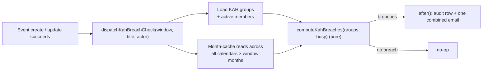
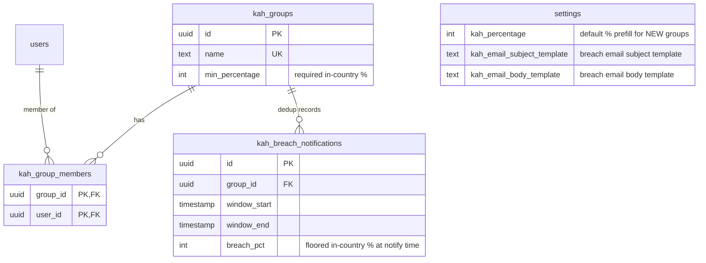
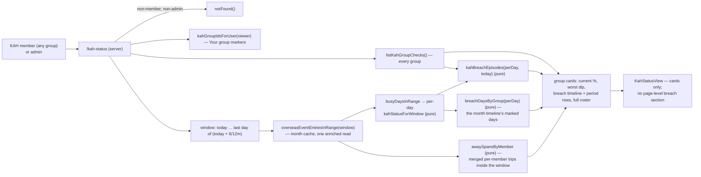

# 1. KAH (Key Appointment Holder) constraints

KAH groups are named sets of important people ("Key Appointment Holders") of which a
required percentage must remain in-country. When an event is created or updated, the app
checks every group over the saved event's time window and notifies configured email
addresses when a group falls below its threshold. **Notification only** — the save itself
never blocks or fails because of KAH.

## Table of contents

- [1.1 What the check does](#11-what-the-check-does)
- [1.2 Data model](#12-data-model)
- [1.3 Breach math](#13-breach-math)
- [1.4 Flow of a mutation](#14-flow-of-a-mutation)
- [1.5 Email delivery](#15-email-delivery)
- [1.6 Admin UI](#16-admin-ui)
- [1.7 User-facing status page](#17-user-facing-status-page)
- [1.8 Files](#18-files)
- [1.9 Deliberate limits & future work](#19-deliberate-limits--future-work)

## 1.1 What the check does

For each enabled group, count how many members are **away** during the saved event's
window, and compare the remaining share against the group's required percentage:



A member is **away** when they are a tagged **invitee** (`event.userIds`) of an
in-app internal event overlapping the window `[event.start, event.end]` **whose location
category is `overseas`** (the `overseas` notes flag; `eventTakesMembersOverseas` in
`src/lib/kah/status.ts`). The organizer counts as away only when they also tagged
themselves (i.e. they appear in the invitee set). In-camp events, local out-of-camp events, external events, and
legacy events without the overseas flag never make anyone away — the flag is only written
for events recorded as overseas, so legacy data stays in-country by default. Deactivated
users stop counting even if still listed as members.

The check is **causal**, not a blanket rescan: it is skipped entirely when the saved event
is not overseas, and a group is only considered when the saved event tags at least one of
its members. A non-overseas event (or an overseas event that takes nobody away) therefore
can never affect KAH status or trigger a notification — unrelated event mutations are
silent.

## 1.2 Data model



- `kah_group_members` cascades on both FKs: deleting a group or user cleans membership.
- `kah_breach_notifications` stores one row per notified (group × window × breach-pct)
  combination; cascades on `group_id` so deleting a group cleans its dedup history.
- The legacy global `settings.kah_percentage` column is repurposed as the **prefill
  default** for newly created groups (live thresholds live on each row).
- Recipients are the **members of the breached groups**: `resolveMemberEmails`
  (`src/lib/kah/notify.ts`) collects the `users.email` of every member in a breach,
  deduplicated and non-empty only — members without an email on file are skipped
  (a breach with zero resolvable emails stays audit-only). The legacy
  `settings.kah_notification_emails` column is unused.

## 1.3 Breach math

Pure helpers in `src/lib/kah/check.ts`:

- `actualPct = floor(inCountry / totalMembers × 100)` — floored, so rounding is
  conservative against the requirement.
- A breach is **strictly below**: meeting the percentage exactly is not a breach
  (3 of 5 members = 60% satisfies a 60% requirement).
- Empty groups never breach; duplicate member ids collapse.
- A group is only evaluated when the saved event tags one of its members, and
  each breach carries the **away window** — the union `[min start, max end)` of
  the overseas events that put that group's members away — which is the dedup
  identity (see §1.4).

Validation/normalization for the forms lives in `src/lib/kah/validate.ts`; the email body
builder in `src/lib/kah/email.ts`. All three modules are pure and unit-tested without a DB.

## 1.4 Flow of a mutation

```mermaid
sequenceDiagram
 participant U as User (event form)
 participant A as createEvent/updateEvent
 participant G as Google Calendar
 participant N as dispatchKahBreachCheck
 participant M as after() queue
 U->>A: submit form values
 A->>G: create/update all copies
 A->>G: invalidateGcalCache (months touched)
 A->>N: register check (window = saved range)
 A-->>U: ok (response never waits for KAH)
 Note over N,M: skipped unless the saved event is overseas and tags a member;<br/>runs after the response ships, after the invalidation above,<br/>so its reads see the saved copies
 N->>N: listKahGroupChecks (active members only)
 N->>N: overseasEventsInRange — getCachedMonthEventsForCalendars over all calendars × window months
 N->>N: computeKahBreaches (pure) — scope-gated to groups the saved event tags
 N->>N: dedup — filter breaches already in kah_breach_notifications (group × away window × pct)
 alt new breaches exist
 N->>N: logAction(kah.breachNotify) — flat human-readable details
 N->>N: insert dedup rows (group × away window × pct)
 N->>N: buildKahBreachEmail (one combined message)
 N->>M: sendNotificationEmail(to=breached members' emails)
 end
```

Guarantees:

- Registration order matters: `dispatchKahBreachCheck` is called **after**
  `invalidateGcalCache`, so the month cache refetches include the just-saved copies and
  the edited event counts with its *new* invitees.
- Everything inside the check is wrapped in try/catch and logged — a KAH failure can
  never fail the mutation (same philosophy as webhook delivery).
- The check is **skipped before `after()`** unless the saved event is overseas and tags at
  least one member, so non-overseas and people-less mutations never even read KAH data.
- `deleteEvent` skips the check: deleting frees people and cannot cause a breach.
- **Dedup:** each (group × away-window × breach-pct) triggers at most one email. The
  away window is the union of the overseas events that put the group's members away, so
  the same underlying absence notifies once regardless of which event was saved (an
  unrelated overseas event overlapping the same absence is silent). A change in breach
  percentage (worsening) changes the key and re-notifies; recovery followed by a later
  re-breach yields a different away window and re-notifies too.

## 1.5 Email delivery

Transport selection happens at dispatch time (`src/lib/email/send.ts`), first match wins:

1. **Workspace delegation** — `GOOGLE_DELEGATE_EMAIL` set → the integration's real
 `sendEmail`: service-account JWT with the `gmail.send` scope impersonating that
 account (domain-wide delegation; Workspace admins must grant the scope).
2. **SMTP** — `SMTP_URL` set (e.g. a personal Gmail account with an app password, no
 Workspace needed) → nodemailer (`smtp.gmail.com:465`). See `.env.example` for the
 app-password setup.
3. **Neither** → one warn log; the audit row below is still written.

MIME messages for the Gmail path are built by pure `buildTextEmail`
(`src/lib/google/mime.ts`): UTF-8 text, RFC 2047 encoded subject, base64url `raw` for
`users.messages.send`. Without Google credentials the stub logs instead of sending.

One **combined** email per mutation lists every breached group with counts and names;
no resolvable member emails → audit row still written, email skipped.

### 1.5.1 Customizable templates

Subject and body come from admin-editable settings columns
(`kah_email_subject_template` / `kah_email_body_template`, edited in Settings → KAH
Groups with a live preview rendered by the same pure renderer). Tokens, substituted
case-insensitively; unknown tokens stay literal:

| Token | Value |
| --- | --- |
| `{event}` | The rendered Google Calendar title of the saved event |
| `{actor}` | Display name of the user who saved it |
| `{window}` | The checked window, UTC+8 wall clock (all-day end shown inclusive, so a one-day event reads as one day) |
| `{breaches}` | One `- Group: X% in country … away: names` line per breached group |

The body must contain `{breaches}` (validated in the form); blank stored templates fall
back to the shipped defaults in `emailDefaults.ts`, whose strings must stay identical to
the schema column defaults (guarded by a unit test).

## 1.6 Admin UI

- **Settings → KAH Groups** (`/settings/kah-groups`): table (desktop) / cards (mobile) of
  groups with name, required %, members. Create/edit modal: name, required-% NumberInput
  prefilled from the settings default, and members picked through the shared badge dialog
  (`UserSelectModal`, active users grouped by department; summary chips removable via ✕).
  Delete asks for confirmation.
  All mutations are audited (`kahGroup.create/update/delete`) with member display names.
- **Settings → KAH Groups → Breach Email Templates**: subject/body template fields
  with a live preview (sample breach data rendered through
  `renderKahEmailTemplate`), validated by `validateKahNotificationsForm`, saved by one
  audited `updateKahNotifications` action (`settings.update`).
- The tab is registered in `SettingsTabs.tsx` between Quick Links and Banner.

## 1.7 User-facing status page

Every member of at least one KAH group — and every admin — can open the read-only
**KAH Status** page (`/kah-status`), reached from the bottom nav / desktop sidebar.
The nav entry appears for **any member of at least one KAH group** (the server passes
`hasKahGroup` into `AppShellShell` so it can't flicker) and always for admins. The page
lists **every KAH group**, not just the viewer's own: a member sees the status of all
other KAH groups too, with their own groups marked **Your group** and their own roster
row marked **You**. A signed-in non-member who guesses the URL gets the branded
not-found (no data, no hint that the page exists); the nav entry simply never renders
for them. The page answers "what is each KAH group's standing, who is away when, and
which breach periods are coming?" — the same data the notify-only breach check reasons
about, shown proactively.



- The page scans a **forward-only window** from today through the last day of the
  month N months ahead, where N is the **Look ahead** control: **6 months by default,
  or 1 year**. (The app-wide 1/6/12 vocabulary in
  [`event-history.md`](event-history.md) §1.4.3 still backs My Events and Double
  Booking; KAH keeps its own wider set in `src/lib/kah/range.ts` —
  `DEFAULT_KAH_RANGE_MONTHS = 6`, `KAH_RANGE_MONTHS = [6, 12]`, with
  `isKahRangeMonths`/`parseKahRange`; a stale client sending `1` coerces to `6`.)
  The control is the shared `TimeRangeSelect` range pill
  ([`desktop-responsive.md`](desktop-responsive.md) §1.11). The choice is
  **per-view only — never saved** (client state, not the URL or prefs), so a
  refresh resets it to the six-month default. There is no past half: a breach
  that began before today is shown clipped at today.
- The head block (title + window subtitle + Look ahead) is the **shared sticky-chrome
  recipe** — a `c2-glass-surface` block pinned under the app header while the cards
  scroll beneath it (`.c2-report-chrome` + `.c2-report-head` in `globals.css`, shared
  with Double Booking; `loading.tsx` mirrors it). On phones the title block (two
  lines: title, then the window subtitle) and the content-hugging Look ahead pill
  share **one row**, and the wrapper's block padding drops to the compact `sm` — the
  stacked title / full-width pill column it replaced pinned ~141px of chrome above
  the cards, against ~78px now (the subtitle wraps to two lines on a 320px phone, or
  when the 1-year label is long). From the 40em band on the row is title-left /
  control-right with the page rhythm's `md` padding, and the title is top-aligned
  beside the pill. The subtitle carries the window only (no group/member counts),
  wraps rather than being clipped, and breaks evenly when it does wrap
  (`text-wrap: balance`).
- Above the content sits a `role="status"` **summary line** — "2 breach periods
  across 2 groups in the next 6 months — 1 active, 1 upcoming" — or the clear case
  ("No KAH breaches in the next 6 months — all 4 groups stay in country.") with a
  green check. It is the single live region: the in-card period rows are not live
  regions, so a range change is announced exactly once. A failed range change keeps
  the last good window on screen and shows the inline error + **Retry** strip (the
  Double Booking recipe) instead of a toast that vanishes with no way back.
- **Groups come first — and they are the whole report.** Every KAH group is a card
  in a deliberate two-column grid from the 40em band on (one column on phones);
  cards in a row share the row height (`align-items: stretch`), so the vertical
  gaps stay even when rosters differ. Cards are ordered attention-first —
  active breaches, then upcoming, then all-clear, alphabetical inside each band:
  - the group name (`h3`), a **Your group** badge when the viewer is a member, and a
    state pill: **Breaching now** (an episode includes today), **Breach upcoming**
    (an episode starts after today), or **All clear** (no breached day in the
    window);
  - one **current/minimum percentage badge** — `40% now · needs 60%`, red when the
    current in-country share is below the requirement, with an accessible name that
    spells both numbers out — over a thin in-country meter (the meter is decorative;
    the badge carries the numbers). There is no separate requirement/member-count line
    and no separate "today" text line;
  - the **worst dip** in the window and, for an upcoming breach, the day it starts
    (`Worst: 40% on Sun 29 Nov · next Thu 10 Dec`);
  - **the group's breach section** (only for a group with a breached day): a
    **Breaches** subheading with the period count, then a **month preview timeline**
    built from the shared `ClashMonthStrip` over the scanned window — one cell per
    month, busy cells carry that month's breach-day count, and the strip wraps
    inside the card instead of scrolling. Tapping a busy month scrolls to and
    focuses the period row containing that month's first breach day (the Double
    Booking strip interaction; reduced motion gets an instant jump). One flat
    disclosure row per breach period follows:
    - the row shows the status badge (**Active** / **Upcoming**), the period and run
      length, `down to X%`, and `X away · Y in country · worst <day>`;
    - the **away union** is always visible as chips, capped through the shared
      `capBadgeItems` recipe (the viewer's own chip is pinned first and can never
      be hidden behind the cap);
    - expanding lists the **overseas events that took those members away** during
      the run (one row per logical event — cross-calendar copies collapse via
      `dedupeOverseasEventsByGroupId`), each opening the read-only **in-place
      `EventDetail`** through `getKahBreachEventDetail`. That action is gated to
      admins and KAH members and may resolve any listed group's event (members see
      all groups); it still verifies the requested copy against the enriched
      overseas read for its own window.
  - **the full active roster**, one row per member: name (with **You**), a
    present-tense badge — **Away now** (tagged on an overseas event overlapping
    today) or **In country** — and the nearest away stretch (`Away now · until Sep
    16`, `Next away Sep 12 – Sep 16`, `+N more trips`). The stretches are merged per
    member (`awaySpansByMember`: overlapping **and** adjacent runs joined) and
    clipped to the scanned window. A group with no active members says so instead of
    showing an empty percentage.
- Each period is **Active** (red — includes today) or **Upcoming** (amber — starts
  after today). `Resolved` cannot occur with a forward-only window. Runs touching
  the scanned window's edge are shown clipped — a run already broken at the
  window's start reads **"Ongoing"**, and one still broken at the window's end
  shows its end date with a **"+"** ("… – Oct 31+") — they may extend beyond the
  window.
- There is **no page-level breach section and no `ClashCard` on this page**: the
  forecast lives inside each group's card. The old amber period cards are replaced
  by the flat rows above; the shared `ClashEventRow` is still reused for the
  causing events.
- With **zero KAH groups** (admin only) the page shows the shared actionable
  `EmptyState` (green check + **Manage KAH groups**). Groups with no breached day
  stay visible as cards — there is no page-filling clear-state that hides the
  rosters.
- Every calendar read goes through the existing month cache (60s fresh / 30min
  SWR), NEVER raw `listEvents` — same freshness/consistency as the dashboard, no
  forced blocking refresh.
- The per-day scan uses the same half-open UTC+8 day windows and the same
  overseas-overlap rule as the notify path, so the history/forecast can never
  diverge from what the breach check counts.
- Overseas events are read with their **effective occupancy window**: all-day
  events (stored at UTC midnight, Google's date convention) are realigned to the
  UTC+8 civil day and half-day AM/PM markers honored — the same
  `effectiveEventWindow` the clash engine uses (`src/lib/events/clashes.ts`), so
  a one-day all-day event covers exactly one UTC+8 day instead of bleeding 8 h
  into the next. The enriched read (`overseasEventEntriesInRange`) additionally
  carries each event's display/geometry fields (type, raw title, color, calendar,
  inclusive + effective windows) so the cards' rows render identically to the
  clash reports and member away stretches line up with the per-day math; the
  notify path stays on the lean `overseasEventsInRange`.
- The nav entry carries a **breach count badge** (the amber pill shared with
  Double Booking): the number of breach **periods** (maximal runs of consecutive
  breached days) across **every** KAH group — the page lists them all — from
  **today through the last day of the month 6 months ahead**
  (`DEFAULT_KAH_RANGE_MONTHS` — the page's default look-ahead, which the badge is
  fixed to and never follows the page's selection). It is a read-only
  `checkKahBreaches` scan (`src/lib/kah/statusActions.ts`) that runs the page's
  own per-day math (`overseasEventsInRange` → `busyDaysInRange` →
  `kahStatusForWindow` → pure `kahBreachEpisodes`), refreshed on mount, on tab
  refocus, and after any event create/update/delete (via
  `cloudy2:events-changed`); non-members get `0` without a calendar scan. A
  missing pill means no breach period in that forward window.
- Shared plumbing lives in `src/lib/kah/status.ts` (`listKahGroupChecks`,
  `kahGroupIdsForUser`,
  `overseasEventsInRange` + `overseasEventEntriesInRange`,
  `busyDaysInRange`, `kahStatusForWindow`, `kahBreachEpisodes`,
  `dedupeOverseasEventsByGroupId`, `eventsForGroupEpisode`, `memberIdsAwayOnEvent`,
  `userHasKahGroup`, `resolveUserNames`, `isUuid`); the notify path imports
  `listKahGroupChecks` + `overseasEventsInRange` from here so the two never
  diverge on who counts as a member or away. The pure, client-safe look-ahead
  helpers and shared view types live in `src/lib/kah/range.ts`
  (`DEFAULT_KAH_RANGE_MONTHS`, `KAH_RANGE_MONTHS`, `kahForwardWindow`,
  `parseKahRange`, `kahRangeLabel`, `KahGroupRow`, `KahGroupMemberRow`,
  `KahAwaySpan`, `KahEpisodeRow`, `KahStatusViewData`). A group row carries its
  own `episodes` and `breachDayKeys` (there is no page-level episode list). The
  per-member away spans, the breach-day collector and the group state/worst/next
  helpers are pure and in `src/lib/kah/groups.ts` (`awaySpansByMember`,
  `breachDaysByGroup`, `groupBreachState`, `groupWorst`, `groupNextBreachDate`);
  the display copy (period labels, away-span sentences) is in
  `src/lib/kah/display.ts`. `src/lib/kah/viewData.ts`
  (`buildKahStatusViewData`) owns the page's read + shaping, reused by the page's
  initial render and the `getKahStatusView` range-change action. The in-card month
  timeline is the shared `ClashMonthStrip` ([`user-clashes.md`](user-clashes.md)
  §1.8) with KAH-specific accessible wording and a wrapping modifier; the causing
  events reuse `ClashEventRow`. The in-place detail shaping (`shapeClashDetail`)
  and the inclusive window helper (`conflictWindowNaive`) are shared with the
  clash reports (`src/lib/events/clashDetail.ts`,
  `src/lib/events/clashDisplay.ts`).

## 1.8 Files

| File | Role |
| --- | --- |
| `src/db/schema.ts` | `kahGroups`, `kahGroupMembers`, `kahBreachNotifications`, repurposed `settings.kahPercentage` |
| `src/lib/kah/check.ts` | Pure breach math (`computeKahBreaches`, `inCountryPercentage`) |
| `src/lib/kah/validate.ts` | Pure form validation/normalization |
| `src/lib/kah/email.ts` | Pure template renderer + combined breach-email builder |
| `src/lib/kah/emailDefaults.ts` | Default subject/body templates shared with the schema defaults |
| `src/lib/kah/queries.ts` | Group + member reads for the tab |
| `src/lib/kah/status.ts` | Shared status reads (name-ordered groups): `listKahGroupChecks`, `kahGroupIdsForUser`, `overseasEventsInRange` / `overseasEventEntriesInRange`, pure `busyDaysInRange`, `kahStatusForWindow`, `kahBreachEpisodes`, `dedupeOverseasEventsByGroupId`, `eventsForGroupEpisode`, `memberIdsAwayOnEvent`, `userHasKahGroup`, `isUuid` session-id guard |
| `src/lib/kah/range.ts` | Pure, client-safe look-ahead helpers + shared view types: `DEFAULT_KAH_RANGE_MONTHS` (6), `KAH_RANGE_MONTHS` (6/12, KAH-specific), `isKahRangeMonths` / `parseKahRange`, `kahForwardWindow`, `kahRangeLabel`, `KahAwaySpan`, `KahGroupMemberRow`, `KahGroupRow`, `KahEpisodeRow`, `KahStatusViewData` |
| `src/lib/kah/groups.ts` | Pure per-member away calendar (`awaySpansByMember`: clipped + merged trips) and group summary helpers (`groupBreachState`, `groupWorst`, `groupNextBreachDate`) |
| `src/lib/kah/display.ts` | Pure display copy: `periodLabel`, `groupStateLabel`, `awaySpanLabel`, `awaySpanSummary` |
| `src/lib/kah/viewData.ts` | `buildKahStatusViewData` — the page's forward-window read + group-card shaping (all groups for every member; each group row carries its episodes and breach-day keys), shared by the initial render and the range-change action |
| `src/lib/kah/actions.ts` | Audited group CRUD server actions |
| `src/lib/kah/statusActions.ts` | Read-only server actions: `checkKahBreaches` (nav badge over every group), `getKahStatusView` (page look-ahead change), `getKahBreachEventDetail` (in-place detail) — all gated to admins and KAH members |
| `src/lib/kah/notify.ts` | `dispatchKahBreachCheck` — check, audit, email (imports reads from `status.ts`) |
| `src/lib/events/clashDetail.ts` | Shared `shapeClashDetail` — the in-place detail payload for Double Booking, the wizard advisory, and KAH |
| `src/app/(protected)/kah-status/{page,loading,KahStatusView,KahStatusHead,KahGroupCard,KahGroupBreaches,KahBreachPeriodRow,KahGroupRoster,KahStatusBadge,KahEventDetailModal,KahStatusSkeleton,useKahEventDetail}.tsx/.ts` | Read-only status page: forward-only group overview + forecast over a selectable look-ahead (default 6 months; 1 year), per-view only; every KAH group with its current %, worst dip, in-card month breach timeline + flat collapsible period rows (away union, causing events), and full roster; gated to members/admins (non-members 404), inline error + Retry, zero-group `EmptyState` |
| `src/components/clashTimeline.tsx` | `ClashMonthStrip` (shared with Double Booking) — the KAH card's breach preview passes KAH-specific accessible wording and the wrapping `c2-kah-timeline` modifier |
| `src/components/TimeRangeSelect.tsx` | The **Look ahead** control (shared with My Events "Range") — the app-wide range pill, [`desktop-responsive.md`](desktop-responsive.md) §1.11 |
| `src/components/AppShellShell.tsx` | Conditional KAH Status nav entry (members: `hasKahGroup`; admins: always) |
| `src/lib/email/send.ts` | Transport selection: Workspace delegation → SMTP → warn |
| `src/lib/email/smtp.ts` | Pure `SMTP_URL` parser + nodemailer sender |
| `src/lib/events/actions.ts` | Hook call sites in `createEvent` / `updateEvent` |
| `src/lib/google/{mime,config,real,stub}.ts` | MIME builder, scopes, real/stub `sendEmail` |
| `drizzle/0022_*.sql` | Migration creating the two KAH tables |
| `drizzle/0024_*.sql` | Migration adding `kah_breach_notifications` dedup table |

## 1.9 Deliberate limits & future work

- **Notify-only** — there is deliberately no hard block on saving breaching events.
  The status page is similarly read-only: it never blocks or changes anything.
- **All-group visibility is deliberate.** Any KAH member sees every KAH group's
  roster, away calendar and breach periods (own groups marked); the page and its
  three read-only actions are gated to admins and KAH members, and a non-member
  gets the branded not-found. This is broader than the notify path, which still
  only emails the members of the breached groups.
- The check runs only at mutation time over the saved event's own window; the
  status page scans its selected forward look-ahead on demand. Neither
  continuously monitors "right now" nor evaluates other windows automatically.
- Away-ness is tied to the **overseas** location category (see §1.1) — the busy-set
  computation filters on the overseas notes flag (`eventTakesMembersOverseas`) rather
  than counting every tagged event; if finer rules are needed later, extend that pure
  filter rather than changing `computeKahBreaches`.
- **Dedup** via `kah_breach_notifications`: each (group × away-window × breach-pct)
  combination triggers at most one email. The table is append-only during normal
  operation; rows cascade-delete when a group is removed. A one-off migration
  (`drizzle/0053_*.sql`) cleared the pre-existing rows, whose keys were scoped to the
  saved event's window rather than the breach's away window.
- **Not yet built:** a past-breach history view from `kah_breach_notifications`
  (the email dedup log — a different granularity than the status page's
  forward-looking day-aligned scan).
