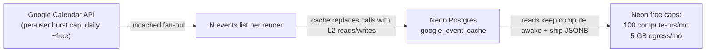

# 1. Neon usage & Google Calendar quota reality

The events cache ([events-cache.md](events-cache.md)) exists to guard Google Calendar
**burst-rate** and **latency**, not a daily Google quota. The resource that actually runs
out is the **Neon free tier**. This document records the quota numbers and the two ways to
verify the app's DB-side load: a daily usage script (consumption API) and query-level
statistics (`pg_stat_statements`).

## Table of contents

- [1.1 Why Google Calendar isn't the constraint](#11-why-google-calendar-isnt-the-constraint)
- [1.2 The real constraint: Neon free tier](#12-the-real-constraint-neon-free-tier)
  - [1.2.1 What the egress reductions are](#121-what-the-egress-reductions-are)
- [1.3 Daily usage via the consumption API](#13-daily-usage-via-the-consumption-api)
- [1.4 Query-level stats via `pg_stat_statements`](#14-query-level-stats-via-pgstatstatements)
- [1.5 Reading the numbers](#15-reading-the-numbers)

## 1.1 Why Google Calendar isn't the constraint

Measured against the production Google Cloud project, Calendar API usage is **~0%** of
every quota. The post-May-2026 limits are:

| Limit | Value | Reached? |
| --------------------------- | -------------------- | -------- |
| Per minute per project | 10,000 requests | No (0) |
| Per minute per user/project | 600 requests | No (0) |
| Per day per project | 1,000,000 (billing threshold) | No |

The one cap an uncached design could hit is the **per-user-per-minute** rate: every call
runs through the **service account**, which Google charges as a *single user*. An admin
rendering all departments fans out to one `events.list` per calendar, so busy multi-user
minutes can burst past 600/min. The cache collapses that to one re-fetch per expired
`(calendar, month)` per minute. That, plus render latency, is why the cache exists —
**not** to stay under a daily capacity figure.

## 1.2 The real constraint: Neon free tier



The cache trades a generous external quota for a scarce internal one. Neon's free tier is
the binding ceiling:

- **100 compute hours/month** — measured as *active time* (wall-clock the compute endpoint
  is not suspended). The 5-minute scale-to-zero timeout is **fixed on the free plan**
  (cannot be lowered or disabled), so any day the team uses the app continuously, the
  endpoint stays awake and accrues active time regardless of per-query efficiency.
- **5 GB egress/month** — every JSONB month payload re-shipped on a render counts.
- **0.5 GB storage** — the `google_event_cache` rows accumulate per `(calendar, month)`.

Because the free suspend timeout is not configurable, the code-level levers are limited to
*reducing how often* the DB is touched (fewer keep-alive reads, shorter bursts) and
*shrinking each touch* — which is what the events-cache optimizations do: metadata-only L1
verification, full rows only for misses, `React.cache`d per-render reads, and Google
refreshes kept outside any transaction so the small connection pool is never held open
across a Google round-trip (see
[events-cache.md §1.5](events-cache.md#15-read-path)).

### 1.2.1 What the egress reductions are

The month payload is the only large object the app reads, so the tuning is about shipping
fewer of them and fewer bytes in each:

1. **Compressed payloads.** `google_event_cache.payload` (and `pinned_event_cache.payload`)
   store the month as **brotli + base64url** instead of jsonb
   (`encodeCachedMonth` / `decodeCachedMonth`, `src/lib/google/eventsCacheCodec.ts`). The
   per-event `calendarId` is dropped (it is the row key) and empty optional fields are
   omitted. Measured on a synthetic entropy-heavy month (30 events, 300-char pseudo-notes
   each, i.e. the worst case): **21.0 KB legacy JSON → 10.0 KB payload (0.47×)**. Real
   months compress better (repeated ids/keys, recurring `EXDATE` lists, similar titles).
   `bytea` would have been 2× in Postgres' hex text output, so the payload stays `text`.
   Legacy jsonb rows are still read as a fallback and are rewritten in the new format on
   their next refresh (30-min TTL), so the change needs no backfill.
2. **Lazy dashboard tabs.** The client no longer warms *every* tab at the anchor on launch
   (that union read shipped all of their calendars × months — the largest single source).
   Only the active tab's previous/next month is warmed; other tabs load on tap or on intent
   (hover/focus/press), so a tab the user never opens ships nothing. Rollback:
   `scope: "all"` on `/api/dashboard/preload`.
3. **Organizer pre-filter.** `google_event_cache_creators` records which users organized
   something in each `(calendar, month)` payload, so My Events' ±6/±12 windows fetch only
   the rows that can contain the user's events instead of every calendar × month
   (`readCalendarRange({ creatorFilter })`). Its adjacent-month prefetch is skipped.
4. **Fewer round trips, same bytes.** The KAH badge reads all its months in one batched
   cache call instead of one call per month.

Rejected on purpose: `fetch_types: false` (postgres.js v3 uses that connect-time query to
install the `text[]` parsers the schema relies on), `bytea` payloads (hex output doubles the
wire size), raising `idle_timeout` (it moves the cost to the compute-hours cap), and
region moves (latency only). PrivateLink is not on the free plan, but note that
`private_network_transfer_bytes` is a **separate** metric from the 5 GiB public allowance.

## 1.3 Daily usage via the consumption API

`scripts/neon-usage.mjs` (also `pnpm db:usage`) prints daily compute active time, CPU
seconds, egress, data written, and storage from the Neon consumption-history API. It needs
no extra packages (Node ≥ 20 `fetch`).

```powershell
# 1. In .env.local (or the shell) set:
# NEON_API_KEY=<console.neon.tech → Account → API keys>
# NEON_ORG_ID=<your organization id>
# NEON_PROJECT_ID=<optional: filter to one project>

# 2. Load the values and run:
$line = Get-Content .env.local | Where-Object { $_ -match '^NEON_API_KEY=' } | Select-Object -First 1
$env:NEON_API_KEY = $line.Substring(13).Trim()
$line = Get-Content .env.local | Where-Object { $_ -match '^NEON_ORG_ID=' } | Select-Object -First 1
$env:NEON_ORG_ID = $line.Substring(12).Trim()
pnpm db:usage

# Or a custom window:
node scripts/neon-usage.mjs --from 2026-08-01 --to 2026-08-31
```

The script reads `NEON_*` from `.env.local` itself, so the shell lines above are only
needed to *pre-seed* them before other tools; `pnpm db:usage` alone works once the values
are present. On the free plan, the two numbers that matter are **active hours** (vs the
100 h/month cap) and **egress** (vs 5 GB/month). If the consumption API is not exposed on
your plan (403/404), the same numbers live in the Neon Console → **Billing → Usage** page.

## 1.4 Query-level stats via `pg_stat_statements`

For *which* queries drive the load, enable Neon's built-in query stats once (SQL editor or
psql):

```sql
CREATE EXTENSION IF NOT EXISTS pg_stat_statements;
```

Then the top consumers by call count and total time:

```sql
-- Most frequent queries (the cache metadata SELECT should be small/frequent
-- and the full google_event_cache SELECT only for misses):
SELECT query, calls
FROM pg_stat_statements
ORDER BY calls DESC
LIMIT 15;

-- Most time spent (total and average ms):
SELECT query,
 calls,
 round(total_exec_time::numeric, 1) AS total_ms,
 round((total_exec_time / calls)::numeric, 1) AS avg_ms
FROM pg_stat_statements
WHERE calls > 0
ORDER BY total_exec_time DESC
LIMIT 15;

-- Biggest rows-per-call (proxy for egress per query):
SELECT query, calls, rows AS total_rows, round(rows::numeric / calls, 1) AS rows_per_call
FROM pg_stat_statements
WHERE calls > 0
ORDER BY rows_per_call DESC
LIMIT 15;
```

Reset the counters when you ship a change so the next window reflects it:

```sql
SELECT pg_stat_statements_reset();
```

## 1.5 Reading the numbers

After the DB-load reductions, expect:

- **Active hours / egress (consumption API):** a downward trend once a workday's usage is
  compared against the previous window — chiefly because the month payload is compressed
  (§1.2.1), a launch no longer ships every tab's calendars × months, My Events no longer
  reads the whole org, and the pinned-events ticker reads one durable `pinned_event_cache`
  row instead of rescanning every department × month on each cold instance. Duplicate
  per-render reads no longer touch the DB, so idle stretches can actually reach Neon's
  5-minute suspend.
- **Row-level check on the cache:** compare `sum(pg_column_size(payload))` with the old
  `sum(pg_column_size(events))` census — that is the per-read saving, independent of traffic.
- **`pg_stat_statements`:** `calendars`/`event_types` reads roughly halve per render (the
  page + `fetchRangeEvents` share one `React.cache`d read each); the `google_event_cache`
  full-payload `SELECT` call count drops to "one per L1-miss month" and its per-call rows
  shrink to the rows a context actually needs (no all-tab union, no whole-org My Events
  read), with warm views hitting only the tiny metadata `SELECT`.

One honest caveat: if the team uses the app continuously through the workday, the free
endpoint stays awake all day and active hours will be consumed **regardless** of these
optimizations. In that case the only real fix is a paid Neon plan; the monitoring above
shows you which scenario you're actually in.