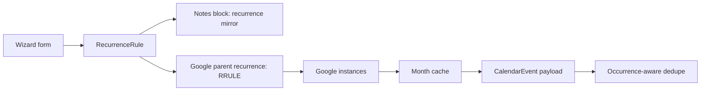
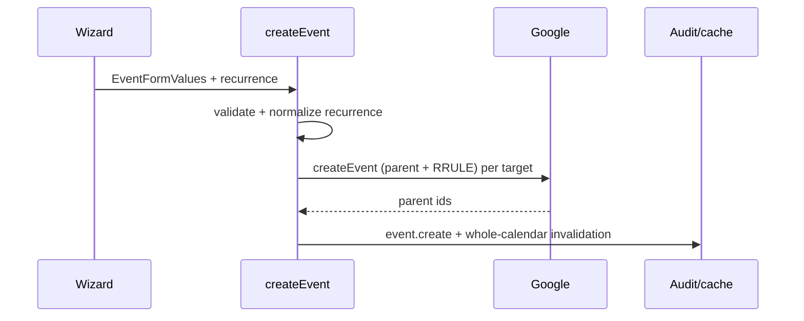
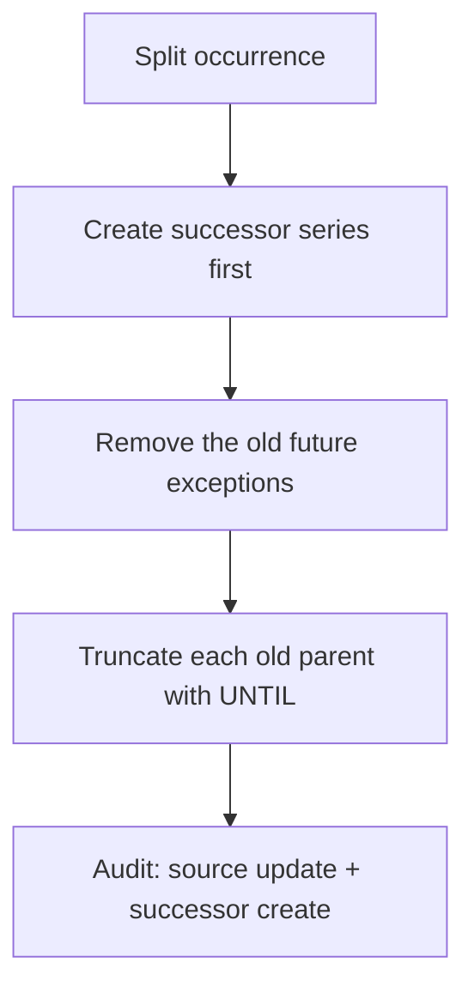

# 1. Recurring events

Repeating events are real Google Calendar recurring series: one parent per
department calendar carrying an `RRULE`, with Google expanding the occurrences.
The app stores a compact rule mirror in its notes block and identifies each
occurrence by Google's `recurringEventId` + `originalStartTime`, so every read
surface can keep a series' occurrences distinct while still collapsing the
per-department copies of one occurrence.

## Table of contents

- [1.1 Problem](#11-problem)
- [1.2 Goals & non-goals](#12-goals--non-goals)
- [1.3 Supported recurrence matrix](#13-supported-recurrence-matrix)
- [1.4 Storage model & occurrence identity](#14-storage-model--occurrence-identity)
- [1.5 The recurrence engine](#15-the-recurrence-engine)
- [1.6 Create flow](#16-create-flow)
- [1.7 Read path](#17-read-path)
- [1.8 Edit scopes](#18-edit-scopes)
  - [1.8.1 This event](#181-this-event)
  - [1.8.2 This and following](#182-this-and-following)
  - [1.8.3 All events](#183-all-events)
- [1.9 Delete scopes](#19-delete-scopes)
- [1.10 Exceptions & cleanup](#110-exceptions--cleanup)
- [1.11 Registration events on a series](#111-registration-events-on-a-series)
- [1.12 Cache, audit, webhooks & notifications](#112-cache-audit-webhooks--notifications)
- [1.13 Edge cases & limitations](#113-edge-cases--limitations)
- [1.14 File index & tests](#114-file-index--tests)

## 1.1 Problem

The app's event store is Google Calendar, and the app previously treated every
Google event as a one-off. A recurring series expands into many instances that
share the notes group id, so the old "one row per group id" display dedupe
would collapse a whole series into a single chip. Editing/deleting also needs
Google's three native scopes — this event, this and following, all events —
without leaving orphan copies, resurrected occurrences or stale exceptions.

## 1.2 Goals & non-goals

**Goals**

- Create daily / weekly / monthly / yearly series with an interval and a
  forever / count / until duration.
- Render every occurrence on every calendar surface; collapse only the
  department copies of the same occurrence.
- Offer the three native edit/delete scopes with correct Google writes.
- Allow series-level self-registration.
- Keep one-off and externally created events working.

**Non-goals**

- Google's *custom* repeat patterns (nth weekday, last day, multi-date) are not
  editable here; such external series are occurrence-only.
- No reminders/attendees are added (Google remains the visibility layer).
- No per-occurrence registration (see §1.11 for the separate design).

## 1.3 Supported recurrence matrix

| Frequency | Google rule | Notes |
| --- | --- | --- |
| Daily | `FREQ=DAILY;INTERVAL=n` | n = 1…99 |
| Weekly | `FREQ=WEEKLY;INTERVAL=n;BYDAY=…` | Multi-select; the start weekday must stay selected. |
| Monthly | `FREQ=MONTHLY;INTERVAL=n;BYMONTHDAY=<start day>` | Months without that day are skipped (Google behaviour). |
| Yearly | `FREQ=YEARLY;INTERVAL=n` | Repeats month/day; Feb 29 only in leap years. |

Duration is exactly one of: no `COUNT`/`UNTIL` (forever), `COUNT=n` (2…999,
includes the first occurrence), or `UNTIL` (inclusive). Timed series use the
last instant of the SGT end date (`…T155959Z`); all-day series use `YYYYMMDD`.

The app's wall clock is fixed UTC+8 (`Asia/Singapore`); timed recurring parents
are written with `timeZone: "Asia/Singapore"` so expansion is deterministic.

## 1.4 Storage model & occurrence identity

- Google's parent `recurrence` is the authority for expansion.
- The notes block mirrors the compact rule (`recurrence`) so a read can prefill
  and summarise without fetching the parent. Notes also carry `override: true`
  on a single-occurrence exception and `splitFromEventId` / `splitAt` on a
  "this and following" successor.
- `CalendarEventPayload` exposes `recurrence`, `recurrenceSummary`,
  `recurringEventId`, `originalStartTime` (date for all-day, naive SGT for
  timed) and `occurrenceOverride`.
- `occurrenceKey` (`src/lib/events/occurrence.ts`) is
  `eventId + originalStartTime` for a series instance, the group id for a
  one-off, and `calendarId:googleEventId` for external/legacy events.

## 1.5 The recurrence engine

`src/lib/events/recurrence.ts` is pure and unit-tested: normalize/validate a
rule, serialize it to an RRULE, parse the supported RRULE subset (preserving
EXDATE/RDATE lines), expand occurrences (month-end/leap-year skipping),
summarise it, compute an occurrence index and the remaining rule for a split.
`EXCEPTION_SCAN_HORIZON_YEARS = 10` bounds cleanup scans for a Forever series.

## 1.6 Create flow

The wizard's **Other settings** step hosts the Repeat switch and its frequency,
interval, weekday and duration controls. The review step shows the human summary.
A failed multi-target create rolls back every parent it wrote (deleting a Google
parent removes its instances).

## 1.7 Read path

- `projectRangeEvents` dedupes by **occurrence**, not group id.
- Pinned Events and My Events collapse a series to its earliest row
  (`collapseSeriesEvents`); the grids/search/parade/KAH/double-booking keep
  every occurrence.
- Deep links (`?event=`, `?edit=`, share links) carry the occurrence date;
  `findEventByOccurrence` picks the matching occurrence, falling back to the
  earliest.
- The detail modal's live-sync matches the copy id/occurrence, so a refresh
  never swaps the open occurrence for another.
- KAH and clash inputs dedupe by occurrence and ignore an event clashing with
  another occurrence of the same logical series.

## 1.8 Edit scopes

The detail modal's Edit action opens a scope chooser for a repeating event
(This event / This and following / All events). Registration series offer only
"All events"; external/custom series offer only "This event".

The chooser (and the identically built delete-scope chooser in §1.9) renders
through the shared `RadioCardGroup` (`src/components/RadioCardGroup.tsx`): one
full-width **48px row per scope**, each carrying a one-line consequence under its
label ("This occurrence and the later ones become a new series."). The rows are
touch-sized on purpose — a bare `Radio` row is ~24px tall — see
[`accessibility.md`](accessibility.md) §1.9.1. The option list is filtered to the
modal's `editScopes`, so a registration series shows one row and an external
series one row.

### 1.8.1 This event

Updates one Google exception per target calendar. Participants, pin, owner lock
and registration are series-level and preserved from the stored copy (the
wizard disables those controls). The body carries no `recurrence`, so Google
records an exception; notes get `override: true`, keep the series rule for
display, and the audit row records `seriesScope: "This event"` +
`occurrenceStart`.

### 1.8.2 This and following

The successor gets a **new group id**, the form's values, the remaining rule
(COUNT becomes the remaining count), and notes `splitFromEventId`/`splitAt` for
lineage and retry idempotency. Splitting at the first occurrence delegates to
"All events". If creating the successor fails, it is deleted and the old series
is untouched; a partially-truncated retry finds the existing successor instead
of duplicating it. Future single-occurrence overrides of the old series are
removed (the successor's pattern is the form's new definition).

### 1.8.3 All events

Updates each target's parent with a full replace that includes the recurrence
and preserves EXDATE/RDATE lines from the current parent. Copies are
created/removed exactly like a one-off edit. A start/rule change resets the
series' exceptions; a title/participants-only change keeps them. Removing
repeat turns the parent into a single event.

## 1.9 Delete scopes

- **This event:** delete each target's instance (Google cancels it). The
  series and other occurrences remain.
- **This and following:** remove future exceptions, truncate the old parents at
  the split; at the first occurrence this is an all-events delete.
- **All events:** delete each target's parent (Google removes every instance
  and exception).
- Registration events can only be deleted as a series.
- The delete-scope chooser reuses the same touch-sized `RadioCardGroup` rows as
  §1.8.

## 1.10 Exceptions & cleanup

Stored exceptions are enumerated with `singleEvents:false` (parents + stored
exceptions, not generated instances) and filtered by `recurringEventId`,
excluding cancelled rows. Finite series use their exact end; Forever series use
the 10-year horizon. A pattern or registration-policy change deletes the
exceptions because their slots/rosters no longer align.

## 1.11 Registration events on a series

Registration is **per occurrence**. The series parent carries the
`registrationEnabled`/`registrationCap` configuration and the starting roster;
registering or deregistering writes a Google exception for the clicked occurrence
in every target calendar. The exception's notes hold that occurrence's roster,
so other occurrences are untouched. `setEventRegistration` branches to
`setOccurrenceRegistration`; the cap is applied per occurrence from the parent
configuration. Single-occurrence parameter edits and deletes remain rejected on
registration events (only the register/deregister toggle is per occurrence).
Changing the series registration flag/cap or the repeat pattern deletes the
occurrence exceptions so every occurrence starts from the new configuration;
series-level roster edits update generated occurrences but not existing
per-occurrence overrides.

A per-occurrence exception snapshots the roster at edit time and registration
still uses last-write-wins semantics (no atomic cap). A relational roster keyed
by `(event_group_id, occurrence_start, user_id)` with atomic cap enforcement
remains the future hardening path; the current model needs no schema change.

## 1.12 Cache, audit, webhooks & notifications

- `invalidateGcalCalendarCache(googleCalendarIds)` clears every cached month for
  a calendar; series/following mutations use it because a Forever series can
  affect any month. Single-occurrence edits keep the month-scoped invalidation.
- Audit snapshots carry `repeats`; update details carry `seriesScope`,
  `splitAt`, `successorEventId` and `occurrenceStart`.
- Webhook event payloads carry `repeats`.
- Push notifications remain per mutation (never per occurrence); registration
  is series-level.
- KAH checks the union of a series' occurrences in its look-ahead window; the
  clash advisory checks the first occurrence (the Double Booking page scans the
  live instances).

## 1.13 Edge cases & limitations

- Month-end (29/30/31) and Feb 29 occurrences are skipped, not clamped.
- A weekly repeat must keep the start weekday selected.
- Splitting/removing the repeat resets individually edited occurrences.
- A Forever series' exception cleanup is bounded to 10 years.
- External/custom recurring series are occurrence-only; their full rule is
  never silently replaced.
- A Google Calendar "this and following" split produces an `_R` sub-series;
  the Google client falls back to PATCH when PUT rejects that id.
- A single occurrence's edit never changes the series' participants or target
  calendars (series-level fields).
- Fresh Google series windows use Google's own expansion; the app never stores
  an event table.

## 1.14 File index & tests

| File | Role |
| --- | --- |
| `src/lib/events/recurrence.ts` | Pure rule types, RRULE codec, expansion, summaries |
| `src/lib/events/occurrence.ts` | Occurrence identity, dedupe, deep-link pick, series collapse |
| `src/lib/events/notes.ts` | `recurrence`/`override`/split-lineage notes + rewrite helper |
| `src/lib/events/actions.ts` | Create; single/following/series update & delete; registration |
| `src/lib/events/seriesPrefill.ts` + `src/app/api/dashboard/series-prefill/route.ts` | Read-only series prefill for the edit-scope chooser (abortable route handler) |
| `src/lib/google/types.ts`, `real.ts` | `getEvent`, recurrence/timeZone, `singleEvents` option, `_R` fallback |
| `src/app/(protected)/dashboard/EventForm.tsx` | Repeat controls in Other settings, scoped prefill, read-only series fields |
| `src/app/(protected)/dashboard/EventDetailBody.tsx` | Repeats badge, scope chooser, scoped delete, series registration copy |
| `src/lib/events/recurrence.test.ts`, `occurrence.test.ts` | Pure engine/identity tests |
