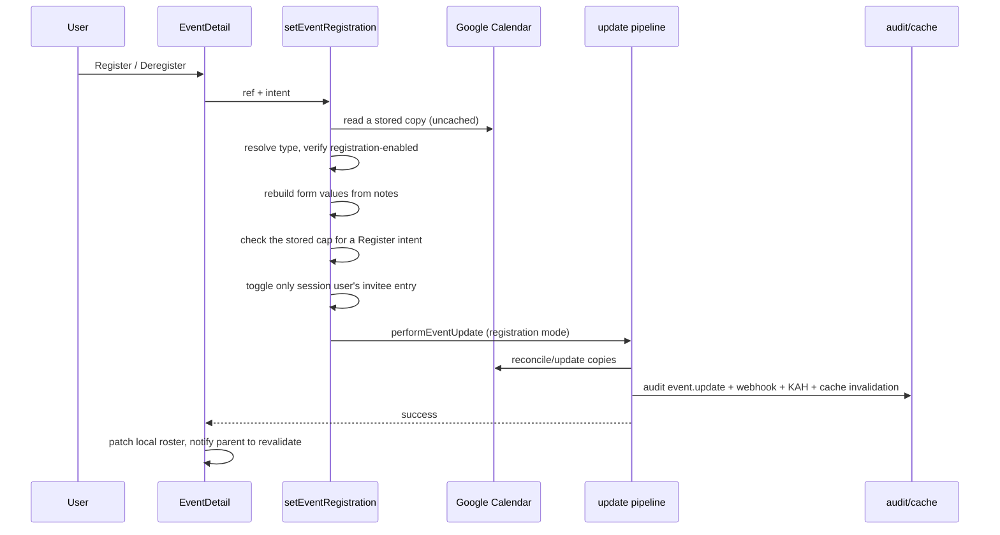

# 1. Registration events

A **registration event** is an ordinary event whose type is marked _Open for
registration_ in Settings → Event Types. It keeps the existing event storage,
title, copy reconciliation and participant model; the difference is who may
change what:

- the organizer and admins may edit/delete the event and manage participants;
- everyone else may only add or remove **themselves** as a participant.

Registration is therefore a narrow, self-service participant toggle around the
shared update pipeline — not a separate event store.

## Table of contents

- [1.1 Problem](#11-problem)
- [1.2 Configuration](#12-configuration)
- [1.3 Permission model](#13-permission-model)
- [1.4 Registration flow](#14-registration-flow)
- [1.5 Registration cap](#15-registration-cap)
- [1.6 Participants, zero registrants & calendars](#16-participants-zero-registrants--calendars)
- [1.7 UI](#17-ui)
- [1.8 Audit, webhooks & notifications](#18-audit-webhooks--notifications)
- [1.9 Edge cases & limitations](#19-edge-cases--limitations)
- [1.10 File index & tests](#110-file-index--tests)

## 1.1 Problem

The existing modification guard deliberately lets organizers, tagged attendees
and active members of tagged departments edit an event. A sign-up style event
needs the opposite balance: the organizer controls the parameters and roster,
while ordinary users get exactly one action — join or leave. Reusing the
ordinary edit guard would let every registrant rewrite the event; a separate
event store would duplicate identity, notes, copies, audit and cache logic.

## 1.2 Configuration

`event_types.registration_enabled` (boolean, default `false`) is edited in
Settings → Event Types as **Open for registration**. The flag is per type, so an
admin can create a dedicated type (e.g. “Training — Open”) or convert an
existing one.

Enabling it:

- forces `show_invitees` on (the Participants step is the roster);
- hides the organizer-only edit-lock switch in the event wizard (the lock is
  redundant: registration events are always organizer/admin-only);
- allows the event to be created with **zero participants**;
- stops the wizard from auto-seeding the organizer as a participant.

The flag is resolved at read time from the event type, so turning it on/off
affects existing events of that type on the next read.

## 1.3 Permission model

| Actor      | Edit parameters | Manage participants | Register/deregister self | Delete/duplicate |
| ---------- | --------------- | ------------------- | ------------------------ | ---------------- |
| Admin      | Yes             | Yes                 | Yes (detail button)      | Yes              |
| Organizer  | Yes             | Yes                 | Yes (detail button)      | Yes              |
| Other user | No              | No                  | Yes                      | No               |

The client mirrors this in `EventDetail` (`canModify`), and the server enforces
it in two layers:

1. the existing `modifyGuard` runs first (so a forged ref that is not even on
   the event is rejected);
2. before any write, `performEventUpdate` / `deleteEvent` read the stored copy,
   resolve its type from the notes, and apply `registrationEditGuard` when the
   type is registration-enabled. This authoritative check cannot be bypassed by
   a forged client `EventRef`.

`?edit=` deep links for a registration event open the details modal instead of
the wizard when the actor is not the organizer/admin.

## 1.4 Registration flow

Key properties:

- the client sends only the event ref and `"register" | "deregister"`; the
  roster, title, times, location and organizer all come from the stored copy;
- the action toggles only the session user's id (idempotent);
- a Register intent is rejected when the stored explicit roster is already at
  or above the event's cap (Deregister is always allowed);
- registration reuses the ordinary update reconciliation, so copies in
  departments gained/lost by the roster change are created/retired correctly;
- no new database table is introduced.

## 1.5 Registration cap

A registration event may optionally carry a **maximum number of explicit
registrants** (`registrationCap` in the notes block). The cap is per event,
configured by the organizer in the wizard's Participants step; an empty cap
means **unlimited**.

- Only unique explicit `inviteeUsers` count. Departments are not participants
  on registration events and cannot be tagged in the wizard; any legacy
  department tags are stripped on the next save (the creator's home department
  is still included as a target independently).
- The cap constrains **self-service registration only**. The organizer and
  admins can still add or remove participants in the wizard; lowering the cap
  below the current roster is allowed and simply marks the event full.
- Enforcement is server-side in `setEventRegistration`: it reads the stored
  copy, resolves the type, and rejects a Register intent when the explicit
  roster is already at/above the cap. The check cannot be bypassed by a forged
  client ref.
- The detail modal shows `Registered (N / cap)` plus a progress bar. At
  capacity the Register button is disabled and a “Registration is full” notice
  is shown; an existing registrant can always Deregister. A stale/racing
  Register attempt falls back to a red toast with the same full message.

## 1.6 Participants, zero registrants & calendars

Registrations **are participants** (`inviteeUsers`). Consequently registering:

- adds the user to schedule rows, clash occupancy and KAH checks;
- makes them eligible for participant push notifications;
- adds their department's calendar copy when that department is newly involved
  (the existing target rule).

Registration events always include the **organizer's home department** as a
target, even though the organizer is not a participant. That gives the event a
stable home the creator can still see and manage, while registrant departments
are added as people register. Zero registrants are therefore allowed too: the
organizer's department keeps the event alive. If the organizer has no
department, creation fails with the usual “Assign yourself to a department…”
message.

The organizer is **not** a participant unless they include themselves. A
zero-registrant event is only visible in the calendars it lives in; pinning it
(the existing Pin switch) is the recommended way to advertise it org-wide.

Duplicating a registration event starts with an **empty roster**: registrations
belong to one event, not to its duplicate.

## 1.7 UI

- **Event type form**: “Open for registration” checkbox; forces participants
  on.
- **Event type list**: a “Registration” badge.
- **Event wizard**:
  - no auto-added organizer for a registration type;
  - Participants step explains that people can register themselves and only
    the organizer/admin can edit;
  - registration types show a **Limit registrations** switch + maximum input
    (empty/off = unlimited) and a people-only picker (no Departments section);
  - organizer-only lock switch replaced by an explanatory note;
  - review shows a “Registration event” badge;
  - zero participants is accepted on submit.
- **Event detail**:
  - "Registration event" badge;
  - the roster is labelled "Registered (N)" or "Registered (N / cap)" and
    shows an empty state; a capped event adds a progress bar;
  - at capacity, a non-registered user's **Register** button is disabled and
    the modal says “Registration is full”; an existing registrant can still
    deregister;
  - every eligible actor sees a primary **Register** / **Deregister** button:
    non-organizer/non-admin users see it _instead of_ Edit/Delete/Duplicate,
    while the organizer and admins see it _last_ (below their action-icon row,
    so they can add/remove themselves without opening the wizard);
  - the button patches the local roster immediately and asks the dashboard to
    revalidate after success.
- **Read-only surfaces** (Double Booking, KAH status, wizard clash detail) never
  show the registration action.

## 1.8 Audit, webhooks & notifications

A register/deregister is a participant change, so it reuses the ordinary update
pipeline:

- one `event.update` audit row with the before→after participant diff, plus a
  flat `registration: "Registered" | "Deregistered"` context field;
- one `event.updated` webhook;
- the event snapshots (audit + webhook) carry `registrationCap`, so a cap
  change appears in the history diff and the webhook body;
- the best-effort KAH breach check;
- participant notifications compute newly added users, which is always empty
  for a self-registration (the acting user is excluded).

There is no dedicated organizer-notification on someone else registering.

## 1.9 Edge cases & limitations

- **Concurrency**: Google stores the roster in the event notes, so two
  simultaneous registrations are a read-modify-write with last-write-wins.
  The cap is checked against the copy read at the start of the action, so two
  racing registrations can both pass and exceed the cap by one or more.
  Expected volume is low; a future hardening path is a per-event lock or a
  relational roster.
- **Type rename**: per-type flags are resolved by the type name stored in the
  event notes. Renaming a type (pre-existing behavior) means existing events no
  longer resolve its flags until re-saved.
- **Copy churn**: joining/leaving a department can create/retire that
  department's Google copy.
- **Discovery**: with the existing target rule, an event with no registrants
  lives only in the organizer's department. Pinning is the org-wide discovery
  mechanism.
- **Audit noise**: every registration writes an update row/webhook.
- **Legacy department tags**: older registration events may still have
  department tags until their next save. They are not counted toward the cap,
  are hidden from the registration roster UI, and are removed by the write
  path's `resolveEventFields`.

## 1.10 File index & tests

| File                                                         | Role                                                                                                 |
| ------------------------------------------------------------ | ---------------------------------------------------------------------------------------------------- |
| `src/db/schema.ts`                                           | `event_types.registration_enabled`                                                                   |
| `src/lib/eventTypes/{validate,actions,queries}.ts`           | Type flag, forcing participants, audit/display                                                       |
| `src/app/(protected)/settings/event-types/EventTypeForm.tsx` | “Open for registration” control                                                                      |
| `src/lib/events/queries.ts`                                  | `payload.registrationEnabled` / `payload.registrationCap` from notes                                 |
| `src/lib/events/notes.ts`                                    | `registrationCap` notes field + tolerant parser                                                      |
| `src/lib/events/guards.ts`                                   | `registrationEditGuard`                                                                              |
| `src/lib/events/registration.ts`                             | Pure roster toggle, seat-count/full helpers + rebuild form values from a copy                        |
| `src/lib/events/actions.ts`                                  | `setEventRegistration`, shared update pipeline, authoritative checks                                 |
| `src/app/(protected)/dashboard/EventDetail.tsx`              | Register/deregister UI and local roster patch                                                        |
| `src/app/(protected)/dashboard/EventForm.tsx`                | Zero-registrant creation, no auto-self, duplicated-registration reset, cap input, people-only picker |
| `src/lib/events/optimistic.ts`                               | Optimistic payload carries the flag + cap                                                            |

Tests: `guards.test.ts`, `registration.test.ts`, `notes.test.ts`,
`validate.test.ts`, `writeContext.test.ts`, `eventAudit.test.ts`,
`webhooks/payload.test.ts`, `optimistic.test.ts`,
`eventTypes/validate.test.ts`, plus the event fixtures updated for the new
payload field.
