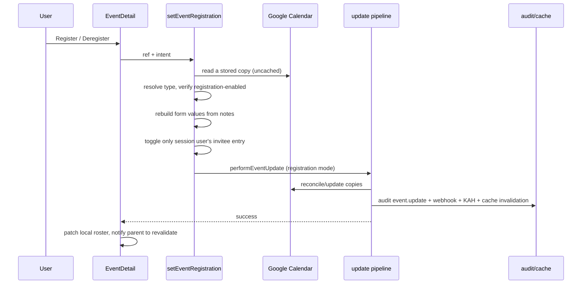

# 1. Registration events

A **registration event** is an ordinary event whose type is marked *Open for
registration* in Settings → Event Types. It keeps the existing event storage,
title, copy reconciliation and participant model; the difference is who may
change what:

- the organizer and admins may edit/delete the event and manage participants;
- everyone else may only add or remove **themselves** as a participant.

Registration is therefore a narrow, self-service participant toggle around the
shared update pipeline — not a separate event store.

## Table of contents

- [1.1 Problem](#11-problem)
- [1.2 Configuration](#12-configuration)
- [1.3 Permission model](#13-permission-model)
- [1.4 Registration flow](#14-registration-flow)
- [1.5 Participants, zero registrants & calendars](#15-participants-zero-registrants--calendars)
- [1.6 UI](#16-ui)
- [1.7 Audit, webhooks & notifications](#17-audit-webhooks--notifications)
- [1.8 Edge cases & limitations](#18-edge-cases--limitations)
- [1.9 File index & tests](#19-file-index--tests)

## 1.1 Problem

The existing modification guard deliberately lets organizers, tagged attendees
and active members of tagged departments edit an event. A sign-up style event
needs the opposite balance: the organizer controls the parameters and roster,
while ordinary users get exactly one action — join or leave. Reusing the
ordinary edit guard would let every registrant rewrite the event; a separate
event store would duplicate identity, notes, copies, audit and cache logic.

## 1.2 Configuration

`event_types.registration_enabled` (boolean, default `false`) is edited in
Settings → Event Types as **Open for registration**. The flag is per type, so an
admin can create a dedicated type (e.g. “Training — Open”) or convert an
existing one.

Enabling it:

- forces `show_invitees` on (the Participants step is the roster);
- hides the organizer-only edit-lock switch in the event wizard (the lock is
  redundant: registration events are always organizer/admin-only);
- allows the event to be created with **zero participants**;
- stops the wizard from auto-seeding the organizer as a participant.

The flag is resolved at read time from the event type, so turning it on/off
affects existing events of that type on the next read.

## 1.3 Permission model

| Actor | Edit parameters | Manage participants | Register/deregister self | Delete/duplicate |
| ----- | --------------- | ------------------- | ------------------------ | ---------------- |
| Admin | Yes | Yes | Yes (detail button) | Yes |
| Organizer | Yes | Yes | Yes (detail button) | Yes |
| Other user | No | No | Yes | No |

The client mirrors this in `EventDetail` (`canModify`), and the server enforces
it in two layers:

1. the existing `modifyGuard` runs first (so a forged ref that is not even on
   the event is rejected);
2. before any write, `performEventUpdate` / `deleteEvent` read the stored copy,
   resolve its type from the notes, and apply `registrationEditGuard` when the
   type is registration-enabled. This authoritative check cannot be bypassed by
   a forged client `EventRef`.

`?edit=` deep links for a registration event open the details modal instead of
the wizard when the actor is not the organizer/admin.

## 1.4 Registration flow

Key properties:

- the client sends only the event ref and `"register" | "deregister"`; the
  roster, title, times, location and organizer all come from the stored copy;
- the action toggles only the session user's id (idempotent);
- registration reuses the ordinary update reconciliation, so copies in
  departments gained/lost by the roster change are created/retired correctly;
- no new database table is introduced.

## 1.5 Participants, zero registrants & calendars

Registrations **are participants** (`inviteeUsers`). Consequently registering:

- adds the user to schedule rows, clash occupancy and KAH checks;
- makes them eligible for participant push notifications;
- adds their department's calendar copy when that department is newly involved
  (the existing target rule).

Registration events always include the **organizer's home department** as a
target, even though the organizer is not a participant. That gives the event a
stable home the creator can still see and manage, while registrant departments
are added as people register. Zero registrants are therefore allowed too: the
organizer's department keeps the event alive. If the organizer has no
department, creation fails with the usual “Assign yourself to a department…”
message.

The organizer is **not** a participant unless they include themselves. A
zero-registrant event is only visible in the calendars it lives in; pinning it
(the existing Pin switch) is the recommended way to advertise it org-wide.

Duplicating a registration event starts with an **empty roster**: registrations
belong to one event, not to its duplicate.

## 1.6 UI

- **Event type form**: “Open for registration” checkbox; forces participants
  on.
- **Event type list**: a “Registration” badge.
- **Event wizard**:
  - no auto-added organizer for a registration type;
  - Participants step explains that people can register themselves and only
    the organizer/admin can edit;
  - organizer-only lock switch replaced by an explanatory note;
  - review shows a “Registration event” badge;
  - zero participants is accepted on submit.
- **Event detail**:
  - "Registration event" badge;
  - the roster is labelled "Registered (N)" and shows an empty state;
  - every eligible actor sees a primary **Register** / **Deregister** button:
    non-organizer/non-admin users see it *instead of* Edit/Delete/Duplicate,
    while the organizer and admins see it *above* their edit actions (so they
    can add/remove themselves without opening the wizard);
  - the button patches the local roster immediately and asks the dashboard to
    revalidate after success.
- **Read-only surfaces** (Double Booking, KAH status, wizard clash detail) never
  show the registration action.

## 1.7 Audit, webhooks & notifications

A register/deregister is a participant change, so it reuses the ordinary update
pipeline:

- one `event.update` audit row with the before→after participant diff, plus a
  flat `registration: "Registered" | "Deregistered"` context field;
- one `event.updated` webhook;
- the best-effort KAH breach check;
- participant notifications compute newly added users, which is always empty
  for a self-registration (the acting user is excluded).

There is no dedicated organizer-notification on someone else registering.

## 1.8 Edge cases & limitations

- **Concurrency**: Google stores the roster in the event notes, so two
  simultaneous registrations are a read-modify-write with last-write-wins.
  Expected volume is low; a future hardening path is a per-event lock or a
  relational roster.
- **Type rename**: per-type flags are resolved by the type name stored in the
  event notes. Renaming a type (pre-existing behavior) means existing events no
  longer resolve its flags until re-saved.
- **Copy churn**: joining/leaving a department can create/retire that
  department's Google copy.
- **Discovery**: with the existing target rule, an event with no registrants
  lives only in the organizer's department. Pinning is the org-wide discovery
  mechanism.
- **Audit noise**: every registration writes an update row/webhook.
- **Department-tagged events**: a member of a tagged department is already a
  participant through the department. The Register/Deregister button only
  toggles the user's **explicit** entry; it cannot remove someone from a tagged
  department without affecting that department's other members.

## 1.9 File index & tests

| File | Role |
| ---- | ---- |
| `src/db/schema.ts` | `event_types.registration_enabled` |
| `src/lib/eventTypes/{validate,actions,queries}.ts` | Type flag, forcing participants, audit/display |
| `src/app/(protected)/settings/event-types/EventTypeForm.tsx` | “Open for registration” control |
| `src/lib/events/queries.ts` | `payload.registrationEnabled` from the type flag |
| `src/lib/events/guards.ts` | `registrationEditGuard` |
| `src/lib/events/registration.ts` | Pure roster toggle + rebuild form values from a copy |
| `src/lib/events/actions.ts` | `setEventRegistration`, shared update pipeline, authoritative checks |
| `src/app/(protected)/dashboard/EventDetail.tsx` | Register/deregister UI and local roster patch |
| `src/app/(protected)/dashboard/EventForm.tsx` | Zero-registrant creation, no auto-self, duplicated-registration reset |
| `src/lib/events/optimistic.ts` | Optimistic payload carries the flag |

Tests: `guards.test.ts`, `registration.test.ts`, `rangeProjection.test.ts`,
`optimistic.test.ts`, `eventTypes/validate.test.ts`, plus the event fixtures
updated for the new payload field.
