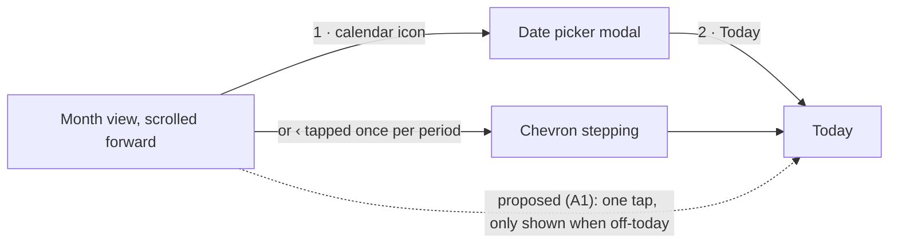
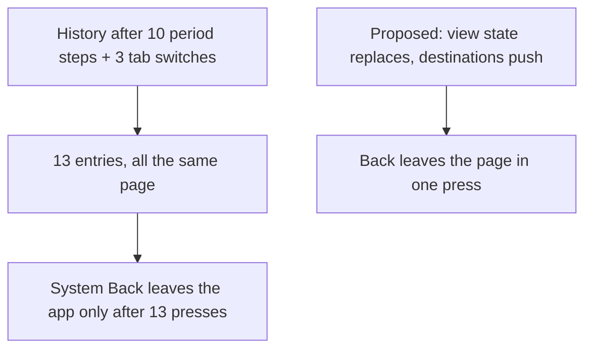
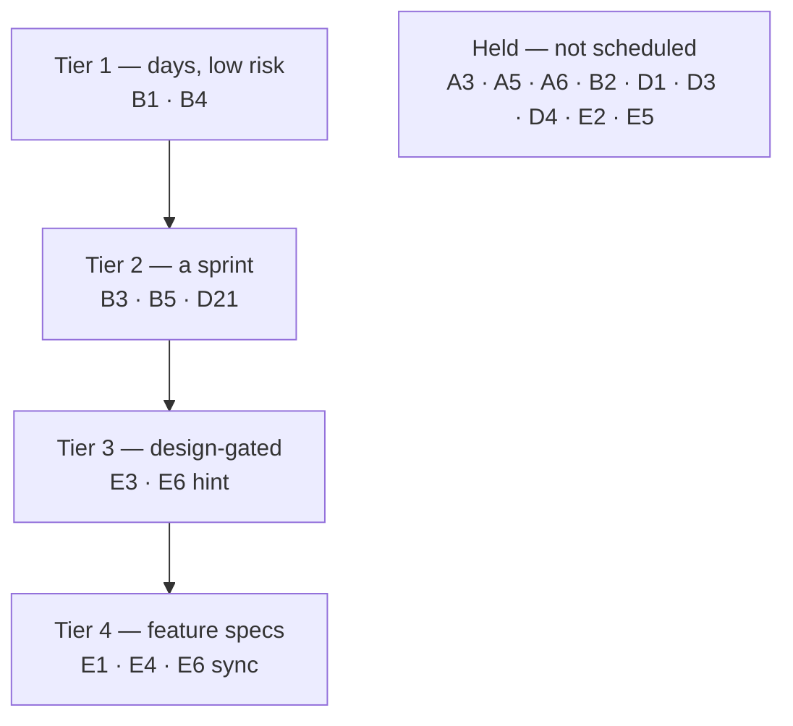

# 1. UI/UX research — improvements that can be made

The standing UI/UX backlog for Cloudy2: what is worth improving, why, where it lives in the
code, how big it is, and in which order to take it. Every finding cites a file and line range
verified against the tree at changelog **1.397** (research date **2026-11-22**, Asia/Singapore),
so a future pass can re-check the claim instead of re-deriving it.

This doc deliberately records **what is already right** (§1.2) as firmly as what is wrong, and
it keeps a **held register** (§1.9) of items that were reviewed and consciously put aside —
those are not to be implemented without a new decision.

## Table of contents

- [1.1 Scope and method](#11-scope-and-method)
- [1.2 What is already strong — do not re-propose](#12-what-is-already-strong--do-not-re-propose)
- [1.3 How to read a finding](#13-how-to-read-a-finding)
- [1.4 Calendar core and the touch model](#14-calendar-core-and-the-touch-model)
- [1.5 Legibility and accessibility](#15-legibility-and-accessibility)
- [1.6 Finding things and information density](#16-finding-things-and-information-density)
- [1.7 Feedback, guidance and trust](#17-feedback-guidance-and-trust)
- [1.8 Workflow level](#18-workflow-level)
- [1.9 Held register](#19-held-register)
- [1.10 Prioritisation](#110-prioritisation)
- [1.11 Implementation guardrails](#111-implementation-guardrails)
- [1.12 Validation and follow-through](#112-validation-and-follow-through)
- [1.13 File index](#113-file-index)
- [1.14 Calendar view review — 2026-11-26](#114-calendar-view-review--2026-11-26)

## 1.1 Scope and method

**In scope:** interaction design, affordance reachability, feedback and guidance, legibility,
accessibility beyond what [`accessibility.md`](accessibility.md) already closes, information
density, and the workflow gaps that show up as UI friction.

**Out of scope:** server performance, the events cache, PWA launch mechanics and the mutation
pipeline — those have their own docs and are, on the evidence, in good shape. Nothing here
proposes a library swap or a rewrite.

**Method.**

| Input       | What was read                                                                                                                                                                                                                                                                                                                                                                                                                                                                                                              |
| ----------- | -------------------------------------------------------------------------------------------------------------------------------------------------------------------------------------------------------------------------------------------------------------------------------------------------------------------------------------------------------------------------------------------------------------------------------------------------------------------------------------------------------------------------- |
| Conventions | `AGENTS.md`, [`progress.md`](../progress.md) (changelog through 1.397 + §1.4 open items)                                                                                                                                                                                                                                                                                                                                                                                                                                   |
| Design docs | all 38 files in `docs/`; read in full: [`accessibility.md`](accessibility.md), [`user-guide.md`](user-guide.md), [`loading-transitions.md`](loading-transitions.md) §1.2 (goals **and non-goals**); targeted: `dashboard-views.md`, `desktop-responsive.md`, `event-lifecycle.md`, `user-picker.md`, `motion.md`, `action-pill.md`, `pwa-offline.md`, `event-clashes.md`, `event-notifications.md`                                                                                                                         |
| UI code     | `DashboardView.tsx` (6,415 lines — chrome, nav row, mobile pill, compact cluster, swipe refs, navigation helpers), `EventForm.tsx`, `EventFormSteps.tsx`, `EventDetailBody.tsx`, `DashboardScreen.tsx`, `AppShellShell.tsx`, `SettingsTabs.tsx`, `ContactList.tsx`, `ParadeStateView.tsx`, `MyEventsView.tsx`, `AuditLogView.tsx`, `EventSearchBody.tsx`, `LoginForm.tsx`, `LoginShell.tsx`, `UserMenu.tsx`, `PreferencesModal.tsx`, `theme.ts`, `globals.css` (3,994 lines), `bottomNav.ts`, `datetime.ts`, `validate.ts` |
| Gap probes  | grep sweeps over `src/` for keyboard handlers, `prefers-reduced-motion`, focus-visible, list virtualisation, undo, print CSS, `navigator.share`, pull-to-refresh, recurrence, timezone handling, `--mantine-scale`, legend/help affordances, `router.push` vs `router.replace`                                                                                                                                                                                                                                             |

**Ranking basis.** There is no usage telemetry in this app, so the ranking is expert review, not
data. Where a finding's value depends on behaviour we cannot see (how often users leave the
calendar scrolled forward, how large the roster gets), that dependency is stated in the finding.

## 1.2 What is already strong — do not re-propose

The app has ~1,400 phases of UI work behind it. These are settled; re-suggesting them is waste.

| Area                 | Already handled                                                                                                                                                                                                                                                                                                         |
| -------------------- | ----------------------------------------------------------------------------------------------------------------------------------------------------------------------------------------------------------------------------------------------------------------------------------------------------------------------- |
| Loading              | Skeleton-only appearance (dimming is banned), `CrossfadeSwap` on every in-place swap, `LoadingStatus` sr-only announcements, the global activity bar + comet head, cold-start readiness bar, `WaitOverlay` on slow routes, preview-first paint for detail surfaces — [`loading-transitions.md`](loading-transitions.md) |
| Perceived speed      | Optimistic event mutations with stand-in chips, tab/period intent prefetch, warm-cache preload, PWA instant open, offline fallback, update pill                                                                                                                                                                         |
| Motion               | `prefers-reduced-motion` honoured in every animation path; the `motionProfile` flag scales cadence app-wide — [`motion.md`](motion.md)                                                                                                                                                                                  |
| Accessibility        | Skip link as first focusable element, one polite live region fed by `announce()`, count badges riding accessible names, dark-scheme contrast pass, keyboard reorder sensor — [`accessibility.md`](accessibility.md)                                                                                                     |
| Empty & error states | Shared actionable `EmptyState` everywhere; branded error / 404 / offline fallbacks                                                                                                                                                                                                                                      |
| Forms                | `validateInputOnBlur` + `showValidationFailure` (toast + scroll to first invalid field) on every form; buttons carry their own loader                                                                                                                                                                                   |
| Pickers              | Badge dialogs (`UserSelectModal` + `PickerField`/`PickerBadges`) instead of searchable selects; no-keyboard dropdowns                                                                                                                                                                                                   |
| Chrome               | Coherent mobile/desktop split at `lg` (640px), compact tier at ≤ 360px, auto-hiding mobile chrome, 44px targets, trigger-origin modal zooms                                                                                                                                                                             |
| Lists                | One shared reorder recipe (`useReorderRows` + FLIP + dnd-kit)                                                                                                                                                                                                                                                           |
| Filters              | Per-view filter sets stored server-side, one header recipe in `FilterModal`, removable summary chips, Reset                                                                                                                                                                                                             |

**Consequence:** the remaining gaps are almost entirely **affordance reachability, feedback and
guidance** — things that exist but are hard to reach, or absent muscle-memory paths — not visual
design.

## 1.3 How to read a finding

Each finding is one block:

- **ID** — stable across edits (A1, B4, …). Cite it in commits and issues.
- **Evidence** — file:line verified at 1.397.
- **Impact** — what a user actually pays for today.
- **Fix** — the shape of the change, including the shared component to reuse.
- **Effort** — `S` (hours), `M` (a day or two), `L` (a design-gated week), `XL` (needs a spec).
- **Respect** — the convention or existing machinery the change must not break.

Statuses: **Tier 1–4** (see §1.10), **Held** (see §1.9) or **Shipped** (see §1.10.1).

## 1.4 Calendar core and the touch model

### 1.4.1 A1 — "Today" is not one tap away anywhere

**Evidence.** `goToday` (`src/app/(protected)/dashboard/DashboardView.tsx:3339`) has exactly one
caller: the date-picker modal (`DashboardView.tsx:6140` → `src/components/DateSelectorModalBody.tsx:139`).
The mobile floating control pill (`DashboardView.tsx:4447-4512`) carries search · filter · date ·
view-menu · fullscreen; the compact-desktop navigator cluster (`:4391-4417`) carries view ·
period label · `‹ ›` · filter · date. There is no overflow menu in the dashboard chrome any more —
the only `IconDotsVertical` left in the folder is the per-row menu inside the Manage-views dialog
(`src/app/(protected)/dashboard/EditViewsModalBody.tsx:340`).

**Impact.** "Back to now" — the single most common gesture in every calendar product — costs a
modal round trip, or one chevron tap per period. From a forward-scrolled month it is the difference
between one tap and fourteen.

**Fix.** A **Today** affordance that exists only when the shown period is not today:

- mobile pill and compact cluster: one more circle/squircle at the existing `36px` circle /
  `40px`+`12px` squircle recipe, ordered next to the period stepper;
- tap-the-period-label → Today (the label is already the primary read-out at
  `:4396-4404` / `:4462-4470`), long-press → the existing date picker;
- announce through `announce()` (`docs/accessibility.md` §1.2) and reuse the existing period
  slide/skeleton path — no new loading indicator.

**Effort.** S.

**Respect.** `useChromeHide` hit-tests every `.c2-chrome-hide-able` rect before starting a hide
(`src/lib/ui/chromeHide.ts`) — a control added to the pill is automatically covered, but a control
added _outside_ it must carry the class or be excluded deliberately. Do not add a second surface
that duplicates the date picker.

**Status.** Shipped **1.399** (2026-11-22; placement revised three times the same day — the first floating version sat top-center over the canvas and covered weekday labels/chips, the second centred the pill in the date-nav row, where a narrow desktop window could still land it on the chevrons): visible only while
today is outside the shown period — pure `isOffToday` (`src/lib/ui/todayAffordance.ts`,
unit-tested) reads the same optimistic `shown*` state as the period label — and **always anchored
immediately left of the period chevrons, never over the canvas**, so it can never cover them and
the controls right of it never move: at `lg`+ a **"Back to Today"** pill is an in-flow child of the
date-nav row just before `‹ ›` (the period label is that row's only flexible child, so it is what
truncates; below 720px of row the `.c2-nav-row` container query drops the pill to a 36px icon
circle — compact desktop
tier: an icon circle stacked under the floating fullscreen button); below `lg` a 56px circle joins
the FAB row left of the `[< | >]` step pill (right-anchored
row). The label tap/long-press variant from the fix sketch was **not** built: a hidden gesture,
and the label stays a pure read-out. §1.10.1.

### 1.4.2 A2 — two docs describe chrome that no longer exists

**Evidence.** [`user-guide.md`](user-guide.md) line 105: "Date-nav arrows move day/week/month; the
⋮ menu has **Today** and **Select date**." [`dashboard-views.md`](dashboard-views.md) line 477:
"**Today / Select date / Enter fullscreen** only (Force refresh …)". Neither menu exists in
`DashboardView.tsx`; fullscreen is now the shared `FullscreenButton`
(`src/components/FullscreenToggle.tsx:44`) and date selection is a circle.

**Impact.** The written product contract is wrong on the app's most-used page; anyone implementing
from the docs re-adds dead chrome.

**Fix.** Correct both docs in the same change as A1, describing the affordance that actually ships.
While editing, make sure neither doc documents held items (§1.9) as if they existed.

**Effort.** S. **Respect.** Doc conventions: TOC anchors, hierarchical numbering, Mermaid where it
helps.

**Status.** Shipped **1.399** (2026-11-22): both docs now describe the real chrome plus the A1
control (Today-jump bullet in `dashboard-views.md` §1.1); the same stale ⋮-menu claim in
`user-guide.md`'s **Fullscreen** bullet was corrected in the same pass. No held item is documented
as existing. §1.10.1.

### 1.4.3 A4 — every period step and tab switch pushes a history entry

**Evidence.** `navigate` (`DashboardView.tsx:2907-2924`) and `navigateLocal` (`:2931-2942`) both
call `router.push`; the in-place date anchor pushes too (`:3413`). Tab switches route through
`switchTab` → `navigate` (`:3269-3337`).

**Impact.** On Android and in the installed PWA the system Back gesture walks the whole stack: ten
chevron taps plus three tab taps means thirteen Back presses before leaving the calendar. Users
experience this as "the app is stuck" or "Back doesn't work".

**Fix.** `router.replace` for period steps and tab switches — they are view state, not destinations
(the URL still carries `?date=`/`?view=`, so deep links and share links are unaffected).

**Effort.** S.

**Respect.** The one-shot params (`refresh`, `edit`, `event`, `_eventCal`, `share`,
`ONE_SHOT_PARAMS` at `:1095`) already strip with `replace`; the SWR document/RSC cache keys and
`useStaleDocumentReconcile` must keep seeing the same URLs. Verify the remembered-page cookie
(`docs/ui-state.md`) still lands on the last context after a replace-only session. Keep
`router.push` for genuine destinations — opening an event deep link, post-save navigation, and
`openClashEventInCalendar` (`:2520-2530`).

**Status.** Shipped **1.399** (2026-11-22): `navigate`/`navigateLocal`, the in-month agenda-day
anchor and the one-shot `edit`/`event` strips all `router.replace(…, { scroll: false })` now;
genuine destinations (event deep links, post-save nav, `openClashEventInCalendar`) keep `push`.
Correction to the Respect note above: at 1.397 only `refresh`/`share` stripped with `replace` —
`edit`/`event` pushed, even though their own comments promised Back would not re-open the modal;
they now honour it. The remembered-page cookie is written client-side from the snapshot state
(`src/lib/ui/uiStateClient.ts`), so replace-only sessions still land on the last context. §1.10.1.

### 1.4.4 A7 — the mobile control pill packs so many circles the date truncates

**Evidence.** Below `lg` the floating control pill (`DashboardView.tsx`, `mobilePill`) renders the
period label and **six** circles — search / filter / date / view menu / fullscreen / guide **?** —
in one non-wrapping row. Six 36px circles + five 10px gaps are **266px** of fixed width; the pill
leaves the viewport minus 54px (16px edge insets + 10px padding + hairline), so the label's budget
is **≈30px at 360px**, **≈60px at 390px** and **≈100px at 430px** — against ~122px for
"Wed, Nov 22, 2026". Its `truncate` therefore fires on every phone in the range, and the row
neither wraps nor pans, so nothing else is reachable either.

**Impact.** The period label is the pill's only text and the anchor of the whole screen: a
truncated "Wed, N…" costs the user exactly the fact they were checking. The pill also has no
overflow affordance — the controls simply compress everything else.

**Fix.** Make the label a **static read-out** that never surrenders width and let the controls
**pan**: a wrapping flex row (`.c2-pill-row`) with the label on the left and a horizontally
scrollable strip (`.c2-pill-scroll`) on the right, flex-basis `--c2-pill-actions-min` so the row
breaks to a second line only when the label and a minimum strip genuinely cannot share it.
Right-anchor the strip with an auto margin (never `justify-content: flex-end`, which clips the
scroll start), keep the strip `pointer-events: none` so the tap-through contract and the
chrome-hide hit-test are untouched, and reuse the `RailEdgeControl` fade recipe (`useScrollEdges`)
to show which side still has content. Drop the pill's **Guide "?"** in the same pass — the profile
menu already carries the sheet at every width — which frees 76px on every phone.

**Effort.** S.

**Respect.** `.c2-control-pill` is shared with the Contacts and Parade State pills — their layout
must not change. The pill's height is auto-measured (`bottomBarRef` → `--c2-bottom-chrome-height`),
so a two-line pill reflows the FAB offset and the page pads by itself; do not hard-code a height.
`scroll` does not bubble, so a strip pan must never start a chrome hide — keep it that way.
_(Superseded in part by **A8** at 1.412: the pill became the shared `ControlPill` and the other
pages' pills deliberately took the same layout, each measuring its own height.)_

**Status.** Shipped **1.403** (2026-11-22): `.c2-pill-row` / `.c2-pill-label` / `.c2-pill-actions`
/ `.c2-pill-scroll` / `.c2-pill-edge` in `globals.css`; `useScrollEdges` gained a `ResizeObserver`
(a sibling reflow changes the clip) and starts unclipped on both edges so no false fade flashes
before the first measurement; the Guide "?" is gone from the dashboard chrome at **both** tiers.
`dashboard-views.md` §1.1 (pill-layout bullet) and §1.2. §1.10.1.

### 1.4.5 A8 — the cramping A7 fixed on the calendar still ships on the other bottom pills

**Evidence.** A7's panning-strip recipe lived only inside `DashboardView`'s `mobilePill`. The other
`.c2-control-pill` surfaces still rendered a plain `Group wrap="nowrap"`: Parade State
(`ParadeStateView.tsx`, `mobilePill`) put the day label + **six** 36px circles in one non-wrapping
row — 266px of fixed controls against a ~306px pill interior at 360px, so the label's budget is
**≈30px** and "Wed, Nov 22, 2026" ellipses to a couple of characters; Contacts (`ContactList.tsx`)
and `SettingsListChrome` (Users / Departments / Event Types) put a `TextInput` with
`flex: 1, minWidth: 0` beside two-to-three **44px** circles, so the search box shrinks toward
~104px at 320px and the circles press into the pill's rounded caps. Each page also **hardcoded**
the pill's height (58 / 50 / 58px) for its page pad, so nothing about the row could give way.

**Impact.** Parade's date read-out — the fact that page is about — disappears on every phone below
~430px. The list pills' search fields get too narrow to type into, and because the pads assume a
one-row pill, any taller pill would sit on top of the last card row.

**Fix.** Extract the calendar's pill into a shared **`ControlPill`** and render all four surfaces
through it: a leading slot (the read-out, or a `.c2-pill-field` search box whose flex-basis is
`--c2-pill-field-min`, so the strip gives up the line before the field is squeezed) plus the
panning circle strip with edge fades, `--c2-pill-actions-min` computed per pill from its circle
size and count (pure `pillActionsMin`). Measure the pill per page (`useElementHeight`, callback
ref) and publish it to that page's pad (`--c2-bottom-chrome-height`, `--c2-settings-pill-height`,
Parade's attendance-bar offset) instead of hardcoding a height.

**Effort.** M.

**Respect.** The tap-through contract (`pointer-events: none` on the surface and the strip, buttons
opting back in) must survive — it is what keeps a pill gap from swallowing list taps and what the
calendar's chrome-hide hit test relies on. Keep the 44px circles on the list pills
([`accessibility.md`](accessibility.md) §1.9) and the 36px on the calendar/Parade pills; never
shrink a control to make a row fit. Parade's search-open state must drop `minActions` to 1, or its
lone close circle wraps to a row of its own.

**Status.** Shipped **1.412** (2026-11-23): `src/components/ControlPill.tsx`,
`src/lib/ui/controlPill.ts` (+ `pillActionsMin` tests) and `src/lib/ui/elementSize.ts`
(`useElementHeight`); `.c2-pill-field` / `.c2-pill-label--fill` / `--c2-pill-field-min` and the
var-driven `.settings-pill-page-pad` in `globals.css`; `DashboardView`, `ParadeStateView`,
`ContactList` and `SettingsListChrome` (+ the three settings pages) render the shared pill.
[`dashboard-views.md`](dashboard-views.md) §1.1 (pill-layout + pill-reuse bullets) and
[`desktop-responsive.md`](desktop-responsive.md) §1.5/§1.6/§1.13.

### 1.4.6 A9 — the auto-hiding pill is wrong on the pages that borrowed it

**Evidence.** 1.324 extended `useChromeHide` from the calendar to the Contacts pill and the Parade
State pill + attendance mode bar, and `SettingsListChrome` mounted it as well. On those pages the
pill is the **only** search/filter/action surface below `lg` (their sticky top bar is `lg`-only),
so scrolling a long roster hides the very controls the user is scrolling to reach — and revealing
them again costs a second gesture.

**Impact.** Searching Contacts or Parade State means scrolling, waiting for the settle, then
tapping a control that vanished mid-scroll; on the settings lists the create/manage actions hide
the same way. The calendar can afford the behaviour because its pane _is_ the content worth the
room and the same controls also live in its pinned top strip.

**Fix.** Scope the auto-hide to the calendar page: drop `useChromeHide` and the
`c2-chrome-hide-able` classes from Contacts, Parade State and `SettingsListChrome`, leave
`advanceChromeHide` / `useChromeHide` exactly as they are for the dashboard's pill + FAB row, and
say so in the hook's doc comment plus the docs that describe the behaviour.

**Effort.** S.

**Respect.** Do not delete the chrome-rect hit test or the `.c2-chrome-hide-able` CSS — the calendar
still needs both, and the minimized-draft chip rides the FAB row's hide state. Parade's attendance
bar keeps its own exit transition (`c2-attendance-bar-closing`); only the hide-on-scroll coupling
goes, along with the `resetKey: attendanceMode` that existed to stop it mounting hidden.

**Status.** Shipped **1.412** (2026-11-23): `useChromeHide` is mounted by `DashboardView` alone;
Contacts / Parade State / `SettingsListChrome` no longer import it (the settings chrome's
`paneRef` prop is gone with it). `chromeHide.ts` header, the `globals.css` hide-rule comment,
`AGENTS.md`, [`dashboard-views.md`](dashboard-views.md) §1.1 (auto-hide + pill-reuse bullets) and
[`desktop-responsive.md`](desktop-responsive.md) §1.5/§1.6 updated.

### 1.4.7 Not re-proposed here

Swipe-to-change-period on the non-Agenda grids (A3), drag-to-create/reschedule (A5) and delete undo
(A6) were reviewed and are **held** — see §1.9.

## 1.5 Legibility and accessibility

### 1.5.1 B1 — event chips still fail the dark-scheme boundary test

**Evidence.** [`accessibility.md`](accessibility.md) §1.7 records it as "Known-but-untouched":
calendar event chips sit at **1.08–1.76:1** against the grid in the dark scheme, with the chosen
treatment already specified — a hairline ring via
`color-mix(in srgb, var(--event-color) 45%, transparent)` on `.c2-schedule-event .c2-event-inner`.
No such rule exists in `src/app/globals.css`.

**Impact.** In dark mode the event chips read as floating text with no edge; the boundary is a
WCAG 1.4.11 (≥ 3:1) target.

**Fix.** Apply the documented ring to the schedule chips **and** the Month-grid chip equivalent
(the library hook classes are already wired in `src/lib/theme.ts:103-105`), keeping the existing
amber/purple state rings (`:2988-3004`) visually distinct.

**Effort.** S. **Respect.** Dark-only rules (`[data-mantine-color-scheme="dark"]`); no layout
shift — `--badge-bd`-style transparent borders change colour only.

### 1.5.2 B3 — sub-11px text in dense surfaces

**Evidence.** Hard-coded literals in `src/app/globals.css`: `11px` (`:1314`), `10px` (`:1332`),
`0.5625rem` = 9px (`:3528`, `:3683`, `:3736`, `:3747`), `0.6875rem` = 11px (`:3741`). The Month
grid additionally inherits the schedule library's auto-size text tiers, which is exactly why
`monthFitChipCount` keeps a 21px chip-slot floor "above the library's 9px auto-size text tier"
(`AGENTS.md`, dashboard views bullet).

**Impact.** 9–10px labels are below the practical floor for a mobile app, and — because page
magnification is switched off app-wide (`globals.css:63-66`,
[`accessibility.md`](accessibility.md) §1.8) — there is no user-side escape hatch on a phone.

**Fix.** Raise every literal to a tokenised 11px minimum (`font-size: max(0.6875rem, …)` style
guards where the library drives the size), then re-check the Month chip-count trade-off: fewer
legible chips per cell beat more unreadable ones. **This finding stands on its own** — it is not
gated on the held text-size control (B2).

**Effort.** S. **Respect.** Keep the compact tier (≤ 360px, `NARROW_MEDIA_QUERY`) working; re-run
the `monthFitChipCount` legibility floor tests after the change.

### 1.5.3 B4 — no legend for the amber "mine" / purple "external" encodings

**Evidence.** Parade State names its colour semantics with a legend
(`src/app/(protected)/parade-state/ParadeStateView.tsx:1177`); the dashboard has none — the string
`legend` does not occur anywhere in `src/app/(protected)/dashboard/`. The encodings themselves are
`c2-my-*` / `c2-ext-*` rules in `globals.css` (`:2988-3004`) plus the amber row tints.

**Impact.** A new user cannot tell why one chip is ringed amber and another purple; the meaning is
only in the source and the admin-facing docs.

**Fix.** A compact legend in the view menu (and the "?" popover from D2): _mine_, _external
(created in Google)_, plus the event-colour note. Keep the existing non-colour cues (ring, bold,
side bar) so the legend explains rather than becomes load-bearing.

**Effort.** S. **Respect.** Colour must never be the only channel (WCAG 1.4.1).

### 1.5.4 B5 — no keyboard layer on desktop

**Evidence.** Keyboard handling is sparse and entirely local — a grep for `onKeyDown` / keydown listeners across
`src/` returns 19 lines (imports and comments included): wizard Enter suppression
(`EventForm.tsx:678`), the time cells (`TimeSelectField.tsx:158`), and a handful of row-activation
handlers. The only shortcut the app advertises is `aria-keyshortcuts="Escape"` on wizard minimize,
and no global key handler exists.

**Impact.** Desktop users (the `lg` shell starts at 640px, so this includes foldables) drive a
calendar entirely by mouse: no `T` for today, no arrow stepping, no `/` for search.

**Fix.** A pure keymap module (`src/lib/ui/shortcuts.ts`, unit-tested) + a `useKeyboardShortcuts`
hook mounted by `DashboardView`: `←`/`→` period, `T` today, `1`–`6` view kinds, `N` new event,
`/` search, `?` shortcut sheet. Inert while focus is in an input, an open menu, or a dialog;
announced through `announce()`.

**Effort.** M. **Respect.** Never intercept keys inside Mantine popovers/comboboxes; the sheet must
be discoverable (D2) or the feature is folklore.

### 1.5.5 B6 — rule, not a task

Every affordance added under this plan ships its accessibility **in the same change**: accessible
name, `announce()` for state changes with no toast, correct focus order, and a `docs/accessibility.md`
row where the pattern is new.

## 1.6 Finding things and information density

### 1.6.1 C1 — the Settings tab strip is a bare scroller

**Evidence.** `src/app/(protected)/settings/SettingsTabs.tsx:11-25` defines **13** tabs; the list is
rendered `overflowX: "auto"` with no edge affordance (`:63-100`), fixed above the bottom nav below
`lg`. The bottom nav already solved the identical problem with a right-edge fade and a decorative
chevron (`AppShellShell.tsx:198` `RailEdgeControl`, used at `:1433-1434`).

**Impact.** Admins don't discover Webhooks / Feature Flags / Parade State Email because the strip
gives no hint it scrolls, and the active tab can be off-screen on entry.

**Fix.** Reuse the `RailEdgeControl` fade+chevron recipe, scroll the active tab into view on mount,
and group the tabs — **Roster** (Users, Departments) · **Events** (Event Types, Templates) ·
**Delivery** (Webhooks, Quick Links, Parade State Email, Banner) · **System** (KAH Groups, General,
Security, Audit Log, Feature Flags) — as section separators at `lg`+ and an index list below `lg`.

**Effort.** S–M. **Respect.** `SettingsTabs` owns the sticky-height measurement published through
`SettingsShell`; grouping must not change the measured chrome height contract.

**Status.** Shipped **1.401** (2026-11-22): the 13 tabs now read as four groups — **Roster ·
Events · Delivery · System** — with labelled separators at `lg`+ (only KAH Groups moved to fit
the groups; below `lg` the strip stays the same scroller, since separators would grow the
measured chrome height). Both tiers gained the bottom-nav rail's fade + chevron edge affordance
(`RailEdgeControl` extracted to a shared component; pure `measureScrollEdges` +
`useScrollEdges` in `src/lib/ui/scrollEdges.ts`, unit-tested), and the active tab is centred in
the scroller on entry. The height contract is measured, so it adapts unchanged. §1.10.1.

### 1.6.2 C2 — Contacts is a flat card wall

**Evidence.** `src/app/(protected)/contacts/ContactList.tsx:356-403`: every match renders a bordered
`Paper` card; there are no alphabetical sections, no jump index, no sort control, and the name is
printed twice — `user.name` at `:362` and again inside `formatFullName(...)` at `:370-373`.

**Impact.** A phone list is a lookup tool; scrolling an unsectioned card grid to find a name is the
slowest possible interaction for the page's actual job.

**Fix.** Alphabetical section headers + a jump index (A–Z rail or a chip row), a sort control
(name / department), and drop the duplicated name line. Consider a denser row recipe than a card.

**Effort.** M. **Respect.** Keep the `.card-grid` responsive recipe and `c2-defer-render`; the VCF
export must keep following the active search + filter set (`:160-162`).

**Status.** Shipped **1.401** (2026-11-22): the card wall is now one bordered container of
hairline-separated **dense rows** (template name + shortname, phone + department/role chips,
copy/call pinned right — the duplicated raw-name line is gone; the template line is the primary,
matching the VCF export and Parade State). Sections follow the active **sort** (name ↔
department, a menu beside the search box; pure `buildContactSections`/`buildContactRail` in
`src/lib/contacts/sections.ts`, unit-tested), and a right-edge **A–Z rail** (one letter per
section initial, tap = smooth scroll to the section, `scroll-margin` clears the sticky chrome)
appears from four sections up. Deliberate deviation from the Respect note, by decision: the
denser row recipe replaces `.card-grid` on this page (`c2-defer-render` stays, per row). The VCF
export still follows the active search + filters. **Follow-up 1.402:** the first cut drew one
continuous container with plain section seams, and floated the rail as a viewport-fixed column
_outside_ the border on the scrollbar zone with no active state and ~16px rows — users reported
it detached, unclickable and unlit. Now **every group is its own rounded card** (letter groups
for the name sort, department groups for the department sort), the rail is a **sticky pill beside
the cards** — pinned under the chrome through the list, 26×20 letter targets, the current
section's letter highlighted as you scroll (capture-phase scroll listener + pure
`activeSectionKey`), and the jump announced. **Follow-up 1.409:** the rail is a
**viewport-centred index** now instead of a block pinned under the chrome — sticky `top` is
`50dvh − height/2` from the height the component declares (`--c2-rail-h` from
`contactRailHeightPx`), clamped under the sticky bar by `max()` and internally scrollable when it
is taller than the window, so no letter is ever unreachable. And on wide screens the **rows inside**
each group card flow into auto-filling columns (`.c2-contact-rows`, each cell drawing its own
top/left hairline, the blank area beside a partial last row ruled by the last cell, so columns stay
uniform and the matrix stays closed) while the groups themselves stay **one per row** —
gridding unevenly sized groups reintroduces exactly the empty space a phone list should not spend.
**Follow-up 1.413:** the rail is a press-and-hold **scrubber** now — slide along it and the list
follows the letter under the pointer (instant scroll per section, live-band mapping + edge
auto-scroll in pure `railIndexFromPoint`/`railScrubEdgeDirection`, `touch-action: none` so drags
never pan the page), while taps keep their smooth jump + announcement.
§1.10.1.

### 1.6.3 C3 — Parade State has no name search

**Evidence.** `ParadeStateView.tsx` has no text input at all — narrowing the roster means opening the
Users filter modal (`:1365-1371`); the sticky/floating chrome carries day step · filter · date ·
attendance · fullscreen (`:1085`, `:1318`).

**Impact.** This is the page used live during roll call. Finding one person in a large org costs a
modal, a search box inside it, and an apply round trip.

**Fix.** A search field in the existing chrome (sticky at `lg`+, in the floating pill below)
filtering the rendered roster client-side over the already-loaded users, reusing the Contacts text
semantics. Attendance mode must be unaffected — a filtered list must not silently change what
"present" counts.

**Effort.** S–M. **Respect.** The attendance report (`attendanceReport.ts`) and the `X/Y` headers are
aggregations; a search filter must not narrow them.

**Status.** Shipped **1.401** (2026-11-22): a **Search roster** field in the sticky day-nav row at
`lg`+, and below `lg` a search **circle** in the control pill that swaps the day label for an
inline field (✕ clears and restores the label; the other circles hide while it is open, and the
pill rides the Contacts keyboard lift). The filter is client-side over the already-loaded users
with the Contacts text semantics (fuzzy over name + shortname). The Respect note holds exactly:
only the cards filter — section headers keep the section's full aggregate, the attendance bar's
`X/Y present`, the roll-call summary and the Copy report all stay org-wide. §1.10.1.

### 1.6.4 C4 — My Events has range and paging but no text filter

**Evidence.** The sticky chrome holds only `TimeRangeSelect`
(`src/app/(protected)/my-events/MyEventsView.tsx:298-305`); the empty state and paging follow at
`:314-320`.

**Impact.** "Which conference did I create in June?" requires paging 20 rows at a time.

**Fix.** A search box mirroring the dashboard's event-name filter semantics
(`src/lib/events/textFilter.ts`, case-insensitive substring over typed name + rendered title) so the
vocabulary is identical across surfaces.

**Effort.** S. **Respect.** Range and page stay in the URL (`?range=`, `?page=` mirrored with
`history.replaceState`, `docs/loading-transitions.md` §1.8); a search term should follow the same
rule or stay deliberately ephemeral — decide, don't drift.

**Status.** Shipped **1.401** (2026-11-22): decision — **mirror `?q=`**, same rule as range/page.
A search box in the sticky chrome, debounced 300 ms, resetting to page 1; the filter runs
**server-side** inside `buildMyEventsPage` before the page slice (paging is server-side, so a
client-only filter would miss rows on other pages) via pure `filterMyEventRowsByTitle`
(`src/lib/events/myEvents.ts`, unit-tested) over the dashboard filter's substring semantics
(`textFilter.ts`). The always-fresh adoption gate compares range + page + q. §1.10.1.

### 1.6.5 C5 — audit-log timestamps are absolute only

**Evidence.** `AuditLogView.tsx:607` and `:672` render `formatLogTimestamp(row.createdAt)`; the
mobile row splits the same absolute string.

**Impact.** In a log you scan for "what just happened", absolute timestamps force mental arithmetic.

**Fix.** Relative primary ("12 min ago") with the absolute value as secondary text or a tooltip;
keep the CSV export absolute.

**Effort.** S. **Respect.** The audit log is the one always-fresh route
(`docs/audit-log.md`) — a relative label must not imply live polling that doesn't exist.

**Status.** Shipped **1.401** (2026-11-22): the relative age leads (reusing the shared
`relativeChangeLabel` from `changeTrail.ts`) with the absolute UTC+8 stamp as the secondary line
— stacked under the age on the desktop Time column, under the action label on mobile cards. The
age is computed once per render, so it reads as "age at load" on this fresh-on-entry route; no
polling added or implied. The detail modal and the CSV export stay absolute. §1.10.1.

### 1.6.6 C6 — the event detail modal renders every participant badge

**Evidence.** `EventDetailBody.tsx:376-385` maps all resolved people into `Badge`s with no cap; the
same unbounded pattern for departments at `:416-429`.

**Impact.** A department-wide event becomes a wall of chips that pushes the action row off-screen —
on the one surface where the user came to read, not scroll.

**Fix.** Cap + "+N" using the shared `PickerBadges` recipe (`docs/user-picker.md` §1.6, cap 5 +
overflow), with the full list in an expandable section.

**Effort.** S. **Respect.** Keep the `(You)` marker and `c2-my-badge` ring on the current user even
when they fall outside the visible cap — pin that chip first.

**Status.** Shipped **1.401** (2026-11-22): participants and departments render through the shared
`PickerBadges` recipe capped at 5, and the **"+N" is the expand trigger** (tap → full list →
"Show less"; state resets when a different event opens). The signed-in user's chip is pinned
first by pure `capBadgeItems` (`src/lib/ui/badgeCap.ts`, unit-tested), so the `(You)` marker and
`c2-my-badge` ring survive any cap; `PickerChip self` carries the same amber treatment as before.
§1.10.1. **Follow-up 1.416** (C7): the two capped lists merged into one Participants section and
the read-only chips dropped to compact Badge size.

### 1.6.7 C7 — the detail modal split one audience across two lists and mixed two pill grammars

**Evidence.** Verified at 1.415: `EventDetailBody.tsx` rendered the people under **Participants**
and the departments under a separate **Departments** section — each with its own `PickerBadges` cap
and "+N" — so a department-tagged event showed one audience as two lists, and users read the
department list as _other_ people rather than as groups already covering the people above; both
sections rendered their chips at the tappable 36px `--c2-chip-height` size — the size
`PickerField` reserves for removable chips — while the event-type pill beside them rendered as a
plain compact Badge, so one row carried two pill grammars with no meaning attached to the
difference; and the ⋮ menu named two actions by mechanism, not effect: **Copy event** (which
creates a new event) and **Add to Google Calendar** (which copies the event to another
department's calendar).

**Impact.** Reported by users directly — "combine the entries under Departments under the
Participants section… the users are confused otherwise." Meanwhile the oversized read-only chips
inflated the modal's busiest row and borrowed the size that means removable elsewhere, teaching a
tap that does nothing.

**Fix.** One **Participants** list — people first (self pinned, per C6), then departments as
accent chips with an sr-only "department" suffix — under one cap and one "+N"; read-only chips
render as compact Badges, keeping 36px for tappable/removable; rename the actions to
**Duplicate Event** and **Copy to Other Google Calendar**.

**Effort.** S. **Respect.** C6's pin rule survives the merge (`capBadgeItems` keeps self first);
the standalone share tooltip "Add to other Calendars" is a different surface and stays.

**Status.** Shipped **1.416** (2026-11-24): all of the above landed — one `participantItems` list
(people `user:<id>`, then departments `dept:<name>` with `srSuffix="department"`), one
`capBadgeItems` cap + one "+N" button (`aria-expanded`; "Show all N Participants/Registrants" ↔
"Show fewer …"), `PickerBadges size="compact"` through the new `PickerChipSize`
(`src/components/PickerField.tsx`), and the two menu renames. The chip-size rule is written down
in [`user-picker.md`](user-picker.md) §1.6. §1.10.1.

### 1.6.8 C8 — details-modal section headers floated a full stack-gap from their content

**Evidence.** Verified at 1.417: every section of `EventDetailBody.tsx` was a flat sibling of
the body `Stack` (Mantine's default `lg` spacing), so the "Location" / "Event Type" /
"Owner" / "Participants" / "Remarks" labels sat the same 16px above their pills as the
sections sat apart — the label read as a leftover from the section above rather than the
title of the row below it.

**Impact.** The modal's busiest surface asked the user to re-associate each small dimmed
label with its content across a gap wider than the content's own internal spacing.

**Fix.** A local `DetailSection` recipe (label + content in a 4px `Stack`) for every
labelled section; the outer Stack keeps the between-section rhythm.

**Effort.** S. **Respect.** Pure structure — no markup, copy or behavior changes inside
the sections.

**Status.** Shipped **1.418** (2026-11-24): `DetailSection` wraps Location, Event Type,
Owner, Participants/Registered (both branches) and Remarks; header→content is now 4px,
section→section unchanged. §1.10.1.

## 1.7 Feedback, guidance and trust

### 1.7.1 D2 — there is no in-app help anywhere

**Evidence.** Protected routes are `dashboard`, `parade-state`, `contacts`, `double-booking`,
`my-events`, `kah-status`, `settings` — no help/guide route exists. The profile menu
(`src/components/UserMenu.tsx:141-192`) offers version, theme, Calendar Access, Notifications,
Preferences, Log out. Meanwhile [`user-guide.md`](user-guide.md) is a maintained 280-line guide
nobody inside the app can reach.

**Impact.** Every question about per-view filters, attendance mode, pinning or share links becomes
a message to an admin.

**Fix.** A lightweight Guide sheet: one "what this page is for" block per route, the shortcut list
(from B5), and "ask your admin about your login keyword". Opened from the profile menu and a "?" in
the dashboard chrome. Render from a small typed content module, not a new CMS.

**Effort.** M. **Respect.** It must not become a second source of truth for the user guide — link
out, don't fork the prose.

**Status.** Shipped **1.400** (2026-11-22): a `GuideSheet` modal rendered from the typed content
module `src/lib/help/guideContent.ts` (pure route matcher, unit-tested) — one short "what this page
is for" block per route, the current page's block first with a "This page" badge, and a footer
pointing to the admin-held user guide (no prose forked; there is no hosted guide URL to link).
Opened from the profile menu at every width **and** a **"?"** circle in the dashboard chrome — the
wide toolbar's right-anchored tail and the mobile control pill. **1.403 removed both "?" triggers**
(A7): the profile menu is now the only entry at every width. The **shortcut list is
deliberately absent**: it was sourced from B5, which is not built, and a guide must not
advertise folklore — add the section when
B5 ships. §1.10.1.

### 1.7.2 D5 — saving the only preference reloads the whole document

**Evidence.** `src/components/PreferencesModal.tsx:61` calls `window.location.reload()` after
`setWeekStart`, preceded by `clearAllDashboardSnapshots()`.

**Impact.** A one-control dialog destroys scroll position, warm client state and any in-progress
draft, for a change the dashboard can already re-derive.

**Fix.** Invalidate the snapshots and revalidate in place through the dashboard's own
`revalidate()` (`docs/dashboard-views.md`, `docs/loading-transitions.md` §1.15) instead of a
document reload. Keep the dialog's layout extensible so a future control needs no rework.

**Effort.** S. **Respect.** The week start changes the fetch set for every week/month grid — the
snapshot clear must stay, only the reload goes.

**Status.** Shipped **1.400** (2026-11-22): the dialog now clears the snapshots (kept), fires a
`cloudy2:prefs-changed` window event (`src/lib/ui/prefsChanged.ts`, mirroring the
`events-changed` bus), confirms with a green toast and closes. A mounted `DashboardScreen` listens
and calls its own `revalidate()` — the fresh record carries the new `weekStartsOn` and every grid
rebuilds in place; scroll, drafts and warm state survive. On other routes no listener exists and
none is needed: the cleared snapshots make the next dashboard visit re-read (Parade State's
server-read week start refreshes on its next mount). §1.10.1.

### 1.7.3 D6 — success feedback is split between the action pill and raw toasts

**Evidence.** The house rule is the shared action pill for actionable feedback
(`docs/action-pill.md`, `src/components/ActionPill.tsx`), yet `EditViewsModalBody.tsx:199` and
`:234`, `EventDetailBody.tsx:229`, and `EventForm.tsx:1042` call `notifications.show` directly.

**Impact.** Two visual languages for the same moment; outcomes that _could_ offer a follow-up action
(open the saved event, retry) don't, because they were rendered as inert toasts.

**Fix.** State the boundary in this doc and in `action-pill.md` — **actionable → pill, inert
confirmation → toast** — and migrate the actionable cases (e.g. "View deleted event's history",
"Open the saved event").

**Effort.** S. **Respect.** The `savedEventToastVariant` flag already owns the post-save
presentation (`docs/feature-flags.md`); don't fork that path — extend it.

**Status.** Shipped **1.400** (2026-11-22): the boundary — **actionable → pill, inert confirmation
→ toast** — is now stated in [`action-pill.md`](action-pill.md) §1.2. Migrated: the delete success
in `EventDetailBody` is a pill offering **History**, opening the shared `EventHistoryModal` hosted
by `DashboardView` (the details modal is gone by tap time; payload-less external events and hosts
without a trail modal keep the green toast). Audited the other cited sites: `EditViewsModalBody`
"View updated"/"View deleted" are inert confirmations (the boundary legitimizes the toast), and
`EventForm.tsx:1042` is the flag's own `toastPlain` variant — flag-owned, untouched. §1.10.1.

### 1.7.4 D7 — offline writes fail after the user has done the work

**Evidence.** [`user-guide.md`](user-guide.md) §1.10: "Offline is **read-only** — creating or editing
shows an error until you're back online." Nothing in the wizard consults `navigator.onLine`
(the flag is consulted only for prefetch suppression, `DashboardView.tsx:2953`).

**Impact.** A user in a basement or on a flight fills a seven-step wizard and is rejected at
submit.

**Fix.** While `navigator.onLine === false`: mark the create/save affordances as unavailable with a
one-line reason, and route the user to the wizard draft (which already survives minimize and reload,
`docs/accessibility.md` §1.6) instead of letting them lose the work.

**Effort.** S–M. **Respect.** Offline detection must be an enhancement, never a gate that
misfires on a flaky connection; the server remains the authority.

**Status.** Shipped **1.400** (2026-11-22): the connectivity signal is one shared hook,
`useIsOffline` (`src/lib/ui/onlineStatus.ts` — the SSR-safe pattern the amber `OfflineBanner`
already used, now refactored onto it, so strip and affordances can't disagree). While
`navigator.onLine === false`: every wizard start is refused at the single `requestFormStart` choke
point (nav button, FAB, day modal, agenda button alike) with a one-line toast reason, the New-event
affordances render disabled beside the standing amber banner, and the wizard's
"Create event"/"Save changes" submit is disabled with a quiet one-liner — _"You're offline — your
draft is saved. Reconnect to submit."_ — plus an `announce()` guard for implicit Enter-submits. The
draft itself is untouched by all of it (it already survived minimize and reload), and because only
a genuinely interface-less device reports offline, a flaky connection never trips the gate.
§1.10.1.

### 1.7.5 D8 — the KAH Status page never followed its sibling report pages

**Evidence.** Verified at 1.413: `KahStatusView.tsx` scrolled its header + Look-ahead control
away with the list (`:220-234`) while Double Booking and My Events pin the same block under the
app header; the result counts were crammed into the page subtitle (`:222-224`) and a range change
announced nothing (the cards render `live={false}`); a failed range change was a toast + silent
revert (`:136-144`) where Double Booking offers an inline error + Retry; the no-breach case was a
bare dimmed `Text` (`:306-308`) against the actionable-`EmptyState` house rule; the card heading
`40% of 60%` (`:272`) needed the docs to decode; and the roster chip cap (`:84-87`) could hide the
"(You)" chip — exactly what C6's `capBadgeItems` exists to prevent.

**Impact.** The page answers the same question as Double Booking ("am I clear for the next N
months?") with a worse copy of every affordance the sibling pages already ship: the range control
scrolls off a long 6/12-month list, a failed scan dead-ends, screen-reader users get no feedback
from the range change, and the heading forces the user to re-learn the worst-vs-required reading.

**Fix.** Adopt the sibling recipes wholesale: the shared sticky head (generalize Double Booking's
`.c2-db-head` CSS to a shared `.c2-report-head` used by both pages), a `role="status"` summary
line above the cards, the admin hint folded into the subtitle, an actionable `EmptyState` for the
clear case, the inline error + Retry strip, human-readable heading copy, `capBadgeItems` for the
chip cap, and the "advisory, never blocks" footnote.

**Effort.** S.

**Respect.** No data-layer change — `viewData.ts` / `statusActions.ts` untouched; the per-view-only
range rule and the `WaitOverlay` skeleton stay; the generalized head CSS must keep Double Booking's
layout identical; `loading.tsx` must mirror the new head.

**Status.** Shipped **1.414** (2026-11-24): all of the above landed as specified — sticky
`c2-glass-surface` head with the range pill right at 40em+, live summary line ("2 breach periods in
the next 1 month — 1 active, 1 upcoming"), admin hint in the subtitle, green-check `EmptyState` +
**Open calendar** for the clear case, inline error + Retry (the selected look-ahead is kept for the
retry, like Double Booking), "Alpha — 40% in country (needs 60%)" headings, `capBadgeItems`-capped
roster chips, and the advisory footnote. [`kah.md`](kah.md) §1.7. §1.10.1.

### 1.7.6 D9 — full-day and half-day events leaked into the next day

**Evidence.** Verified at 1.414: `halfDayRange` (`src/lib/datetime.ts:282-294`) stores a PM-only
window with an exclusive end at next-day `00:00:00`, and the clash display layer expanded that
exclusive end naively — `clashCoveredDayKeys` (`src/lib/events/clashDisplay.ts`) counted the end
day as covered, `clashDayBuckets` therefore bucketed a pair of PM half-days a second time on the
next day, `buildClashTimeline` (`src/lib/events/clashTimeline.ts`) clamped the zero-width window to
a `MIN_BAR_MINUTES` stub at 00:00, and the time labels rendered the end as "12:00 AM".

**Impact.** A PM half-day on Sep 14 displayed as an event on Sep 15: a phantom second
double-booking row on the next day (two PM halves bucketed again there), a stub bar at midnight,
and "9:00 AM – 12:00 AM" reading as a 15-hour event. The day grouping the whole page is organized
by lied, so users learned to distrust the report.

**Fix.** One rule in the shared display core — a midnight-aligned exclusive end (`00:00:00`:
whole-day, PM half-day, or a 24:00 close) is the end of the day it ends, not a moment of the next:
step it back one civil day in the covered-day set, label it **Midnight**, and render no bar at all
for a half-open window that does not touch the day.

**Effort.** S.

**Respect.** The stored windows and the clash _math_ were already correct (half-open, SGT-aligned
via `effectiveEventWindow`) — this is display-only; the Google all-day `occupiesFullDay` path and
the KAH scan stay untouched.

**Status.** Shipped **1.415** (2026-11-24): `isMidnightEnd` + `timedEnd` (`clashDisplay.ts`) step
the label back — "8:00 PM – Midnight", "Sep 14, 8:00 PM – Sep 15, Midnight" — and a legacy
"12:00 AM – 11:59 PM" window collapses to "All day"; `clashCoveredDayKeys` ends the covered set the
day before a midnight end, so `clashDayBuckets` can no longer fabricate a phantom next-day bucket;
`buildClashTimeline` renders no bar for a window that does not touch the day.
[`user-clashes.md`](user-clashes.md) §1.8/§1.9, [`event-clashes.md`](event-clashes.md) §1.6/§1.7.
§1.10.1.

### 1.7.7 D10 — the clash reports made the user decode the display

**Evidence.** Verified at 1.414: the Double Booking card heading ran `clashTimeLabel` over the
_first event_ of the group — a pair of half-days read "12:00 PM – 12:00 AM" and a mixed group read
as one event's window; day grouping keyed on the first event's start day, so a chain that only
collided on day 2 of a multi-day all-day event was filed under day 1; the KAH card heading
"Alpha — 40% in country (needs 60%)" stated the run's worst % as if it were the group's standing
state and never named the day it happened; a KAH run clipped by the scan window showed the raw
boundary dates as if they were the run's own span; and the red "away" roster chips said nothing
about what away meant across a multi-day run.

**Impact.** Every heading described an event instead of the episode, the wrong day's section held
the report, and the KAH card made the user open the day list to find which day was worst — three
re-reads per card for information the data already had.

**Fix.** Headings that describe the _episode_: a shared `clashEpisodeTimeLabel` (all whole-day →
"All day" / a date range; all half-day → the shared half "PM" or "AM – PM"; otherwise the min–max
span with a `· All day` suffix when mixed); file each episode under the first day that genuinely
holds two or more entries (`clashEpisodeDayKey` over `clashDayBuckets(entries, 2)`); carry the
worst day through the KAH episode (`worstDate`) and say "down to X% in country (needs Y%)" plus
"worst Mon 14 Sep" in the summary; mark clipped runs "Ongoing" / "…+"; title the away chips.

**Effort.** S–M.

**Respect.** Filing must agree with the timeline's own day bucketing (same `clashDayBuckets`
rule); `worstDate` is display metadata on the existing episode scan — no schema, no server-read
change; the nav badge counts stay as they are.

**Status.** Shipped **1.415** (2026-11-24): all of the above landed — `clashEpisodeDayKey` files a
chain under the day it first clashes (a run colliding only from day 2 files under day 2),
`clashEpisodeTimeLabel` heads half-day groups with "PM" / "AM – PM" and mixed groups with the span

- `· All day`; KAH headings read "Alpha — down to 40% in country (needs 60%)", the summary names
  the worst day ("4 away · 7 in country · worst Mon 14 Sep"), clipped runs read "Ongoing – …" /
  "… – Oct 31+", and away chips carry an "Away at some point during this period" title.
  [`user-clashes.md`](user-clashes.md) §1.8, [`kah.md`](kah.md) §1.7. §1.10.1.

### 1.7.8 D11 — saving an event always notified, with no way to opt out

**Evidence.** Verified at 1.415: `createEvent` and the series-scoped `updateEvent`
(`src/lib/events/actions.ts`) dispatched `dispatchParticipantNotifications` unconditionally after
a successful write, so saving a half-built event, or adding a colleague to the invitees before
the event is real, pushed a browser notification to everyone newly included — and there was no
way to save without it short of not saving.

**Impact.** Organizers learned that the wizard's Save is a broadcast: they either finished
everything in one sitting or notified people about events still in draft. The one place the app
sends unsolicited pings had no consent step.

**Fix.** A **Notify participants** switch on the review step, default on, rendered only when the
save actually adds participants (a tag-level diff against the event's stored invitees, excluding
self); `notify: false` threads through as an options parameter on both actions, skips the
dispatch, and records `notifications: "skipped"` on the audit row.

**Effort.** S. **Respect.** Dispatch sites and semantics unchanged (create + series update only —
single/following scopes never notified); the KAH breach check still runs on every save; the audit
row still records the save itself.

**Status.** Shipped **1.416** (2026-11-24): as specified — the `addedParticipantCount` tag diff in
`EventForm.tsx` gates a **Notifications** `WizardSection` on the review step ("Sends a browser
notification to people newly added to this event." / "No notifications will be sent for this
save."), and `EventSaveOptions { notify }` on `createEvent`/`updateEvent` skips the dispatch and
writes the audit marker. [`event-notifications.md`](event-notifications.md) §1.1/§1.6/§1.9,
[`event-mutations.md`](event-mutations.md) §1.4/§1.5/§1.8. §1.10.1.

### 1.7.9 D12 — an invalid time pair dead-ended in an error

**Evidence.** Verified at 1.415: the Timestamp step validated `endAfterStart` and reported "End
time must be after the start time" — after the user had already typed the start they intended,
the error told them to go find and re-edit the other field; picking a half-day option that
implied an earlier end produced the same dead-end error rather than the obvious adjustment.

**Impact.** Every out-of-order edit cost a second pass through a field the user had not touched,
and the error named the problem without offering the fix the app itself could compute.

**Fix.** Snap the opposite side to the field just edited — `clampEventEnd` already existed,
mirror it as `clampEventStart` — and say so in a one-line dimmed hint (Collapse + `announce()`);
keep the hard error only where no snap is implied (time-option toggles, submit-time validation).

**Effort.** S. **Respect.** The stored windows and validation are unchanged — this is an
edit-time convenience; half-day semantics (start follows the end's half, end follows the start's)
must round-trip.

**Status.** Shipped **1.416** (2026-11-24): `syncTimeOrder` in `EventForm.tsx` snaps the opposite
side via `clampEventEnd` / the new `clampEventStart` (`src/lib/events/validate.ts`, unit-tested) —
including half-day options, which now snap instead of erroring — with the hint "End set to match
the start." / "Start set to match the end." in a motion-token `Collapse` + `announce()`; the
ordering error remains reachable only via `switchTimeOption` and submit validation.
[`event-lifecycle.md`](event-lifecycle.md) §1.4.1/§1.5.2. §1.10.1.

### 1.7.10 D13 — "Remarks" meant the title, and Other settings was one undifferentiated form

**Evidence.** Verified at 1.415: the wizard's single **Remarks** textarea was bound to the `title`
field — the words the admin's title recipe puts into the calendar _title_ — so the label promised
calendar remarks and delivered title fragments, and there was no way to write an internal note
into the event's Google notes at all; the Other settings step stacked Repeat, pinning and the
owner-lock/registration controls in one flat `Stack` with no headings, so three unrelated
decisions read as one wall.

**Impact.** Users typed real remarks into a field that renamed their event, and the settings
step's most consequential switch (the organizer-only lock) sat visually mid-list with no framing.

**Fix.** Split the step into **Description** (the existing `title` field, honestly labelled) and
a new **Remarks** field that writes plain text into the Google event's notes above the Edit link
(notes-block v3 layout — `withRemarks` on write, `parseEventRemarks` on read), each with a
one-sentence helper; wrap each Other-settings group in its own bordered section card.

**Effort.** S–M. **Respect.** The step id/label stay `remarks`/"Remarks" — they are tied to the
admin "Show remarks in the event form" toggle (`showRemarks`), which now governs both fields; the
notes-block reader stays bottom-up, so the remarks line above the block is never parsed as state;
no schema change.

**Status.** Shipped **1.416** (2026-11-24): **Description** → `title` ("Optional — the words your
admin's title template puts into the calendar title.") and **Remarks** → the new `remarks` field
("Optional — an internal note shown only in the event's Google Calendar notes."), assembled by
`withRemarks` above the Edit link and round-trip-tested (`src/lib/events/notes.ts`,
`migration.test.ts`); the review step gained Description/Remarks rows, and the Other settings
step renders **Repeat** / **Pinned events** / **Editing & registration** `WizardSection` cards.
[`event-lifecycle.md`](event-lifecycle.md) §1.4/§1.4.1/§1.7.2–§1.7.4. §1.10.1. **Follow-up
1.417** (D14): the remarks now also render in the details modal, with link previews.
**Follow-up 1.419**: the step itself was renamed **Details** — it holds both fields (D15's
keep-on-type-change work made the step's contents and its old name diverge further).

### 1.7.11 D14 — Remarks were write-only — the details modal never showed them

**Evidence.** Verified at 1.416: the wizard's new **Remarks** field (§1.7.10) wrote its note
into the Google event's notes, but `EventDetailBody.tsx` rendered Location, Event Type, Owner
and Participants — no Remarks section — so in-app the note was only readable by opening the
event in Google Calendar itself; and on every surface we control the text was inert: a pasted
link (the most common remark content — a sign-up sheet, a doc) was not clickable.

**Impact.** The one field meant for the organizer's internal note was invisible to the people
the note was written for, and its links had to be retyped from Google Calendar to be used.

**Fix.** Render a **Remarks** section in the details modal through a shared `RichRemarks`
component: preserve line breaks, linkify URLs, and show a preview card (title, description,
image) per linked page, fetched from a bounded, SSRF-gated `POST /api/link-preview`.

**Effort.** M. **Respect.** Remarks stay plain text in storage (Google Calendar is unchanged);
previews are enrichment — the modal never waits on them, and a failed fetch leaves the plain
link.

**Status.** Shipped **1.417** (2026-11-24): the details modal shows a **Remarks** section
whenever remarks are non-blank, rendered by `RichRemarks` (`src/components/RichRemarks.tsx`) —
pre-wrap text, shortened tappable links (`rel="noopener noreferrer"`), and up to 5 preview
cards fading in via `content-enter`. The pipeline (`src/lib/linkPreviews/`) re-gates every URL,
redirect hop and `og:image` through the SSRF safety module, bounds each fetch (5 s timeout,
≤ 3 hops, 256 KB, `text/html` only), caches per instance and per page load, and answers from a
plain read route so it never queues behind a save. [`event-lifecycle.md`](event-lifecycle.md)
§1.7.5. §1.10.1.

### 1.7.12 D15 — Changing the event type silently destroyed entered Description, Remarks and Participants

**Evidence.** Verified at 1.418: `handleEventTypeChange` cleared the title/remarks fields when
the newly selected type hides the Details step and wiped every participant when invitees are
off (`EventForm.tsx:1015-1026`), and enabling registration filtered tagged departments out of
the form (`EventForm.tsx:2332-2337`). Because the step strip is a free jump (`goToStep`,
`EventForm.tsx:833-840`), the sequence _fill Details → jump back to Type → switch type → text
gone_ was reachable with no toast and no undo; a Full/Half Day round trip also reset the clock
times to `00:00:00` (`EventForm.tsx:947-961`).

**Impact.** Silent data loss mid-draft — the only destructive path in the wizard, and it fired
on a plain settings change the user could not suspect.

**Fix.** Keep every typed value in the form; mirror the server's field dropping client-side so
preview, review, the notify diff and the payload all match what the save carries.

**Effort.** S. **Respect.** `resolveEventFields` (`writeContext.ts`) stays the authority — the
client mirror only decides what is _displayed and sent_, never what is stored.

**Status.** Shipped **1.419** (2026-11-24): the clears are gone; `effectiveInviteeTags` /
`effectiveFreeText` (`src/lib/events/effectiveFields.ts`, unit-tested) gate `previewTitles`,
the review rows, the summary chips, the notify diff and `valuesToPayload`, so switching the
type or the registration toggle back restores the full selection. Leaving `range` stores the
timed span and returning restores it unless the user edited the zeroed times.
[`event-lifecycle.md`](event-lifecycle.md) §1.4.1. §1.10.1.

### 1.7.13 D16 — The required-participants rule surfaced only at submit, and Review hid the empty section

**Evidence.** Verified at 1.418: the invitees step validated nothing on Next
(`eventFormStepLogic.ts:33` — `fields: []`), the Review step rendered the Participants row only
when non-empty (`EventForm.tsx:1679-1700`), and the rule fired as a red toast + bounce at
submit (`EventForm.tsx:1316-1331`).

**Impact.** The user read a clean Review — the empty section was simply absent — tapped
"Create event", and got bounced; the one hard people rule was invisible until it failed.

**Fix.** Gate the step walk, and never hide the row the rule governs.

**Effort.** S. **Respect.** Registration events may legitimately start with an empty roster;
the submit bounce stays as the strip-jump safety net.

**Status.** Shipped **1.419** (2026-11-24): leaving the Participants step with zero tags sets
an inline red error + `announce()` (`INVITEES_REQUIRED_ERROR`), cleared by any invitee edit;
Review always shows the row — red "None yet — add at least one participant or department" when
truly empty, dimmed "No registrants yet" on registration events, "—" when departments alone
carry the event. §1.10.1.

### 1.7.14 D17 — Review was read-only with no per-section edit affordance

**Evidence.** Verified at 1.418: the definition rows were static caption+value pairs
(`EventForm.tsx:1596-1603`); the only way back to a field was the step strip — 24px circles on
phones (D18) or the Steps menu.

**Impact.** Fixing one reviewed value meant re-orienting on the strip instead of tapping the
thing you were looking at.

**Fix.** Make each Review row tap-to-jump to its owning step; the step↔field mapping already
existed (`STEP_BY_FIELD`, `steps.findIndex`).

**Effort.** S. **Respect.** The Organizer row stays inert (the organizer is fixed); the 4px
label recipe (C8) is unchanged.

**Status.** Shipped **1.419** (2026-11-24): `reviewDef(label, node, jumpTo?)` wraps the row in
a full-width `.c2-review-jump` button (`aria-label="Edit {label}"`, quiet hover fill, shared
focus ring — the whole row is the target per [`accessibility.md`](accessibility.md) §1.9) that
jumps to the owning step. §1.10.1.

### 1.7.15 D18 — The phone step strip and compact inline controls fell under the 44px floor

**Evidence.** Verified at 1.418 against [`accessibility.md`](accessibility.md) §1.9 (44×44):
below 800px the locked `guided` strip rendered a Mantine `Stepper` with clickable 24px circles
(`EventFormSteps.tsx:177-189`) beside a 32px "Steps · N/M" menu trigger (`:143-151`); the
registration-cap steppers were 36px (`EventForm.tsx:2389-2424`), "Add myself" `compact-xs`
(~26px, `:2002-2005`), and the clash-check Retry `compact-xs`
(`EventClashCheck.tsx:228-236`).

**Impact.** The primary step map on every phone was a fingertip miss, exactly the category
§1.9 names ("compact inline controls whose whole hit area is the glyph itself").

**Fix.** §1.9's row-wrapper recipe: grow the hit row, never the glyph.

**Effort.** S. **Respect.** The locked `rail`/`classic` variants stay in code untouched.

**Status.** Shipped **1.419** (2026-11-24): the phone guided strip now renders the shared
`.c2-wizard-guided-steps` row as icon-only circles with full 44px rows
(`--icons` modifier — the header line names the current step and the menu lists them all),
riding the same state styling and dark-scheme ramp as the wide rail; the menu trigger, "Add
myself" and the clash Retry get 44px hit rows; the cap steppers move to `size="lg"` (44px).
§1.10.1.

### 1.7.16 D19 — The offline line promised the draft survives reload

**Evidence.** Verified at 1.418: "You're offline — your draft is saved."
(`EventForm.tsx:2538-2545`) and a code comment claiming the draft "survives minimize and
reload" (`:301-303`) — but `formState` is plain React state in `DashboardView`; grep-verified
there is no localStorage/IndexedDB draft persistence, and
[`event-lifecycle.md`](event-lifecycle.md) §1.4.3 documents minimize-only survival.

**Impact.** The reassurance was false on precisely the retry an offline user reaches for — a
reload — while the copy implied the work was safe.

**Fix.** Say what is true (minimizing keeps the draft) and track real persistence separately.

**Effort.** S. **Status.** Shipped **1.419** (2026-11-24): the line reads "You're offline —
minimize to keep your draft. Reconnect to submit." (announce + comment aligned). Persistence is
tracked as **D21** below. §1.10.1.

### 1.7.17 D20 — Two bare-text empty states broke the actionable-EmptyState convention

**Evidence.** Verified at 1.418: "No event types" (`EventForm.tsx:1817-1820`) and "No active
users or departments to tag yet." (`EventForm.tsx:1997-1999`) were dimmed `Text` — the pattern
AGENTS.md explicitly replaces with the shared `EmptyState` and role-aware actions.

**Impact.** A staff user facing an unconfigured app saw a dead end with no named next step.

**Effort.** S. **Respect.** No in-draft navigation on the participants step — leaving the
wizard would lose the draft.

**Status.** Shipped **1.419** (2026-11-24): both are shared `EmptyState`s — the type step is
role-aware (admins get **Open Event Types** → `/settings/event-types`; staff are pointed at
their admin), the invitees step names the admin path in its description. §1.10.1.

### 1.7.18 D21 — The wizard draft does not survive a reload

**Evidence.** Verified at 1.418: `formState` lives only in `DashboardView` React state; no
storage persists it (grep-verified); minimizing keeps it alive (keepMounted), a reload — the
natural offline retry — loses it. D19 fixed the copy that claimed otherwise; this is the real
fix.

**Impact.** A full draft typed on a phone is lost to a refresh, a crash, or the PWA document
swap — the wizard's staged walk makes that draft longer than a single screen of typing.

**Fix.** Snapshot the wizard (values + step + direction) to `localStorage` keyed by the
existing per-form key, restore on mount, clear on save/discard; restore edge cases are the
series scope and the duplicate prefill.

**Effort.** M. **Respect.** The discard confirm and the draft chip stay the only ways to drop
a draft; a restored draft must re-run the same effective-field gating as a fresh one.

**Status.** **Tier 2** (added 2026-11-24).

### 1.7.19 D22 — Long details push the modal's action row below the fold

**Evidence.** Verified at 1.419: `EventDetailBody.tsx` renders the title, every section, the
Remarks (with ~90px link-preview cards since 1.417) **and the action row** as siblings in one
flat `Stack` inside Mantine's scrolling modal body — the row is the tail of a variable-length
scroll flow. C6 capped the one cause that existed when it was filed (a wall of chips); every
new content section re-introduces the disease.

**Impact.** On a phone (the modal is `xs`/`sm`, nearly full-height) a verbose event pushes
Share/More/History/Edit/Delete and Register below the fold — the user must scroll past
everything they came to read to reach anything they came to _do_, with Delete buried worst of
all.

**Fix.** Make the action row a **sticky footer** inside the modal body riding the app-wide
frosted surface (`.c2-glass-surface`), so details blur behind it as they scroll under; clamp
the Remarks (6 lines + 2 preview cards + **Show more**) so the scroll itself stays short.

**Effort.** S. **Respect.** Keep the 44px floor and the action grammar (icon row, Register
stacked below); the blur must ride the shared `--c2g-*` tokens so the locked translucency
level, the dark scheme, the low-end tint-only tier and the `@supports` fallback come free.

**Status.** Shipped **1.420** (2026-11-24): the four action branches render inside
`.c2-detail-footer` (sticky bottom, glass, top border; flush bleed via body
`paddingBottom: 0` together with negative inline margins), Register / Open-in-calendar
are `lg` (44px), and `RichRemarks` collapses to 6 lines + 2 cards behind a measured
**Show more** toggle. §1.10.1. Hardened at **1.421**, root-caused and fixed at **1.422**:
the clip check lifts the clamp for one synchronous height read (`scrollHeight` on a
`-webkit-box` is browser-dependent), and — the real defect — it must never record a
reading from a box without layout. Mantine's Transition renders kept-mounted modal content
with `display: none` for the first two frames of every open, so the original one-shot read
compared 0 against 0 and silently hid the toggle for the whole event whenever the body
chunk landed inside that window (warm chunks failed, cold chunks worked — the intermittent
"sometimes invisible" report). A `ResizeObserver` now re-measures the moment the box
appears (and on the xs→md resize and font reflows), `clipped` resets per event, and a
≥ 420-character fallback guarantees the toggle on notes that cannot possibly fit (see
[`registration-events.md`](registration-events.md) for the dropped per-occurrence caveat).

## 1.8 Workflow level

These are feature-shaped gaps that surface as UX pain. Most need their own spec before any UI is
drawn; the item marked **in scope now** is messaging-only and can ship without one.

### 1.8.1 E1 — no recurring events

**Evidence.** No `rrule`/`recurrence` token anywhere in `src/`; the wizard creates exactly one event
(one logical group, N department copies).

**Impact.** Standing duties (weekly parade, monthly inspection) are re-created by hand every time,
which is how calendars end up with gaps and duplicates — and how KAH forecasts end up wrong.

**Effort.** XL. **Respect.** Needs decisions on series editing across Google copies, the notes-block
round-trip, clash checks and the audit diff before any UI is drawn.

### 1.8.2 E3 — no conflict awareness in the event detail modal

**Evidence.** `computeClashes` (`src/lib/events/clashes.ts`) runs only from the wizard's review step
(`docs/event-clashes.md`); `EventDetailBody.tsx` has no advisory.

**Impact.** The clash question is asked at creation and never again — an edit that moves an event
onto a busy afternoon is silent.

**Fix.** A read-only advisory card in the detail modal reusing the same engine and the shared
`ClashCard`, notify-only like every other clash surface.

**Effort.** M. **Respect.** Reads must go through the cache (`clashQuery.ts`), never raw
`integration.listEvents`; advisory must never block.

### 1.8.3 E4 — no in-app notification history

**Evidence.** Participant pushes are fire-and-forget: `dispatchParticipantNotifications` runs in
`after()` after a create/update ([`event-notifications.md`](event-notifications.md)) and nothing
stores a per-user inbox. The profile menu's Notifications modal
(`src/components/NotificationSettings.tsx`) is permission + pause only, and no route renders past
notifications.

**Impact.** The lock-screen banner is the entire record. Miss it and the only way to learn "I was
added to an event" is to scan the calendar or the Double Booking page.

**Effort.** L. **Respect.** Needs a read-state model that survives several devices per user and must
not duplicate the audit log; the account-wide pause switch and the per-device permission semantics
stay exactly as they are.

### 1.8.4 E6 — attendance marks are device-local with no on-screen warning

**Evidence.** [`user-guide.md`](user-guide.md) §1.7: "Attendance checks are stored **on this device
only** … another device or person won't see your checks." The mode bar itself says nothing about it.

**Impact.** A supervisor marks a roll call on the office tablet, then wonders why the report from
their phone is empty.

**Fix (in scope now).** A quiet "this device only" hint in the attendance mode bar next to the live
`X/Y present` count. Server-side sync is Tier 4.

**Effort.** S (hint) / L (sync). **Respect.** The hint must not compete with the count for
attention, and must survive the chrome-hide rules.

## 1.9 Held register

Reviewed on **2026-11-22** and **put aside by decision — not to be implemented without a new
decision.** The evidence stays here so the research isn't lost; the fixes are deliberately not
specified.

| ID  | Item                                                                                                                                                                                                      | Evidence anchor              | Status                                                                                       |
| --- | --------------------------------------------------------------------------------------------------------------------------------------------------------------------------------------------------------- | ---------------------------- | -------------------------------------------------------------------------------------------- |
| A3  | Swipe to change period on Month / Week / Day (swipe exists only on the Agenda tab and the day modal: `DashboardView.tsx:5192`, `:5830`, `DAY_SWIPE_THRESHOLD` `:501`; the Month grid at `:5077` has none) | as cited                     | Held 2026-11-22                                                                              |
| A5  | Drag-to-create / drag-to-reschedule on the grids (dnd-kit is used only for reorderable lists, `docs/reorder.md`)                                                                                          | grids + `useGridPan`         | Held 2026-11-22                                                                              |
| A6  | Delete undo, and naming the department-copy count in the delete confirm (`EventDetailBody.tsx:562-569`, success toast `:229`)                                                                             | as cited                     | Held 2026-11-22                                                                              |
| B2  | In-app text-size control driving `--mantine-scale` (only preference today is week start, `PreferencesModal.tsx`; pinch/double-tap zoom disabled at `globals.css:63-66`)                                   | as cited                     | Held 2026-11-22 — the WCAG 1.4.4 trade-off in `accessibility.md` §1.8 **stands as accepted** |
| D1  | Login affordances: format hint, `inputMode`/`autoComplete`/`enterKeyHint`, help line, version row (`LoginForm.tsx:124-134`, `LoginShell.tsx`)                                                             | as cited                     | Held 2026-11-22 — the masked single field with no hint is the intended design                |
| D3  | First-run orientation for new staff                                                                                                                                                                       | no onboarding surface exists | Held 2026-11-22                                                                              |
| D4  | In-app pull-to-refresh (the native gesture is disabled at `globals.css:39-46`; the header Force refresh is the only path)                                                                                 | as cited                     | Held 2026-11-22                                                                              |
| E2  | Registrant CSV export for capped registration events (only audit CSV and contacts VCF exist)                                                                                                              | grep-verified                | Held 2026-11-22                                                                              |
| E5  | `@media print` stylesheet (no print CSS anywhere in `src/`)                                                                                                                                               | grep-verified                | Held 2026-11-22                                                                              |
| V2  | Tap-empty-to-create on the other grids (only Week (D)'s matrix creates from an empty-cell tap; Month / Day / Week (H) / Week (Grid) do not)                                                                | `WeekMatrixView.tsx` cell tap | Held 2026-11-26 — calendar-review decision (§1.14): keep the current behaviour              |

Two held items have consequences worth restating so nobody "fixes" them by accident:

1. **B2 held** means the app has **no user-side text-size control on phones**. B3 (§1.5.2) is
   therefore the only legibility action, and it must be written and shipped without assuming a
   scale control exists.
2. **D1 held** means the login screen stays deliberately unexplained. Treat it as a product
   position, not an oversight.

## 1.10 Prioritisation

Order is fixed; held items were removed without renumbering or re-ranking anything else.

| Tier                   | Items           | Why here                                                                                                                                                                                                                                                                                                                                                                                                                                                                                                                                                                                                             |
| ---------------------- | --------------- | -------------------------------------------------------------------------------------------------------------------------------------------------------------------------------------------------------------------------------------------------------------------------------------------------------------------------------------------------------------------------------------------------------------------------------------------------------------------------------------------------------------------------------------------------------------------------------------------------------------------- |
| **1 — days, low risk** | B1, B4          | Missing-affordance and correctness fixes. Each is local, reversible, needs no schema or data change, and closes a gap the codebase already knows about (B1). A1/A2/A4, C1/C6 and D5/D6 left this tier shipped (§1.10.1), as did A7 — added and shipped at 1.403 — and A8/A9, added and shipped at 1.412. D8, added and shipped at 1.414, D9/D10, added and shipped at 1.415, and C7/D11/D12/D13, added and shipped at 1.416, never entered the tier table; nor did D14, added and shipped at 1.417, or C8, added and shipped at 1.418, nor D15–D20, added and shipped at 1.419, nor D22, added and shipped at 1.420. |
| **2 — a sprint**       | B3, B5, D21     | Keyboard parity, the legibility floor, and the wizard draft surviving a reload. D2 shipped ahead of the tier (§1.10.1) **without** its shortcut section — fold that section in when B5 lands, per the original "B5 before D2" note. C2/C3/C4/C5 left this tier shipped (§1.10.1).                                                                                                                                                                                                                                                                                                                                    |
| **3 — design-gated**   | E3, E6-hint     | Advisory and messaging that must be designed against the clashes engine and attendance docs rather than bolted on.                                                                                                                                                                                                                                                                                                                                                                                                                                                                                                   |
| **4 — feature work**   | E1, E4, E6-sync | Each needs its own spec, schema, and subsystem doc.                                                                                                                                                                                                                                                                                                                                                                                                                                                                                                                                                                  |

**Intra-tier notes.** C1 and C6 are independent of everything else.

### 1.10.1 Shipped

Findings stay in place (evidence and rationale included); their blocks carry a **Status** line and
land here.

| ID  | Shipped                                                | Landed as                                                                                                                                                                                                                                                                                                                                                                                                                                                                                                                                                                                                                                                                                                                                                                                                                                                                                                                                                                                                                                                            |
| --- | ------------------------------------------------------ | -------------------------------------------------------------------------------------------------------------------------------------------------------------------------------------------------------------------------------------------------------------------------------------------------------------------------------------------------------------------------------------------------------------------------------------------------------------------------------------------------------------------------------------------------------------------------------------------------------------------------------------------------------------------------------------------------------------------------------------------------------------------------------------------------------------------------------------------------------------------------------------------------------------------------------------------------------------------------------------------------------------------------------------------------------------------- |
| A1  | 1.399 (2026-11-22); placement revised 1.408            | Off-today-only Today jump, anchored **immediately left of the period chevrons** and never over the canvas: at `lg`+ a **"Back to Today"** pill is an in-flow child of the date-nav row just before `‹ \| ›` (the period label is that row's only flexible child, so it truncates instead of the controls moving; below 720px of row the `.c2-nav-row` container query drops the pill to a 36px icon circle — the centred float it replaced could reach the chevrons on a narrow desktop window; compact desktop tier: an icon circle stacked under the floating fullscreen button); below `lg` a 56px frosted circle joins the FAB row left of the `[< \| >]` step pill (right-anchored, so existing controls never shift). Pure `isOffToday` (`src/lib/ui/todayAffordance.ts` + tests). Tap runs the existing `goToday` cross-slide + replace; intent prefetch like the chevrons; sr announcement rides the existing chrome watcher. Documented in [`dashboard-views.md`](dashboard-views.md) §1.1 (Today-jump bullet) and [`user-guide.md`](user-guide.md) §1.3.2. |
| A2  | 1.399 (2026-11-22)                                     | `user-guide.md` §1.3.1/§1.3.2 and `dashboard-views.md` §1.1/§1.2 describe the real chrome — no ⋮ menu, shared `FullscreenButton`, the A1 control — and no held item is described as existing.                                                                                                                                                                                                                                                                                                                                                                                                                                                                                                                                                                                                                                                                                                                                                                                                                                                                        |
| A4  | 1.399 (2026-11-22)                                     | `navigate`/`navigateLocal`, the in-month agenda-day anchor and the one-shot `edit`/`event` strips `router.replace(…, { scroll: false })`; deep links, post-save nav and `openClashEventInCalendar` keep `push`. Back leaves the calendar in one press; the cookie path is history-method-agnostic (verified).                                                                                                                                                                                                                                                                                                                                                                                                                                                                                                                                                                                                                                                                                                                                                        |
| D2  | 1.400 (2026-11-22)                                     | In-app **Guide** sheet (`src/components/GuideSheet.tsx`) rendered from the typed `src/lib/help/guideContent.ts` (route matcher unit-tested): one short block per route, current page first. Opened from the profile menu at every width; the "?" triggers in the dashboard chrome (wide toolbar tail + mobile control pill) were **removed at 1.403** (A7), so the profile menu is the only entry. Shortcut section deferred to B5 by design; the user guide's prose is not forked.                                                                                                                                                                                                                                                                                                                                                                                                                                                                                                                                                                                  |
| D5  | 1.400 (2026-11-22)                                     | Preferences save = snapshot clear + `cloudy2:prefs-changed` (`src/lib/ui/prefsChanged.ts`) + toast + close — no `window.location.reload()`. `DashboardScreen` listens and `revalidate()`s in place; grids rebuild from the fresh record with the new week start.                                                                                                                                                                                                                                                                                                                                                                                                                                                                                                                                                                                                                                                                                                                                                                                                     |
| D6  | 1.400 (2026-11-22)                                     | Boundary stated in [`action-pill.md`](action-pill.md) §1.2 (actionable → pill, inert → toast). Delete success is now a pill offering **History** (trail modal hosted by `DashboardView`); inert toasts and the flag-owned post-save path audited and left as-is.                                                                                                                                                                                                                                                                                                                                                                                                                                                                                                                                                                                                                                                                                                                                                                                                     |
| D7  | 1.400 (2026-11-22)                                     | Shared `useIsOffline` (`src/lib/ui/onlineStatus.ts`, `OfflineBanner` refactored onto it). Offline: wizard starts refused at `requestFormStart` with a reason toast, New-event affordances disabled, wizard submit disabled with a "draft is saved" one-liner + `announce()` guard. Drafts untouched; conservative signal only.                                                                                                                                                                                                                                                                                                                                                                                                                                                                                                                                                                                                                                                                                                                                       |
| C1  | 1.401 (2026-11-22)                                     | Settings tabs grouped Roster/Events/Delivery/System with labelled separators at `lg+` (scroller kept below `lg`); shared `RailEdgeControl` fade + chevron edges on both tiers (`useScrollEdges` + pure `measureScrollEdges`, unit-tested); active tab centred on entry.                                                                                                                                                                                                                                                                                                                                                                                                                                                                                                                                                                                                                                                                                                                                                                                              |
| C2  | 1.401 (2026-11-22)                                     | Contacts: dense sectioned row list (name/department sort, duplicated name line gone) + right-edge A–Z jump rail (`src/lib/contacts/sections.ts`, unit-tested); VCF export still follows search + filters.                                                                                                                                                                                                                                                                                                                                                                                                                                                                                                                                                                                                                                                                                                                                                                                                                                                            |
| C3  | 1.401 (2026-11-22)                                     | Parade State roster search: nav-row field at `lg+`, search circle in the mobile pill (label ↔ inline field). Client-side fuzzy filter over loaded users; attendance `X/Y`, summary and Copy report stay org-wide aggregates.                                                                                                                                                                                                                                                                                                                                                                                                                                                                                                                                                                                                                                                                                                                                                                                                                                         |
| C4  | 1.401 (2026-11-22)                                     | My Events title search mirrored in `?q=` (decision: mirror, like range/page), debounced, server-side `filterMyEventRowsByTitle` before the page slice; adoption gate compares range + page + q.                                                                                                                                                                                                                                                                                                                                                                                                                                                                                                                                                                                                                                                                                                                                                                                                                                                                      |
| C5  | 1.401 (2026-11-22)                                     | Audit-log rows lead with the relative age (`relativeChangeLabel`) + absolute UTC+8 secondary; computed once per render; detail modal + CSV stay absolute.                                                                                                                                                                                                                                                                                                                                                                                                                                                                                                                                                                                                                                                                                                                                                                                                                                                                                                            |
| C6  | 1.401 (2026-11-22); merged + resized under C7 at 1.416 | Event detail participants/departments capped at 5 via `PickerBadges` with "+N" as the expand trigger; self chip pinned first by pure `capBadgeItems` (`src/lib/ui/badgeCap.ts`, unit-tested).                                                                                                                                                                                                                                                                                                                                                                                                                                                                                                                                                                                                                                                                                                                                                                                                                                                                        |
| A7  | 1.403 (2026-11-22)                                     | Mobile control pill: the period label is a **static read-out** (`.c2-pill-label`) and the circles pan in a scrollable strip (`.c2-pill-actions` / `.c2-pill-scroll`) that wraps to a second row only when the label + `--c2-pill-actions-min` cannot share the line (flex-basis line-breaking, no JS); auto-margin right-anchoring, `RailEdgeControl`-style edge fades from `useScrollEdges` (now `ResizeObserver`-aware, starts unclipped). Guide "?" removed from the dashboard chrome at both tiers — profile menu only.                                                                                                                                                                                                                                                                                                                                                                                                                                                                                                                                          |
| A8  | 1.412 (2026-11-23)                                     | The pill layout is now the shared **`ControlPill`** (`src/components/ControlPill.tsx`) rendered by the calendar, Parade State, Contacts and `SettingsListChrome`: leading read-out (`.c2-pill-label` / centred `--fill`) or search field (`.c2-pill-field`, `--c2-pill-field-min` floor) + the panning circle strip, `--c2-pill-actions-min` from pure `pillActionsMin` (`src/lib/ui/controlPill.ts`, tested). Each page measures the pill (`useElementHeight`, `src/lib/ui/elementSize.ts`) and feeds its own pad — `--c2-bottom-chrome-height`, `--c2-settings-pill-height` (`.settings-pill-page-pad` default 58px) and Parade's attendance-bar offset — replacing the hardcoded 58/50/58px heights.                                                                                                                                                                                                                                                                                                                                                              |
| A9  | 1.412 (2026-11-23)                                     | Floating-chrome auto-hide is the **calendar page alone**: `useChromeHide` stays on the dashboard's pill + FAB row (and the docked draft chip), and is gone from Contacts, Parade State (pill + attendance bar) and `SettingsListChrome`, whose pills stay put while their lists scroll. `chromeHide.ts` API and state machine unchanged; docs + `AGENTS.md` re-scoped.                                                                                                                                                                                                                                                                                                                                                                                                                                                                                                                                                                                                                                                                                               |
| D8  | 1.414 (2026-11-24)                                     | KAH Status chrome aligned with the sibling report pages: shared sticky head (`.c2-report-head`, generalized from Double Booking's `.c2-db-head`, both pages on it), `role="status"` summary line, admin hint in the subtitle, actionable clear-state `EmptyState`, inline error + Retry on a failed look-ahead, "X% in country (needs Y%)" headings, `capBadgeItems`-capped roster chips, advisory footnote. [`kah.md`](kah.md) §1.7.                                                                                                                                                                                                                                                                                                                                                                                                                                                                                                                                                                                                                                |
| D9  | 1.415 (2026-11-24)                                     | Midnight-aligned exclusive ends (`00:00:00` — whole-day, PM half-day, 24:00 close) step back one civil day in `clashCoveredDayKeys` (`isMidnightEnd`) and label **Midnight** on the day they end (`timedEnd` — "8:00 PM – Midnight", "Sep 14, 8:00 PM – Sep 15, Midnight"; legacy "12:00 AM – 11:59 PM" collapses to "All day"); `buildClashTimeline` renders no bar for a half-open window that does not touch the day — no phantom next-day buckets, no midnight stubs, no "… – 12:00 AM". [`user-clashes.md`](user-clashes.md) §1.8/§1.9, [`event-clashes.md`](event-clashes.md) §1.6/§1.7.                                                                                                                                                                                                                                                                                                                                                                                                                                                                       |
| D10 | 1.415 (2026-11-24)                                     | Episode-first display on both clash pages: `clashEpisodeTimeLabel` heads Double Booking cards with the shared half ("PM" / "AM – PM"), "All day" / a date range, or the min–max span with a `· All day` suffix when whole-day events mix in; `clashEpisodeDayKey` files each episode under the first day holding two entries; KAH headings read "down to X% in country (needs Y%)" with the worst day named in the summary (`worstDate`), clipped runs read "Ongoing" / "…+", and away chips carry an explanatory title. [`kah.md`](kah.md) §1.7.                                                                                                                                                                                                                                                                                                                                                                                                                                                                                                                    |
| C7  | 1.416 (2026-11-24)                                     | Event detail modal: Departments merged into one **Participants** list (people first, self pinned, then accent department chips with an sr-only "department" suffix) under one `capBadgeItems` cap + one "+N" (`aria-expanded`); read-only chips render as compact Badges (`PickerBadges size="compact"` — 36px `--c2-chip-height` now means tappable/removable, [`user-picker.md`](user-picker.md) §1.6); menu actions renamed **Duplicate Event** / **Copy to Other Google Calendar**. [`event-lifecycle.md`](event-lifecycle.md) §1.12.                                                                                                                                                                                                                                                                                                                                                                                                                                                                                                                            |
| D11 | 1.416 (2026-11-24)                                     | Review-step **Notifications** card: **Notify participants** switch (default on) rendered only when the save adds participants — tag-level `addedParticipantCount` diff (invitee tags not on the event, excluding self); `EventSaveOptions { notify }` on `createEvent`/`updateEvent` skips the dispatch and records `notifications: "skipped"` in the audit row. [`event-notifications.md`](event-notifications.md) §1.1/§1.6/§1.9, [`event-mutations.md`](event-mutations.md) §1.4/§1.5/§1.8.                                                                                                                                                                                                                                                                                                                                                                                                                                                                                                                                                                       |
| D12 | 1.416 (2026-11-24)                                     | `syncTimeOrder` snaps the opposite side on edit — `clampEventStart` (new) mirrors `clampEventEnd` (`src/lib/events/validate.ts`, unit-tested), half-day options snap instead of erroring — with a dimmed one-liner in a motion-token `Collapse` + `announce()`; the ordering error remains only on time-option toggles and submit validation. [`event-lifecycle.md`](event-lifecycle.md) §1.4.1/§1.5.2.                                                                                                                                                                                                                                                                                                                                                                                                                                                                                                                                                                                                                                                              |
| D13 | 1.416 (2026-11-24)                                     | Remarks step split: **Description** (the existing `title` field — what the title recipe puts into the calendar title) + new **Remarks** (plain text in the Google notes above the Edit link — notes v3 `withRemarks`/`parseEventRemarks`, round-trip-tested), each with a one-sentence helper; review step shows both rows; Other settings step grouped into `WizardSection` cards (Repeat / Pinned events / Editing & registration). [`event-lifecycle.md`](event-lifecycle.md) §1.4/§1.4.1/§1.7.2–§1.7.4; the step itself renamed **Details** at 1.419 (it holds both fields).                                                                                                                                                                                                                                                                                                                                                                                                                                                                                     |
| D14 | 1.417 (2026-11-24)                                     | Details-modal **Remarks** section (`src/components/RichRemarks.tsx`): pre-wrap text, shortened tappable links, and up to 5 preview cards fading in from `POST /api/link-preview` — SSRF-gated per URL/hop/`og:image` (`src/lib/linkPreviews/safety.ts`), bounded fetch (5 s timeout, ≤ 3 re-gated hops, 256 KB, `text/html`), per-instance + per-page-load caches; failed links stay plain links. [`event-lifecycle.md`](event-lifecycle.md) §1.7.5.                                                                                                                                                                                                                                                                                                                                                                                                                                                                                                                                                                                                                 |
| C8  | 1.418 (2026-11-24)                                     | Details-modal sections tightened: a local `DetailSection` (label + content in a 4px `Stack`) wraps Location, Event Type, Owner, Participants/Registered and Remarks — the label sits tight above its pills instead of floating a full 16px stack-gap away; between-section rhythm unchanged.                                                                                                                                                                                                                                                                                                                                                                                                                                                                                                                                                                                                                                                                                                                                                                         |
| D15 | 1.419 (2026-11-24)                                     | Type/registration changes keep every typed value: the destructive clears in `handleEventTypeChange` and the registration toggle are gone, and `effectiveInviteeTags`/`effectiveFreeText` (`src/lib/events/effectiveFields.ts`, unit-tested) mirror `resolveEventFields` across the title preview, review rows, summary chips, notify diff and `valuesToPayload`; a Full/Half Day round trip restores the saved clock times. [`event-lifecycle.md`](event-lifecycle.md) §1.4.1.                                                                                                                                                                                                                                                                                                                                                                                                                                                                                                                                                                                       |
| D16 | 1.419 (2026-11-24)                                     | Participants rule moved early: leaving the step with zero tags (non-registration) sets an inline red error + `announce()` (cleared by any invitee edit via `setInvitees`), and Review always shows the row — red flag when empty, "No registrants yet" on registration events, "—" when departments alone carry the event; the submit bounce stays for strip jumps.                                                                                                                                                                                                                                                                                                                                                                                                                                                                                                                                                                                                                                                                                                  |
| D17 | 1.419 (2026-11-24)                                     | Review rows tap-to-jump: `reviewDef(label, node, jumpTo?)` wraps each row in a full-width `.c2-review-jump` button (`aria-label="Edit {label}"`, whole-row target) that jumps to the owning step; the Organizer row stays inert.                                                                                                                                                                                                                                                                                                                                                                                                                                                                                                                                                                                                                                                                                                                                                                                                                                     |
| D18 | 1.419 (2026-11-24)                                     | 44px floor restored on the wizard's compact controls: the phone guided strip renders the shared `.c2-wizard-guided-steps` row as icon-only circles with 44px rows (`--icons`), the Steps menu trigger / "Add myself" / clash Retry get 44px hit rows, and the registration-cap steppers move to `size="lg"`. [`accessibility.md`](accessibility.md) §1.9.                                                                                                                                                                                                                                                                                                                                                                                                                                                                                                                                                                                                                                                                                                            |
| D19 | 1.419 (2026-11-24)                                     | Offline copy tells the truth: "You're offline — minimize to keep your draft. Reconnect to submit." (line + `announce()` + comment); real persistence tracked as D21.                                                                                                                                                                                                                                                                                                                                                                                                                                                                                                                                                                                                                                                                                                                                                                                                                                                                                                 |
| D20 | 1.419 (2026-11-24)                                     | Both wizard empty states are shared `EmptyState`s: the type step is role-aware (admins get **Open Event Types** → `/settings/event-types`, staff are pointed at their admin), the invitees step names the admin path without navigating away from the draft.                                                                                                                                                                                                                                                                                                                                                                                                                                                                                                                                                                                                                                                                                                                                                                                                         |
| D22 | 1.420 (2026-11-24)                                     | Details-modal action row is a sticky frosted footer: the four action branches render inside `.c2-detail-footer` (sticky bottom, top border, riding the shared `.c2-glass-surface` so long details blur behind it as they scroll under; flush bleed via body `paddingBottom: 0` + negative inline margins), Register / Open-in-calendar move to `lg` (44px), and `RichRemarks` collapses to 6 lines + 2 preview cards behind a measured **Show more** toggle. [`event-lifecycle.md`](event-lifecycle.md) §1.12.                                                                                                                                                                                                                                                                                                                                                                                                                                                                                                                                                       |
| dual | 1.426 (2026-11-26)                                    | **Month & Agenda view retired** (calendar review §1.14): below `lg` the Agenda half never rendered (the day modal already covered it) — a sixth renderer for a niche pairing. `dual` is out of the kind vocabulary; existing tabs, share tokens and `?view=dual` params coerce to Month via `resolveViewKind` (`src/lib/dashboardViews/views.ts`); `DualPaneView` / `dualSplit` deleted, cookie v3.7 drops the key. [`dashboard-views.md`](dashboard-views.md) §1.9, [`ui-state.md`](ui-state.md) §1.5.2. |

## 1.11 Implementation guardrails

Every item above inherits these; they are the reason some obvious-looking fixes are not proposed.

- **Theme:** Mantine v9, theme only in `src/lib/theme.ts`, mounted by `AppProviders` (it carries a
  function value in `components.Input.vars`, so it cannot move to the server layout).
- **Reuse, don't re-hand-roll:** `EmptyState`, `ActionPill`/`useActionPill`,
  `FloatingActionButton`/`FloatingToolbar`, `PickerField`/`PickerBadges`, `ConfirmModal`+`runConfirm`,
  `MotionModal`, `LazyModal`, `CrossfadeSwap`, `LoadingStatus`, `useReorderRows`, `GridNavControls`.
- **Loading:** skeleton only + reveal; never dim content (`opacity: isPending ? …` is banned); no
  per-resource progress bars — the indeterminate activity bar is the only sanctioned strip
  ([`loading-transitions.md`](loading-transitions.md) §1.2).
- **Variants:** a presentational choice worth A/B-ing goes through the feature-flag framework
  (`src/lib/settings/featureFlags.ts`) and defaults to today's behaviour; `LOCKED_VARIANTS` stay
  locked.
- **Pure logic** in `src/lib/**` with Vitest coverage in `src/**/*.test.ts` (node env, no DB
  fixtures) — the keymap (B5), text filters (C4) and any chip-cap math (C6) belong there.
- **Breakpoints:** `useMediaQuery` takes the em breakpoint interpolated into the query —
  `(min-width: ${theme.breakpoints.lg})` — never append `px` to the em value (it is an `em`
  string, and appending makes an invalid query that always returns false); CSS switches live under
  `@media (min-width: 40em)`.
- **Page zoom:** the `touch-action: pan-x pan-y` rule on `html` stays; never add
  `user-scalable=no`/`maximum-scale`.
- **Docs:** update the owning subsystem doc with the change, keep TOC anchors and hierarchical
  numbering, add a Mermaid diagram where a diagram helps.
- **Handover:** a code change bumps `APP_VERSION` in `src/lib/appVersion.ts` and ends with the
  `dev` → `main` git workflow and a suggested commit message **for the user to run** — this repo's
  agents never run git.
- **Formatting:** Prettier, double quotes, `printWidth: 100`.

## 1.12 Validation and follow-through

- **No telemetry exists**, so each Tier 1–2 item should be judged on the device, not a screenshot:
  the repo already carries manual-QA debt (`progress.md` §1.4 item 4) — PWA installs, on-device
  gesture checks, width sweeps. Each implementation issue should name the widths to re-check
  (≤ 360px compact tier, 640px `lg`, 800px wide-desktop rail band) and both colour schemes.
- **Cut tickets from this doc, not from memory:** when a tier is approved, publish one file per
  ticket under `.scratch/ui-ux/issues/NN-<slug>.md` with a `Status:` line
  (`docs/agents/issue-tracker.md`, `docs/agents/triage-labels.md`), citing the finding ID.
- **Keep this doc honest:** when a finding ships, move its line to a _Shipped_ table with the
  changelog number; when one is rejected, move it to §1.9 with the date and reason. Never delete a
  row — the point of the register is that the reasoning survives.
- **Re-baseline:** the line numbers here are from changelog 1.397. Re-verify the anchors of any
  finding being implemented; `DashboardView.tsx` in particular moves often.

## 1.13 File index

| Path                                                                 | Role for this research                                                                                                                                                                                              |
| -------------------------------------------------------------------- | ------------------------------------------------------------------------------------------------------------------------------------------------------------------------------------------------------------------- |
| `src/app/(protected)/dashboard/DashboardView.tsx`                    | A1, A4, B5, C6 context: chrome, navigation helpers, swipe refs                                                                                                                                                      |
| `src/app/(protected)/dashboard/EventDetailBody.tsx`                  | C6, C7, C8, D6, D14, D22, E3                                                                                                                                                                                        |
| `src/components/RichRemarks.tsx` + `src/lib/linkPreviews/`           | D14, D22 — remarks rendering + the bounded, SSRF-gated preview pipeline; the collapsed clamp + Show more toggle                                                                                                     |
| `src/app/(protected)/dashboard/EventForm.tsx`                        | D11, D12, D13, D15–D20 — review-step notify switch, timestamp snap, Description/Remarks split + settings cards, keep-on-type-change gating, early participants rule, tap-to-jump review, offline copy, empty states |
| `src/lib/events/effectiveFields.ts`                                  | D15 — the client mirror of `resolveEventFields` (kept values, honest payload)                                                                                                                                       |
| `src/app/(protected)/dashboard/EventFormSteps.tsx`                   | D18 — the phone guided strip (44px icon rows) and the step menu                                                                                                                                                     |
| `src/lib/events/notes.ts`                                            | D13 — remarks in the notes-block v3 layout                                                                                                                                                                          |
| `src/app/(protected)/settings/SettingsTabs.tsx`                      | C1                                                                                                                                                                                                                  |
| `src/components/AppShellShell.tsx`                                   | `RailEdgeControl` recipe (C1), header controls                                                                                                                                                                      |
| `src/app/(protected)/contacts/ContactList.tsx`                       | C2                                                                                                                                                                                                                  |
| `src/app/(protected)/parade-state/ParadeStateView.tsx`               | C3, E6, the legend precedent                                                                                                                                                                                        |
| `src/app/(protected)/my-events/MyEventsView.tsx`                     | C4                                                                                                                                                                                                                  |
| `src/app/(protected)/settings/audit-log/AuditLogView.tsx`            | C5                                                                                                                                                                                                                  |
| `src/app/(protected)/kah-status/KahStatusView.tsx`                   | D8, D10                                                                                                                                                                                                             |
| `src/lib/events/clashDisplay.ts` + `src/lib/events/clashTimeline.ts` | D9, D10 — the shared clash display core                                                                                                                                                                             |
| `src/app/(protected)/double-booking/DoubleBookingView.tsx`           | D10 — episode filing + heading                                                                                                                                                                                      |
| `src/lib/kah/status.ts` + `src/lib/kah/range.ts`                     | D10 — `worstDate` on the breach episode                                                                                                                                                                             |
| `src/components/PreferencesModal.tsx`                                | D5, and the future home of any held preference                                                                                                                                                                      |
| `src/components/UserMenu.tsx`                                        | D2 host                                                                                                                                                                                                             |
| `src/app/globals.css`                                                | B1, B3, and the page-zoom / pull-to-refresh rules behind B2 and D4                                                                                                                                                  |
| `src/lib/theme.ts`                                                   | Schedule/Month hook classes for B1; breakpoints for every responsive change                                                                                                                                         |
| [`accessibility.md`](accessibility.md)                               | §1.7 chip contrast (B1), §1.8 page-zoom policy (B2/B3)                                                                                                                                                              |
| [`loading-transitions.md`](loading-transitions.md)                   | §1.2 non-goals that constrain every item                                                                                                                                                                            |
| [`action-pill.md`](action-pill.md)                                   | D6 boundary                                                                                                                                                                                                         |
| [`user-picker.md`](user-picker.md)                                   | §1.6 `PickerBadges` cap + chip-size rule (C6, C7)                                                                                                                                                                   |
| [`event-clashes.md`](event-clashes.md)                               | E3 engine reuse                                                                                                                                                                                                     |

## 1.14 Calendar view review — 2026-11-26

A dated review pass over every renderer kind (Month · Week (H) · Week (D) · Week (Grid) ·
Day · Agenda) across all screen sizes. IDs are **review-local** — X = cross-view, W = Week (H),
V = Week (D), G = Week (Grid), M = Month, D = Day, A = Agenda — and do not renumber or collide
with the §1.4–§1.8 series (the D-series here is Day-view, not §1.7's feedback series). Evidence
re-verified against the tree at this changelog.

**Closed by decision.** The review's two Month & Agenda findings closed with the view itself —
**retired at 1.426** (§1.10.1; [`dashboard-views.md`](dashboard-views.md) §1.9). Two further
decisions came out of the review: the **Agenda window is 14 days forward** from the anchor
(chevrons/swipe still step one day; per-day headers restored; actionable empty state) —
scheduled first — and **tap-empty-to-create stays Week (D)-only** (held as V2, §1.9).

| ID   | View          | Finding (evidence verified 2026-11-26)                                                                                                                              | Fix shape                                                                                                     | Tier |
| ---- | ------------- | ------------------------------------------------------------------------------------------------------------------------------------------------------------------- | ------------------------------------------------------------------------------------------------------------- | ---- |
| X2   | all           | Chips announce the bare event title, and Week (H)/Day `display: none` the library's day/time label rows — a screen reader loses all date context                      | `chipAriaLabel` carrying day + time context (the library supports it; Month's `onEventClick` wiring precedent) | 1    |
| X3   | Week (D)      | Cells are `role="gridcell"` divs with `onClick` and no `tabIndex` (`WeekMatrixView.tsx:579`), and no `role="grid"` ancestor                                          | Real grid semantics + a keyboard-reachable create cell                                                          | 1    |
| X4   | Week (D)      | `ROW_HEIGHT_PX = 36` (`WeekMatrixView.tsx:114`) sits under the 44px touch floor (Week (H) uses 56)                                                                   | Raise to 44                                                                                                    | 1    |
| X5   | Agenda        | The library's bare "No events" in the Agenda tab and the day modal breaks the actionable-`EmptyState` convention                                                     | Shared `EmptyState` with a role-aware action                                                                    | 1    |
| X6   | Week (Grid)   | The all-day `+N more` overlay hardcodes `top: 3.625rem` (`DashboardView.tsx:5666`) while `lg` lifts the box by `topChromeHeight`                                      | Compute `top` from the measured chrome                                                                          | 1    |
| X7   | all           | No server-side viewport-width seed — desktop first-paints mobile-shaped chrome                                                                                        | First-paint tier seed                                                                                           | 2    |
| X8   | Agenda        | The swipe-hint caption (Agenda tab, day modal) needs a legibility pass (P3)                                                                                           | Polish line                                                                                                     | 1    |
| W1   | Week (H) / Day | After a zoom or date step there is no way back to *now* — the A1 Today jump covers off-today periods, but zoom can push today out of the visible slice with no affordance (review D1 merged here) | Now-affordance for the time grids                                          | 2    |
| V1   | Week (D)      | The vertical `writingMode` group label (`WeekMatrixView.tsx:424`) overflows its row header                                                                            | Clamp / ellipsize                                                                                               | 2    |
| G1   | Week (Grid)   | `GRID_WEEK_COL_ZOOM_DEFAULT = 2` at every width — 640px opens horizontally scrolling                                                                                   | Width-aware default zoom                                                                                        | 2    |
| G2   | time grids    | The 80px hour-label column below `lg` eats slot width                                                                                                                  | Width-aware label widths until `isDesktopWide`                                                                  | 1    |
| M1   | Month         | Below `lg` the fit floor can drop to 1 chip and the library's "+N more" text falls to the 9px auto-size tier                                                           | `monthMobileChipCount`: floor of **2 chips** + a legible "+N more" row (user decision 2026-11-26)               | 1    |
| M2   | Month         | No selected-day marker — after closing the day modal nothing shows which day was tapped                                                                                 | Selected-day ring                                                                                               | 1    |

The review also carried two P3-level notes (W2, D2) too minor to promote to findings.
