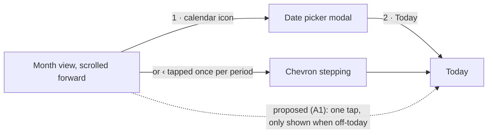
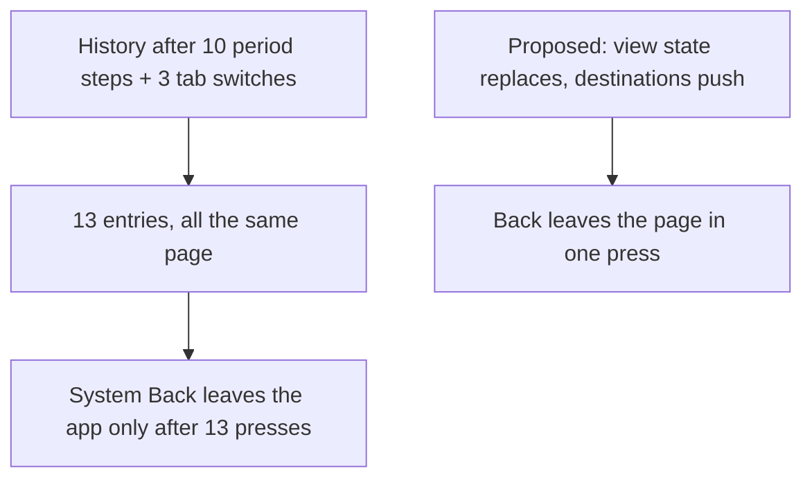
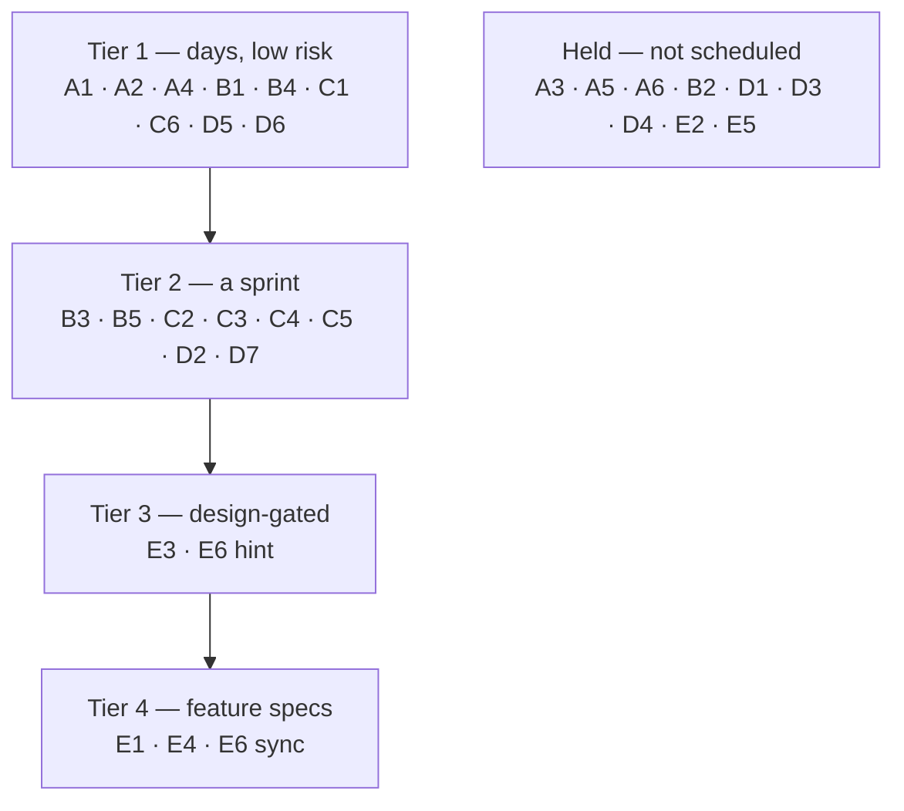

# 1. UI/UX research — improvements that can be made

The standing UI/UX backlog for Cloudy2: what is worth improving, why, where it lives in the
code, how big it is, and in which order to take it. Every finding cites a file and line range
verified against the tree at changelog **1.397** (research date **2026-11-22**, Asia/Singapore),
so a future pass can re-check the claim instead of re-deriving it.

This doc deliberately records **what is already right** (§1.2) as firmly as what is wrong, and
it keeps a **held register** (§1.9) of items that were reviewed and consciously put aside —
those are not to be implemented without a new decision.

## Table of contents

- [1.1 Scope and method](#11-scope-and-method)
- [1.2 What is already strong — do not re-propose](#12-what-is-already-strong--do-not-re-propose)
- [1.3 How to read a finding](#13-how-to-read-a-finding)
- [1.4 Calendar core and the touch model](#14-calendar-core-and-the-touch-model)
- [1.5 Legibility and accessibility](#15-legibility-and-accessibility)
- [1.6 Finding things and information density](#16-finding-things-and-information-density)
- [1.7 Feedback, guidance and trust](#17-feedback-guidance-and-trust)
- [1.8 Workflow level](#18-workflow-level)
- [1.9 Held register](#19-held-register)
- [1.10 Prioritisation](#110-prioritisation)
- [1.11 Implementation guardrails](#111-implementation-guardrails)
- [1.12 Validation and follow-through](#112-validation-and-follow-through)
- [1.13 File index](#113-file-index)

## 1.1 Scope and method

**In scope:** interaction design, affordance reachability, feedback and guidance, legibility,
accessibility beyond what [`accessibility.md`](accessibility.md) already closes, information
density, and the workflow gaps that show up as UI friction.

**Out of scope:** server performance, the events cache, PWA launch mechanics and the mutation
pipeline — those have their own docs and are, on the evidence, in good shape. Nothing here
proposes a library swap or a rewrite.

**Method.**

| Input | What was read |
| --- | --- |
| Conventions | `AGENTS.md`, [`progress.md`](../progress.md) (changelog through 1.397 + §1.4 open items) |
| Design docs | all 38 files in `docs/`; read in full: [`accessibility.md`](accessibility.md), [`user-guide.md`](user-guide.md), [`loading-transitions.md`](loading-transitions.md) §1.2 (goals **and non-goals**); targeted: `dashboard-views.md`, `desktop-responsive.md`, `event-lifecycle.md`, `user-picker.md`, `motion.md`, `action-pill.md`, `pwa-offline.md`, `event-clashes.md`, `event-notifications.md` |
| UI code | `DashboardView.tsx` (6,415 lines — chrome, nav row, mobile pill, compact cluster, swipe refs, navigation helpers), `EventForm.tsx`, `EventFormSteps.tsx`, `EventDetailBody.tsx`, `DashboardScreen.tsx`, `AppShellShell.tsx`, `SettingsTabs.tsx`, `ContactList.tsx`, `ParadeStateView.tsx`, `MyEventsView.tsx`, `AuditLogView.tsx`, `EventSearchBody.tsx`, `LoginForm.tsx`, `LoginShell.tsx`, `UserMenu.tsx`, `PreferencesModal.tsx`, `theme.ts`, `globals.css` (3,994 lines), `bottomNav.ts`, `datetime.ts`, `validate.ts` |
| Gap probes | grep sweeps over `src/` for keyboard handlers, `prefers-reduced-motion`, focus-visible, list virtualisation, undo, print CSS, `navigator.share`, pull-to-refresh, recurrence, timezone handling, `--mantine-scale`, legend/help affordances, `router.push` vs `router.replace` |

**Ranking basis.** There is no usage telemetry in this app, so the ranking is expert review, not
data. Where a finding's value depends on behaviour we cannot see (how often users leave the
calendar scrolled forward, how large the roster gets), that dependency is stated in the finding.

## 1.2 What is already strong — do not re-propose

The app has ~1,400 phases of UI work behind it. These are settled; re-suggesting them is waste.

| Area | Already handled |
| --- | --- |
| Loading | Skeleton-only appearance (dimming is banned), `CrossfadeSwap` on every in-place swap, `LoadingStatus` sr-only announcements, the global activity bar + comet head, cold-start readiness bar, `WaitOverlay` on slow routes, preview-first paint for detail surfaces — [`loading-transitions.md`](loading-transitions.md) |
| Perceived speed | Optimistic event mutations with stand-in chips, tab/period intent prefetch, warm-cache preload, PWA instant open, offline fallback, update pill |
| Motion | `prefers-reduced-motion` honoured in every animation path; the `motionProfile` flag scales cadence app-wide — [`motion.md`](motion.md) |
| Accessibility | Skip link as first focusable element, one polite live region fed by `announce()`, count badges riding accessible names, dark-scheme contrast pass, keyboard reorder sensor — [`accessibility.md`](accessibility.md) |
| Empty & error states | Shared actionable `EmptyState` everywhere; branded error / 404 / offline fallbacks |
| Forms | `validateInputOnBlur` + `showValidationFailure` (toast + scroll to first invalid field) on every form; buttons carry their own loader |
| Pickers | Badge dialogs (`UserSelectModal` + `PickerField`/`PickerBadges`) instead of searchable selects; no-keyboard dropdowns |
| Chrome | Coherent mobile/desktop split at `lg` (640px), compact tier at ≤ 360px, auto-hiding mobile chrome, 44px targets, trigger-origin modal zooms |
| Lists | One shared reorder recipe (`useReorderRows` + FLIP + dnd-kit) |
| Filters | Per-view filter sets stored server-side, one header recipe in `FilterModal`, removable summary chips, Reset |

**Consequence:** the remaining gaps are almost entirely **affordance reachability, feedback and
guidance** — things that exist but are hard to reach, or absent muscle-memory paths — not visual
design.

## 1.3 How to read a finding

Each finding is one block:

- **ID** — stable across edits (A1, B4, …). Cite it in commits and issues.
- **Evidence** — file:line verified at 1.397.
- **Impact** — what a user actually pays for today.
- **Fix** — the shape of the change, including the shared component to reuse.
- **Effort** — `S` (hours), `M` (a day or two), `L` (a design-gated week), `XL` (needs a spec).
- **Respect** — the convention or existing machinery the change must not break.

Statuses: **Tier 1–4** (see §1.10) or **Held** (see §1.9).

## 1.4 Calendar core and the touch model

### 1.4.1 A1 — "Today" is not one tap away anywhere

**Evidence.** `goToday` (`src/app/(protected)/dashboard/DashboardView.tsx:3339`) has exactly one
caller: the date-picker modal (`DashboardView.tsx:6140` → `src/components/DateSelectorModalBody.tsx:139`).
The mobile floating control pill (`DashboardView.tsx:4447-4512`) carries search · filter · date ·
view-menu · fullscreen; the compact-desktop navigator cluster (`:4391-4417`) carries view ·
period label · `‹ ›` · filter · date. There is no overflow menu in the dashboard chrome any more —
the only `IconDotsVertical` left in the folder is the per-row menu inside the Manage-views dialog
(`src/app/(protected)/dashboard/EditViewsModalBody.tsx:340`).

**Impact.** "Back to now" — the single most common gesture in every calendar product — costs a
modal round trip, or one chevron tap per period. From a forward-scrolled month it is the difference
between one tap and fourteen.

**Fix.** A **Today** affordance that exists only when the shown period is not today:

- mobile pill and compact cluster: one more circle/squircle at the existing `36px` circle /
  `40px`+`12px` squircle recipe, ordered next to the period stepper;
- tap-the-period-label → Today (the label is already the primary read-out at
  `:4396-4404` / `:4462-4470`), long-press → the existing date picker;
- announce through `announce()` (`docs/accessibility.md` §1.2) and reuse the existing period
  slide/skeleton path — no new loading indicator.

**Effort.** S.

**Respect.** `useChromeHide` hit-tests every `.c2-chrome-hide-able` rect before starting a hide
(`src/lib/ui/chromeHide.ts`) — a control added to the pill is automatically covered, but a control
added *outside* it must carry the class or be excluded deliberately. Do not add a second surface
that duplicates the date picker.

### 1.4.2 A2 — two docs describe chrome that no longer exists

**Evidence.** [`user-guide.md`](user-guide.md) line 105: "Date-nav arrows move day/week/month; the
⋮ menu has **Today** and **Select date**." [`dashboard-views.md`](dashboard-views.md) line 477:
"**Today / Select date / Enter fullscreen** only (Force refresh …)". Neither menu exists in
`DashboardView.tsx`; fullscreen is now the shared `FullscreenButton`
(`src/components/FullscreenToggle.tsx:44`) and date selection is a circle.

**Impact.** The written product contract is wrong on the app's most-used page; anyone implementing
from the docs re-adds dead chrome.

**Fix.** Correct both docs in the same change as A1, describing the affordance that actually ships.
While editing, make sure neither doc documents held items (§1.9) as if they existed.

**Effort.** S. **Respect.** Doc conventions: TOC anchors, hierarchical numbering, Mermaid where it
helps.

### 1.4.3 A4 — every period step and tab switch pushes a history entry

**Evidence.** `navigate` (`DashboardView.tsx:2907-2924`) and `navigateLocal` (`:2931-2942`) both
call `router.push`; the in-place date anchor pushes too (`:3413`). Tab switches route through
`switchTab` → `navigate` (`:3269-3337`).

**Impact.** On Android and in the installed PWA the system Back gesture walks the whole stack: ten
chevron taps plus three tab taps means thirteen Back presses before leaving the calendar. Users
experience this as "the app is stuck" or "Back doesn't work".

**Fix.** `router.replace` for period steps and tab switches — they are view state, not destinations
(the URL still carries `?date=`/`?view=`, so deep links and share links are unaffected).

**Effort.** S.

**Respect.** The one-shot params (`refresh`, `edit`, `event`, `_eventCal`, `share`,
`ONE_SHOT_PARAMS` at `:1095`) already strip with `replace`; the SWR document/RSC cache keys and
`useStaleDocumentReconcile` must keep seeing the same URLs. Verify the remembered-page cookie
(`docs/ui-state.md`) still lands on the last context after a replace-only session. Keep
`router.push` for genuine destinations — opening an event deep link, post-save navigation, and
`openClashEventInCalendar` (`:2520-2530`).

### 1.4.4 Not re-proposed here

Swipe-to-change-period on the non-Agenda grids (A3), drag-to-create/reschedule (A5) and delete undo
(A6) were reviewed and are **held** — see §1.9.

## 1.5 Legibility and accessibility

### 1.5.1 B1 — event chips still fail the dark-scheme boundary test

**Evidence.** [`accessibility.md`](accessibility.md) §1.7 records it as "Known-but-untouched":
calendar event chips sit at **1.08–1.76:1** against the grid in the dark scheme, with the chosen
treatment already specified — a hairline ring via
`color-mix(in srgb, var(--event-color) 45%, transparent)` on `.c2-schedule-event .c2-event-inner`.
No such rule exists in `src/app/globals.css`.

**Impact.** In dark mode the event chips read as floating text with no edge; the boundary is a
WCAG 1.4.11 (≥ 3:1) target.

**Fix.** Apply the documented ring to the schedule chips **and** the Month-grid chip equivalent
(the library hook classes are already wired in `src/lib/theme.ts:103-105`), keeping the existing
amber/purple state rings (`:2988-3004`) visually distinct.

**Effort.** S. **Respect.** Dark-only rules (`[data-mantine-color-scheme="dark"]`); no layout
shift — `--badge-bd`-style transparent borders change colour only.

### 1.5.2 B3 — sub-11px text in dense surfaces

**Evidence.** Hard-coded literals in `src/app/globals.css`: `11px` (`:1314`), `10px` (`:1332`),
`0.5625rem` = 9px (`:3528`, `:3683`, `:3736`, `:3747`), `0.6875rem` = 11px (`:3741`). The Month
grid additionally inherits the schedule library's auto-size text tiers, which is exactly why
`monthFitChipCount` keeps a 21px chip-slot floor "above the library's 9px auto-size text tier"
(`AGENTS.md`, dashboard views bullet).

**Impact.** 9–10px labels are below the practical floor for a mobile app, and — because page
magnification is switched off app-wide (`globals.css:63-66`,
[`accessibility.md`](accessibility.md) §1.8) — there is no user-side escape hatch on a phone.

**Fix.** Raise every literal to a tokenised 11px minimum (`font-size: max(0.6875rem, …)` style
guards where the library drives the size), then re-check the Month chip-count trade-off: fewer
legible chips per cell beat more unreadable ones. **This finding stands on its own** — it is not
gated on the held text-size control (B2).

**Effort.** S. **Respect.** Keep the compact tier (≤ 360px, `NARROW_MEDIA_QUERY`) working; re-run
the `monthFitChipCount` legibility floor tests after the change.

### 1.5.3 B4 — no legend for the amber "mine" / purple "external" encodings

**Evidence.** Parade State names its colour semantics with a legend
(`src/app/(protected)/parade-state/ParadeStateView.tsx:1177`); the dashboard has none — the string
`legend` does not occur anywhere in `src/app/(protected)/dashboard/`. The encodings themselves are
`c2-my-*` / `c2-ext-*` rules in `globals.css` (`:2988-3004`) plus the amber row tints.

**Impact.** A new user cannot tell why one chip is ringed amber and another purple; the meaning is
only in the source and the admin-facing docs.

**Fix.** A compact legend in the view menu (and the "?" popover from D2): *mine*, *external
(created in Google)*, plus the event-colour note. Keep the existing non-colour cues (ring, bold,
side bar) so the legend explains rather than becomes load-bearing.

**Effort.** S. **Respect.** Colour must never be the only channel (WCAG 1.4.1).

### 1.5.4 B5 — no keyboard layer on desktop

**Evidence.** Keyboard handling is sparse and entirely local — a grep for `onKeyDown` / keydown listeners across
`src/` returns 19 lines (imports and comments included): wizard Enter suppression
(`EventForm.tsx:678`), the time cells (`TimeSelectField.tsx:158`), and a handful of row-activation
handlers. The only shortcut the app advertises is `aria-keyshortcuts="Escape"` on wizard minimize,
and no global key handler exists.

**Impact.** Desktop users (the `lg` shell starts at 640px, so this includes foldables) drive a
calendar entirely by mouse: no `T` for today, no arrow stepping, no `/` for search.

**Fix.** A pure keymap module (`src/lib/ui/shortcuts.ts`, unit-tested) + a `useKeyboardShortcuts`
hook mounted by `DashboardView`: `←`/`→` period, `T` today, `1`–`6` view kinds, `N` new event,
`/` search, `?` shortcut sheet. Inert while focus is in an input, an open menu, or a dialog;
announced through `announce()`.

**Effort.** M. **Respect.** Never intercept keys inside Mantine popovers/comboboxes; the sheet must
be discoverable (D2) or the feature is folklore.

### 1.5.5 B6 — rule, not a task

Every affordance added under this plan ships its accessibility **in the same change**: accessible
name, `announce()` for state changes with no toast, correct focus order, and a `docs/accessibility.md`
row where the pattern is new.

## 1.6 Finding things and information density

### 1.6.1 C1 — the Settings tab strip is a bare scroller

**Evidence.** `src/app/(protected)/settings/SettingsTabs.tsx:11-25` defines **13** tabs; the list is
rendered `overflowX: "auto"` with no edge affordance (`:63-100`), fixed above the bottom nav below
`lg`. The bottom nav already solved the identical problem with a right-edge fade and a decorative
chevron (`AppShellShell.tsx:198` `RailEdgeControl`, used at `:1433-1434`).

**Impact.** Admins don't discover Webhooks / Feature Flags / Parade State Email because the strip
gives no hint it scrolls, and the active tab can be off-screen on entry.

**Fix.** Reuse the `RailEdgeControl` fade+chevron recipe, scroll the active tab into view on mount,
and group the tabs — **Roster** (Users, Departments) · **Events** (Event Types, Templates) ·
**Delivery** (Webhooks, Quick Links, Parade State Email, Banner) · **System** (KAH Groups, General,
Security, Audit Log, Feature Flags) — as section separators at `lg`+ and an index list below `lg`.

**Effort.** S–M. **Respect.** `SettingsTabs` owns the sticky-height measurement published through
`SettingsShell`; grouping must not change the measured chrome height contract.

### 1.6.2 C2 — Contacts is a flat card wall

**Evidence.** `src/app/(protected)/contacts/ContactList.tsx:356-403`: every match renders a bordered
`Paper` card; there are no alphabetical sections, no jump index, no sort control, and the name is
printed twice — `user.name` at `:362` and again inside `formatFullName(...)` at `:370-373`.

**Impact.** A phone list is a lookup tool; scrolling an unsectioned card grid to find a name is the
slowest possible interaction for the page's actual job.

**Fix.** Alphabetical section headers + a jump index (A–Z rail or a chip row), a sort control
(name / department), and drop the duplicated name line. Consider a denser row recipe than a card.

**Effort.** M. **Respect.** Keep the `.card-grid` responsive recipe and `c2-defer-render`; the VCF
export must keep following the active search + filter set (`:160-162`).

### 1.6.3 C3 — Parade State has no name search

**Evidence.** `ParadeStateView.tsx` has no text input at all — narrowing the roster means opening the
Users filter modal (`:1365-1371`); the sticky/floating chrome carries day step · filter · date ·
attendance · fullscreen (`:1085`, `:1318`).

**Impact.** This is the page used live during roll call. Finding one person in a large org costs a
modal, a search box inside it, and an apply round trip.

**Fix.** A search field in the existing chrome (sticky at `lg`+, in the floating pill below)
filtering the rendered roster client-side over the already-loaded users, reusing the Contacts text
semantics. Attendance mode must be unaffected — a filtered list must not silently change what
"present" counts.

**Effort.** S–M. **Respect.** The attendance report (`attendanceReport.ts`) and the `X/Y` headers are
aggregations; a search filter must not narrow them.

### 1.6.4 C4 — My Events has range and paging but no text filter

**Evidence.** The sticky chrome holds only `TimeRangeSelect`
(`src/app/(protected)/my-events/MyEventsView.tsx:298-305`); the empty state and paging follow at
`:314-320`.

**Impact.** "Which conference did I create in June?" requires paging 20 rows at a time.

**Fix.** A search box mirroring the dashboard's event-name filter semantics
(`src/lib/events/textFilter.ts`, case-insensitive substring over typed name + rendered title) so the
vocabulary is identical across surfaces.

**Effort.** S. **Respect.** Range and page stay in the URL (`?range=`, `?page=` mirrored with
`history.replaceState`, `docs/loading-transitions.md` §1.8); a search term should follow the same
rule or stay deliberately ephemeral — decide, don't drift.

### 1.6.5 C5 — audit-log timestamps are absolute only

**Evidence.** `AuditLogView.tsx:607` and `:672` render `formatLogTimestamp(row.createdAt)`; the
mobile row splits the same absolute string.

**Impact.** In a log you scan for "what just happened", absolute timestamps force mental arithmetic.

**Fix.** Relative primary ("12 min ago") with the absolute value as secondary text or a tooltip;
keep the CSV export absolute.

**Effort.** S. **Respect.** The audit log is the one always-fresh route
(`docs/audit-log.md`) — a relative label must not imply live polling that doesn't exist.

### 1.6.6 C6 — the event detail modal renders every participant badge

**Evidence.** `EventDetailBody.tsx:376-385` maps all resolved people into `Badge`s with no cap; the
same unbounded pattern for departments at `:416-429`.

**Impact.** A department-wide event becomes a wall of chips that pushes the action row off-screen —
on the one surface where the user came to read, not scroll.

**Fix.** Cap + "+N" using the shared `PickerBadges` recipe (`docs/user-picker.md` §1.6, cap 5 +
overflow), with the full list in an expandable section.

**Effort.** S. **Respect.** Keep the `(You)` marker and `c2-my-badge` ring on the current user even
when they fall outside the visible cap — pin that chip first.

## 1.7 Feedback, guidance and trust

### 1.7.1 D2 — there is no in-app help anywhere

**Evidence.** Protected routes are `dashboard`, `parade-state`, `contacts`, `double-booking`,
`my-events`, `kah-status`, `settings` — no help/guide route exists. The profile menu
(`src/components/UserMenu.tsx:141-192`) offers version, theme, Calendar Access, Notifications,
Preferences, Log out. Meanwhile [`user-guide.md`](user-guide.md) is a maintained 280-line guide
nobody inside the app can reach.

**Impact.** Every question about per-view filters, attendance mode, pinning or share links becomes
a message to an admin.

**Fix.** A lightweight Guide sheet: one "what this page is for" block per route, the shortcut list
(from B5), and "ask your admin about your login keyword". Opened from the profile menu and a "?" in
the dashboard chrome. Render from a small typed content module, not a new CMS.

**Effort.** M. **Respect.** It must not become a second source of truth for the user guide — link
out, don't fork the prose.

### 1.7.2 D5 — saving the only preference reloads the whole document

**Evidence.** `src/components/PreferencesModal.tsx:61` calls `window.location.reload()` after
`setWeekStart`, preceded by `clearAllDashboardSnapshots()`.

**Impact.** A one-control dialog destroys scroll position, warm client state and any in-progress
draft, for a change the dashboard can already re-derive.

**Fix.** Invalidate the snapshots and revalidate in place through the dashboard's own
`revalidate()` (`docs/dashboard-views.md`, `docs/loading-transitions.md` §1.15) instead of a
document reload. Keep the dialog's layout extensible so a future control needs no rework.

**Effort.** S. **Respect.** The week start changes the fetch set for every week/month grid — the
snapshot clear must stay, only the reload goes.

### 1.7.3 D6 — success feedback is split between the action pill and raw toasts

**Evidence.** The house rule is the shared action pill for actionable feedback
(`docs/action-pill.md`, `src/components/ActionPill.tsx`), yet `EditViewsModalBody.tsx:199` and
`:234`, `EventDetailBody.tsx:229`, and `EventForm.tsx:1042` call `notifications.show` directly.

**Impact.** Two visual languages for the same moment; outcomes that *could* offer a follow-up action
(open the saved event, retry) don't, because they were rendered as inert toasts.

**Fix.** State the boundary in this doc and in `action-pill.md` — **actionable → pill, inert
confirmation → toast** — and migrate the actionable cases (e.g. "View deleted event's history",
"Open the saved event").

**Effort.** S. **Respect.** The `savedEventToastVariant` flag already owns the post-save
presentation (`docs/feature-flags.md`); don't fork that path — extend it.

### 1.7.4 D7 — offline writes fail after the user has done the work

**Evidence.** [`user-guide.md`](user-guide.md) §1.10: "Offline is **read-only** — creating or editing
shows an error until you're back online." Nothing in the wizard consults `navigator.onLine`
(the flag is consulted only for prefetch suppression, `DashboardView.tsx:2953`).

**Impact.** A user in a basement or on a flight fills a seven-step wizard and is rejected at
submit.

**Fix.** While `navigator.onLine === false`: mark the create/save affordances as unavailable with a
one-line reason, and route the user to the wizard draft (which already survives minimize and reload,
`docs/accessibility.md` §1.6) instead of letting them lose the work.

**Effort.** S–M. **Respect.** Offline detection must be an enhancement, never a gate that
misfires on a flaky connection; the server remains the authority.

## 1.8 Workflow level

These are feature-shaped gaps that surface as UX pain. Most need their own spec before any UI is
drawn; the item marked **in scope now** is messaging-only and can ship without one.

### 1.8.1 E1 — no recurring events

**Evidence.** No `rrule`/`recurrence` token anywhere in `src/`; the wizard creates exactly one event
(one logical group, N department copies).

**Impact.** Standing duties (weekly parade, monthly inspection) are re-created by hand every time,
which is how calendars end up with gaps and duplicates — and how KAH forecasts end up wrong.

**Effort.** XL. **Respect.** Needs decisions on series editing across Google copies, the notes-block
round-trip, clash checks and the audit diff before any UI is drawn.

### 1.8.2 E3 — no conflict awareness in the event detail modal

**Evidence.** `computeClashes` (`src/lib/events/clashes.ts`) runs only from the wizard's review step
(`docs/event-clashes.md`); `EventDetailBody.tsx` has no advisory.

**Impact.** The clash question is asked at creation and never again — an edit that moves an event
onto a busy afternoon is silent.

**Fix.** A read-only advisory card in the detail modal reusing the same engine and the shared
`ClashCard`, notify-only like every other clash surface.

**Effort.** M. **Respect.** Reads must go through the cache (`clashQuery.ts`), never raw
`integration.listEvents`; advisory must never block.

### 1.8.3 E4 — no in-app notification history

**Evidence.** Participant pushes are fire-and-forget: `dispatchParticipantNotifications` runs in
`after()` after a create/update ([`event-notifications.md`](event-notifications.md)) and nothing
stores a per-user inbox. The profile menu's Notifications modal
(`src/components/NotificationSettings.tsx`) is permission + pause only, and no route renders past
notifications.

**Impact.** The lock-screen banner is the entire record. Miss it and the only way to learn "I was
added to an event" is to scan the calendar or the Double Booking page.

**Effort.** L. **Respect.** Needs a read-state model that survives several devices per user and must
not duplicate the audit log; the account-wide pause switch and the per-device permission semantics
stay exactly as they are.

### 1.8.4 E6 — attendance marks are device-local with no on-screen warning

**Evidence.** [`user-guide.md`](user-guide.md) §1.7: "Attendance checks are stored **on this device
only** … another device or person won't see your checks." The mode bar itself says nothing about it.

**Impact.** A supervisor marks a roll call on the office tablet, then wonders why the report from
their phone is empty.

**Fix (in scope now).** A quiet "this device only" hint in the attendance mode bar next to the live
`X/Y present` count. Server-side sync is Tier 4.

**Effort.** S (hint) / L (sync). **Respect.** The hint must not compete with the count for
attention, and must survive the chrome-hide rules.

## 1.9 Held register

Reviewed on **2026-11-22** and **put aside by decision — not to be implemented without a new
decision.** The evidence stays here so the research isn't lost; the fixes are deliberately not
specified.

| ID | Item | Evidence anchor | Status |
| --- | --- | --- | --- |
| A3 | Swipe to change period on Month / Week / Day (swipe exists only on the Agenda tab and the day modal: `DashboardView.tsx:5192`, `:5830`, `DAY_SWIPE_THRESHOLD` `:501`; the Month grid at `:5077` has none) | as cited | Held 2026-11-22 |
| A5 | Drag-to-create / drag-to-reschedule on the grids (dnd-kit is used only for reorderable lists, `docs/reorder.md`) | grids + `useGridPan` | Held 2026-11-22 |
| A6 | Delete undo, and naming the department-copy count in the delete confirm (`EventDetailBody.tsx:562-569`, success toast `:229`) | as cited | Held 2026-11-22 |
| B2 | In-app text-size control driving `--mantine-scale` (only preference today is week start, `PreferencesModal.tsx`; pinch/double-tap zoom disabled at `globals.css:63-66`) | as cited | Held 2026-11-22 — the WCAG 1.4.4 trade-off in `accessibility.md` §1.8 **stands as accepted** |
| D1 | Login affordances: format hint, `inputMode`/`autoComplete`/`enterKeyHint`, help line, version row (`LoginForm.tsx:124-134`, `LoginShell.tsx`) | as cited | Held 2026-11-22 — the masked single field with no hint is the intended design |
| D3 | First-run orientation for new staff | no onboarding surface exists | Held 2026-11-22 |
| D4 | In-app pull-to-refresh (the native gesture is disabled at `globals.css:39-46`; the header Force refresh is the only path) | as cited | Held 2026-11-22 |
| E2 | Registrant CSV export for capped registration events (only audit CSV and contacts VCF exist) | grep-verified | Held 2026-11-22 |
| E5 | `@media print` stylesheet (no print CSS anywhere in `src/`) | grep-verified | Held 2026-11-22 |

Two held items have consequences worth restating so nobody "fixes" them by accident:

1. **B2 held** means the app has **no user-side text-size control on phones**. B3 (§1.5.2) is
   therefore the only legibility action, and it must be written and shipped without assuming a
   scale control exists.
2. **D1 held** means the login screen stays deliberately unexplained. Treat it as a product
   position, not an oversight.

## 1.10 Prioritisation

Order is fixed; held items were removed without renumbering or re-ranking anything else.

| Tier | Items | Why here |
| --- | --- | --- |
| **1 — days, low risk** | A1, A2, A4, B1, B4, C1, C6, D5, D6 | Missing-affordance and correctness fixes. Each is local, reversible, needs no schema or data change, and closes a gap the codebase already knows about (B1) or a contract that drifted (A2). |
| **2 — a sprint** | B3, B5, C2, C3, C4, C5, D2, D7 | Keyboard parity, the legibility floor, find-things surfaces, and guidance. Take **B5 before D2** so the guide sheet documents shortcuts that exist. |
| **3 — design-gated** | E3, E6-hint | Advisory and messaging that must be designed against the clashes engine and attendance docs rather than bolted on. |
| **4 — feature work** | E1, E4, E6-sync | Each needs its own spec, schema, and subsystem doc. |

**Intra-tier notes.** A2 rides with A1 (same docs, same chrome). C1 and C6 are independent of
everything else. D6 depends on no other item — it is a routing change, not a new component.

## 1.11 Implementation guardrails

Every item above inherits these; they are the reason some obvious-looking fixes are not proposed.

- **Theme:** Mantine v9, theme only in `src/lib/theme.ts`, mounted by `AppProviders` (it carries a
  function value in `components.Input.vars`, so it cannot move to the server layout).
- **Reuse, don't re-hand-roll:** `EmptyState`, `ActionPill`/`useActionPill`,
  `FloatingActionButton`/`FloatingToolbar`, `PickerField`/`PickerBadges`, `ConfirmModal`+`runConfirm`,
  `MotionModal`, `LazyModal`, `CrossfadeSwap`, `LoadingStatus`, `useReorderRows`, `GridNavControls`.
- **Loading:** skeleton only + reveal; never dim content (`opacity: isPending ? …` is banned); no
  per-resource progress bars — the indeterminate activity bar is the only sanctioned strip
  ([`loading-transitions.md`](loading-transitions.md) §1.2).
- **Variants:** a presentational choice worth A/B-ing goes through the feature-flag framework
  (`src/lib/settings/featureFlags.ts`) and defaults to today's behaviour; `LOCKED_VARIANTS` stay
  locked.
- **Pure logic** in `src/lib/**` with Vitest coverage in `src/**/*.test.ts` (node env, no DB
  fixtures) — the keymap (B5), text filters (C4) and any chip-cap math (C6) belong there.
- **Breakpoints:** `useMediaQuery` takes the em breakpoint interpolated into the query —
  ``(min-width: ${theme.breakpoints.lg})`` — never append `px` to the em value (it is an `em`
  string, and appending makes an invalid query that always returns false); CSS switches live under
  `@media (min-width: 40em)`.
- **Page zoom:** the `touch-action: pan-x pan-y` rule on `html` stays; never add
  `user-scalable=no`/`maximum-scale`.
- **Docs:** update the owning subsystem doc with the change, keep TOC anchors and hierarchical
  numbering, add a Mermaid diagram where a diagram helps.
- **Handover:** a code change bumps `APP_VERSION` in `src/lib/appVersion.ts` and ends with the
  `dev` → `main` git workflow and a suggested commit message **for the user to run** — this repo's
  agents never run git.
- **Formatting:** Prettier, double quotes, `printWidth: 100`.

## 1.12 Validation and follow-through

- **No telemetry exists**, so each Tier 1–2 item should be judged on the device, not a screenshot:
  the repo already carries manual-QA debt (`progress.md` §1.4 item 4) — PWA installs, on-device
  gesture checks, width sweeps. Each implementation issue should name the widths to re-check
  (≤ 360px compact tier, 640px `lg`, 800px wide-desktop rail band) and both colour schemes.
- **Cut tickets from this doc, not from memory:** when a tier is approved, publish one file per
  ticket under `.scratch/ui-ux/issues/NN-<slug>.md` with a `Status:` line
  (`docs/agents/issue-tracker.md`, `docs/agents/triage-labels.md`), citing the finding ID.
- **Keep this doc honest:** when a finding ships, move its line to a *Shipped* table with the
  changelog number; when one is rejected, move it to §1.9 with the date and reason. Never delete a
  row — the point of the register is that the reasoning survives.
- **Re-baseline:** the line numbers here are from changelog 1.397. Re-verify the anchors of any
  finding being implemented; `DashboardView.tsx` in particular moves often.

## 1.13 File index

| Path | Role for this research |
| --- | --- |
| `src/app/(protected)/dashboard/DashboardView.tsx` | A1, A4, B5, C6 context: chrome, navigation helpers, swipe refs |
| `src/app/(protected)/dashboard/EventDetailBody.tsx` | C6, D6, E3 |
| `src/app/(protected)/settings/SettingsTabs.tsx` | C1 |
| `src/components/AppShellShell.tsx` | `RailEdgeControl` recipe (C1), header controls |
| `src/app/(protected)/contacts/ContactList.tsx` | C2 |
| `src/app/(protected)/parade-state/ParadeStateView.tsx` | C3, E6, the legend precedent |
| `src/app/(protected)/my-events/MyEventsView.tsx` | C4 |
| `src/app/(protected)/settings/audit-log/AuditLogView.tsx` | C5 |
| `src/components/PreferencesModal.tsx` | D5, and the future home of any held preference |
| `src/components/UserMenu.tsx` | D2 host |
| `src/app/globals.css` | B1, B3, and the page-zoom / pull-to-refresh rules behind B2 and D4 |
| `src/lib/theme.ts` | Schedule/Month hook classes for B1; breakpoints for every responsive change |
| [`accessibility.md`](accessibility.md) | §1.7 chip contrast (B1), §1.8 page-zoom policy (B2/B3) |
| [`loading-transitions.md`](loading-transitions.md) | §1.2 non-goals that constrain every item |
| [`action-pill.md`](action-pill.md) | D6 boundary |
| [`user-picker.md`](user-picker.md) | §1.6 `PickerBadges` cap (C6) |
| [`event-clashes.md`](event-clashes.md) | E3 engine reuse |
