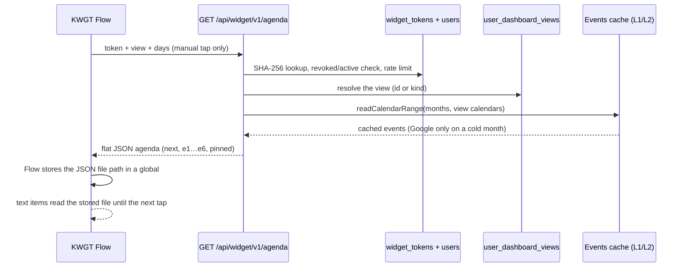

# 1. Home-screen widgets (KWGT)

Users want their calendar on the Android/iOS home screen. A PWA cannot provide a native
home-screen widget — only a native app can — so Cloudy2 exposes a **read-only JSON
agenda** that widget apps consume. This document covers the reason, the API, the token
model, the view semantics, and the manual-refresh KWGT recipe.

> For the **iPhone/iPad calendar-subscription** path (native Calendar widget, no KWGT),
> see [calendar-feed.md](calendar-feed.md). The JSON API here remains the manual-refresh
> and HTTP-widget surface.

## Table of contents

- [1.1 Why an API](#11-why-an-api)
- [1.2 Platform capabilities](#12-platform-capabilities)
- [1.3 Architecture](#13-architecture)
- [1.4 Tokens](#14-tokens)
  - [1.4.1 Storage and lifecycle](#141-storage-and-lifecycle)
  - [1.4.2 Authentication sources](#142-authentication-sources)
  - [1.4.3 Security notes](#143-security-notes)
- [1.5 Endpoint reference](#15-endpoint-reference)
  - [1.5.1 Parameters](#151-parameters)
  - [1.5.2 Response](#152-response)
  - [1.5.3 Flat aliases for KWGT](#153-flat-aliases-for-kwgt)
  - [1.5.4 Errors and rate limits](#154-errors-and-rate-limits)
- [1.6 View semantics](#16-view-semantics)
  - [1.6.1 Supported view kinds](#161-supported-view-kinds)
  - [1.6.2 Time window and titles](#162-time-window-and-titles)
- [1.7 KWGT setup (manual refresh)](#17-kwgt-setup-manual-refresh)
  - [1.7.1 Flow recipe](#171-flow-recipe)
  - [1.7.2 Formulas](#172-formulas)
  - [1.7.3 Tasker hardened mode](#173-tasker-hardened-mode)
- [1.8 Future iOS clients](#18-future-ios-clients)
- [1.9 File index](#19-file-index)

## 1.1 Why an API

Android and iOS home-screen widgets are rendered by a **separate native app** (KWGT,
Scriptable, Widgy) — a PWA cannot register one. Those apps can call a URL, so the app's
job is to provide a stable, credentialled, read-only payload. No service-worker change is
needed: `/api/` is already excluded from the document/RSC caches (`src/lib/pwa/swRules.ts`).

Goals:

- One endpoint shape for every widget platform.
- The widget shows **what the user sees in the app**: it is bound to one dashboard view
  and reuses that view's filters and title recipe.
- Read-only and instantly revocable; never mutates or audits a read.
- Cheap on the database: reads go through the same layered event cache as every other
  calendar surface, and requests only happen on a manual refresh.

Non-goals: write actions, push refresh, a widget-specific renderer, a binary `.kwgt`
preset (Kustom presets are authored in the app and are not generated here).

## 1.2 Platform capabilities

| Platform | HTTP source | Custom headers | Manual refresh | Notes |
| --- | --- | --- | --- | --- |
| KWGT (Kustom) | `wg()` / Flow WebGet | **No** | Yes, via a Flow manual trigger | Token rides in the query string. |
| Scriptable | `fetch` / `Request` | Yes | Timeline / tap | Full JS; future client. |
| Widgy | HTTP data source | Yes (likely) | Tap / timeline | Future client. |

Because KWGT cannot set headers, the endpoint accepts **both**
`Authorization: Bearer <token>` and `?token=<token>`.

## 1.3 Architecture



The builder does **not** call `buildDashboardData`: that reads the months the view's grid
needs (a Week/Day view reads one month), which can miss the tail of a forward window that
crosses a month boundary. Widgets always render a forward agenda regardless of the view's
renderer kind.

## 1.4 Tokens

### 1.4.1 Storage and lifecycle

- One row per **device** in `widget_tokens` (`user_id`, `label`, `token_hash`,
  `token_prefix`, `last_used_at`, `revoked_at`, timestamps).
- Plaintext format: `c2w_` + 32 random bytes base64url. It is shown **once** in
  Profile → Widgets; only the SHA-256 hash is stored.
- Tokens **never expire** by policy. Revoking sets `revoked_at` (the row is kept for the
  audit trail); a user can hold up to 10 active tokens.
- Deleting a user cascades their tokens. Deactivating a user blocks their tokens
  immediately, because every request re-checks `users.status = 'active'`.
- Creation/revocation are audited (`widgetToken.create` / `widgetToken.revoke`) with the
  label, id and prefix — never the secret.

### 1.4.2 Authentication sources

```ts
Authorization: Bearer c2w_…
// or, for KWGT:
?token=c2w_…
```

Malformed tokens, revoked tokens and inactive owners all return the same `401` (no
enumeration hint). `last_used_at` is written at most once every five minutes so a widget
tap does not cost a write every time.

### 1.4.3 Security notes

- **Query-string exposure.** KWGT cannot set headers, so its token appears in the request
  URL and therefore in Cloud Run request logs. Mitigations: read-only scope, immediate
  revocation, a lenient per-token burst limit, and the Tasker hardened mode (§1.7.3).
- **No CORS.** The endpoint sends no `Access-Control-Allow-Origin`; native clients do not
  need it, and adding it would let a browser page read a leaked token.
- **Read-only.** Only `GET`; no mutation, webhook, notification or audit row per read.
- Tokens grant the same calendar **read visibility** as the owner's session. Treat a
  widget token like a password for that user's agenda.

## 1.5 Endpoint reference

`GET /api/widget/v1/agenda` — `runtime = nodejs`, `dynamic = force-dynamic`,
`Cache-Control: no-store`.

### 1.5.1 Parameters

| Param | Required | Meaning |
| --- | --- | --- |
| `token` | unless a bearer header is sent | Per-device token (`c2w_…`). |
| `view` | no | A dashboard view UUID or a view-kind string (`agenda`, `month`, `dual`, `week`, `weekv2`, `weekgrid`, `schedule`). Unknown/missing = the first tab in strip order. |
| `days` | no | Forward window length, clamped 1–14. Default 7. |

### 1.5.2 Response

All times are the app's fixed **UTC+8** naive strings. Display strings are precomputed so
KWGT needs no date math.

```json
{
  "ok": true,
  "v": 1,
  "generatedAt": "2026-11-16 09:12:00",
  "today": "2026-11-16",
  "window": { "start": "2026-11-16", "end": "2026-11-22", "days": 7 },
  "user": { "name": "John Doe", "department": "Ops" },
  "view": { "id": "…", "name": "Agenda", "kind": "agenda" },
  "next": {
    "id": "…",
    "title": "Ops Briefing",
    "date": "2026-11-16",
    "endDate": "2026-11-16",
    "dateLabel": "Today",
    "endDateLabel": "Today",
    "time": "09:00–10:00",
    "when": "Today 09:00–10:00",
    "allDay": false,
    "ongoing": false,
    "location": "Room 1",
    "calendar": "Ops",
    "color": "blue",
    "pinned": false,
    "daysUntil": 0,
    "deepLink": "https://app.example.com/dashboard?view=…&date=…&event=…&_eventCal=…"
  },
  "events": [{ "…": "same shape, chronological, max 30" }],
  "counts": { "today": 2, "window": 7 },
  "pinned": {
    "count": 2,
    "next": {
      "title": "Exercise",
      "daysLeft": 5,
      "date": "2026-11-21",
      "dateLabel": "Sat 21 Nov",
      "deepLink": "https://app.example.com/dashboard?view=…&date=…&event=…&_eventCal=…"
    }
  },
  "flat": { "…": "see §1.5.3" }
}
```

- `events` includes events **overlapping** `[today, today + days - 1]`, including
  multi-day and ongoing ones (`ongoing: true`). All-day ends are inclusive in `endDate`.
- `pinned` is scoped to the owner exactly like the header's Pinned Events panel (admins
  see all pins; a user sees global + ancestor-department pins).
- `deepLink` is the dashboard details deep link (absolute), carrying `?view=` so the
  widget's view stays active. Legacy events without a group id link to the day only.

### 1.5.3 Flat aliases for KWGT

Kustom's JSONPath handling of arrays is fragile, so every field a template needs is also a
scalar:

- `updatedLabel` (`Updated 16 Nov 09:12`), `viewName`, `viewKind`, `todayLabel`,
  `eventCount`
- `nextTitle`, `nextWhen`, `nextWhere`, `nextDate`, `nextTime`, `nextLink`
- `e1Title` … `e6Title` with matching `When` / `Where` / `Date` / `Time` / `Link`
- `pinnedCount`, `pinnedNextTitle`, `pinnedNextWhen` (`5d`), `pinnedNextDate`,
  `pinnedNextLink`

Empty agenda: `nextTitle` is `No upcoming events` and the links fall back to the
dashboard.

### 1.5.4 Errors and rate limits

| Status | Body | Cause |
| --- | --- | --- |
| 200 | `{ ok: true, … }` | Success. |
| 401 | `{ ok: false, error: "Unauthorized" }` | Missing/malformed/revoked token, or inactive owner. |
| 429 | `{ ok: false, error: "Too many requests" }` + `Retry-After` | More than 60 requests/minute for one token (in-memory, per instance). |
| 500 | `{ ok: false, error: "Could not load widget data" }` | Unexpected read failure. |

Widgets refresh only on a manual tap, so the limit is a burst guard rather than a quota.
The read never forces a Google refresh; it uses the normal event cache (`~60s` fresh).

## 1.6 View semantics

### 1.6.1 Supported view kinds

Every dashboard view kind can be a widget source. The widget uses the view's **filters**
(Calendars / Users / Event Types / Event-name) and its **title recipe** (the per-kind
template assignment); it does not reproduce the view's renderer.

| Kind value | UI label |
| --- | --- |
| `agenda` | Agenda |
| `month` | Month |
| `dual` | Month & Agenda |
| `week` | Week (H) |
| `weekv2` | Week (D) |
| `weekgrid` | Week (Grid) |
| `schedule` | Day |

`?view=` accepts a view UUID (as generated by Profile → Widgets) or one of these kind
strings; a kind resolves to the user's first tab of that kind (`resolveActiveTab`).

### 1.6.2 Time window and titles

- The window is always **forward**: today through `today + days - 1` (default 7).
- The previous month is included in the read so an event that started before today (or an
  early-morning SGT event stored under the prior UTC month) still appears as ongoing.
- Titles resolve through the same `resolveDisplayTitles` path as the dashboard, using the
  view kind's recipe assignment.
- The Users filter treats a tagged department as every active member of it, matching the
  dashboard's occupancy model.

## 1.7 KWGT setup (manual refresh)

Inline `$wg("https://…")$` re-fetches whenever the widget redraws, so it cannot be
"manual-only". Use a Kustom **Flow** (Kustom 3.70+): the network call happens only when
the flow's manual trigger runs, and the widget reads the stored file.

### 1.7.1 Flow recipe

```mermaid
flowchart LR
  R[Refresh icon touch action] --> F[Flow: manual trigger]
  F --> W[WebGet URL<br/>token + view + days]
  W --> G[Store to global c2json<br/>file-path mode]
  G --> T[Text items read<br/>wg(gv(c2json), json, .flat…)]
```

1. Add a **text global** named `c2json`.
2. Store the token as a Kustom **secret global** (e.g. `c2token`).
3. Add a **Flow** with a **manual trigger**. Add a **WebGet** action using the agenda URL
   from Profile → Widgets, with `$gv(c2token)$` as the token. Add an action to **store to
   the `c2json` global** — keep the default *file path* mode (not "store file content").
4. Give the widget's refresh icon a touch action that runs the Flow.
5. Tap it once to populate the widget. Thereafter the widget only changes on tap.

### 1.7.2 Formulas

```text
$wg(gv(c2json), json, .flat.nextTitle)$
$wg(gv(c2json), json, .flat.nextWhen)$
$wg(gv(c2json), json, .flat.updatedLabel)$
$wg(gv(c2json), json, .flat.e1Title)$
$wg(gv(c2json), json, .flat.e1When)$
$wg(gv(c2json), json, .flat.pinnedNextTitle)$
```

Set the row/whole-widget touch action to open `.flat.nextLink` (or `e1Link`) to deep-link
back into the app. `updatedLabel` makes the snapshot age explicit.

### 1.7.3 Tasker hardened mode

To keep the token out of the URL/logs: have Tasker (or another HTTP client) send
`Authorization: Bearer <token>` to the endpoint, write the response to a local file
(e.g. `/sdcard/cloudy2/agenda.json`), and point KWGT at that file with
`$wg("file:///sdcard/cloudy2/agenda.json", json, .flat.nextTitle)$`. The app side is
unchanged; the bearer path is already supported.

## 1.8 Future iOS clients

The preferred iOS path is the native **Calendar subscription** documented in
[calendar-feed.md](calendar-feed.md) — no third-party widget app and no on-device setup
beyond subscribing once.

Scriptable can still `fetch` with the bearer header and cache the payload in `Keychain` /
`FileManager`; Widgy's HTTP data source can send headers too. The response shape is
platform-neutral, so no API change is needed — only client scripts/recipes. The manual
refresh philosophy still applies: iOS decides timeline refreshes, so show `updatedLabel`.

## 1.9 File index

| Path | Purpose |
| --- | --- |
| `src/db/schema.ts` | `widget_tokens` table. |
| `src/lib/widgets/tokens.ts` | Generate/hash/validate tokens and labels. |
| `src/lib/widgets/rateLimit.ts` | Pure fixed-window limiter + production map. |
| `src/lib/widgets/auth.ts` | Bearer/query auth, revoked/active checks, last-used throttle. |
| `src/lib/widgets/agenda.ts` | View resolution + range read + response assembly. |
| `src/lib/widgets/shape.ts` | Pure window/label/flat shaping. |
| `src/lib/widgets/actions.ts` | Profile → Widgets server actions. |
| `src/app/api/widget/v1/agenda/route.ts` | The read endpoint. |
| `src/components/WidgetsModal.tsx` | Token management + KWGT setup UI. |
| `src/lib/events/pinned.ts` | `fetchPinnedEventsFor(actor)` shared with the session route. |
| `src/lib/widgets/*.test.ts` | Tokens, limiter, window/shape unit tests. |
